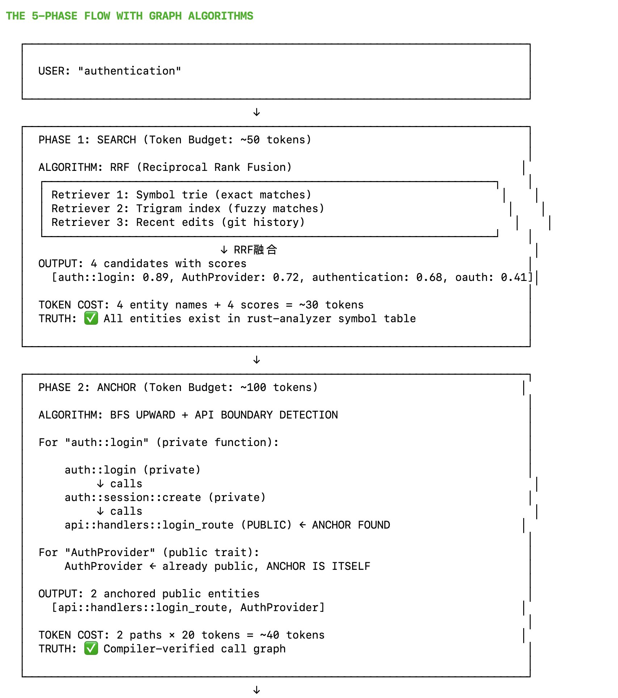
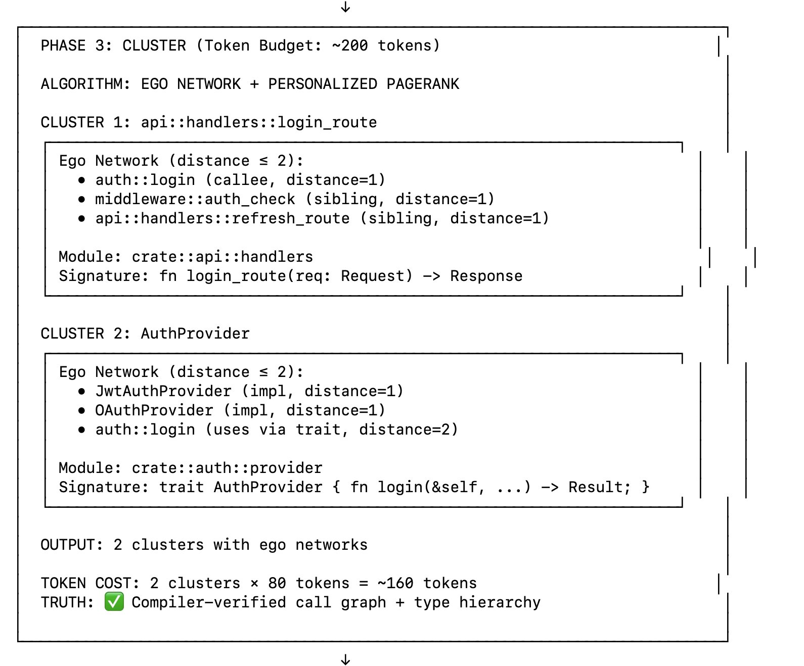
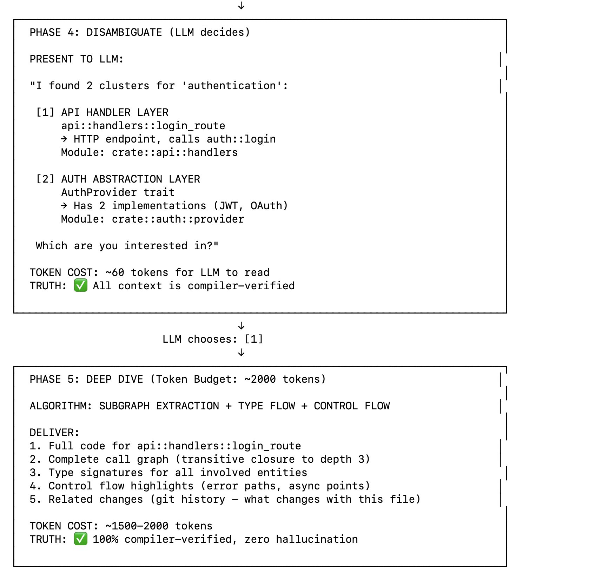
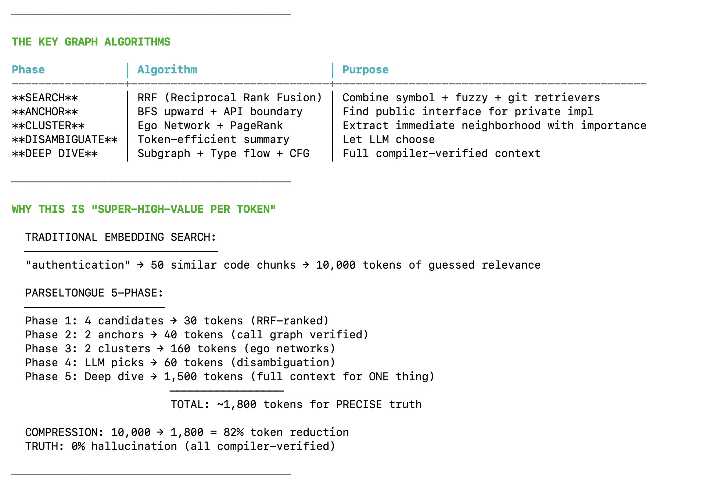

# Parseltongue as a grep replacement: a CPU-only, LLM-free seven-event retrieval protocol over the Rust graph

*Written 2026-11-05 (unix 1793879701). Branch `research/tiny-rust-code-mapper`. Source material: four diagrams supplied by the user (stored in `images/`, transcribed in §1) and the seven-event description quoted in §2. Grounded in the measurements of `1793864191-…` and the limits in `1793873685-…`.*

**New aim, as stated:** Parseltongue specialises as a **grep replacement for coding agents**, running **purely on CPU, with zero GPU and zero LLM inside the tool**. The LLM is the *caller*; Parseltongue returns small, exact, budgeted structure instead of lines of text.

---

## 1. The five-phase flow (transcribed from the diagrams)






```text
USER: "authentication"
  │
  ▼  PHASE 1  SEARCH        budget ~50 tok    RRF over {symbol trie (exact), trigram index (fuzzy), recent edits (git)}
  │                                            → 4 candidates with scores  [auth::login .89, AuthProvider .72, authentication .68, oauth .41]
  │                                            TRUTH: every candidate exists in the symbol table
  ▼  PHASE 2  ANCHOR        budget ~100 tok   BFS upward + API-boundary detection
  │                                            auth::login (private) → auth::session::create (private) → api::handlers::login_route (PUBLIC) ← anchor
  │                                            AuthProvider is already public → anchor is itself
  ▼  PHASE 3  CLUSTER       budget ~200 tok   ego network (distance ≤ 2) + personalized PageRank, per anchor
  │                                            cluster = anchor, module path, signature, top neighbours with role (callee/sibling/impl) and distance
  ▼  PHASE 4  DISAMBIGUATE  ~60 tok           "I found 2 clusters … [1] API handler layer … [2] Auth abstraction layer … which one?"
  │                                            LLM chooses [1]
  ▼  PHASE 5  DEEP DIVE     budget ~2000 tok  subgraph extraction + type flow + control flow
                                               full code of anchor, transitive call graph to depth 3, signatures of everything involved,
                                               control-flow highlights (error paths, async points), git co-change history

Total ≈ 1,800 tokens of exact structure, versus ≈ 10,000 tokens of 50 "similar chunks" from embedding search.
```

## 2. The seven events (quoted) mapped to phases, algorithms and data structures

> event 1: LLM queries 7 words · event 2: parseltongue finds out 4 non-keywords closest in similarity, essentially 4 search results · event 3: finds the encapsulating public-interface which has this code + multiple levels of folder-paths + blast radius of 1 of the public-interface · event 4: curtails event 3 to max 3000 tokens per result, calling them candidate-info-clusters · event 5: shares the 4 clusters with the LLM and asks which to go deeper into · event 6: LLM chooses 1, says none, or quits · event 7: if chosen, deeper control-flow, data-flow, compiler context for that cluster under ~20k tokens + non-traditional queries for this cluster as examples for the next step.

| Event | Phase | What runs (all CPU, all deterministic) | Data it reads | Exact or heuristic? |
|---|---|---|---|---|
| 1 query, ≤ 7 words | — | tokenise: split on whitespace, `::`, `_`, camelCase; lowercase; drop Rust keywords and stop-words; keep the rest as *sub-tokens* (`AuthProvider` → `auth`, `provider`) | — | exact |
| 2 four closest entities | SEARCH | three retrievers, fused with **RRF** (k = 60): (a) **symbol trie** over item names and canonical paths, exact + prefix; (b) **trigram index** over names for fuzzy/typo matches; (c) **BM25** over sub-tokens of name + path + first doc-comment line (and optionally **git-recency** boost). Take top-12 *items*, collapse to **4 distinct anchors** after event 3 | L2/L3 item records | heuristic ranking over an **exact** candidate set: every hit is a real item id, so nothing can be invented |
| 3 encapsulating public interface + folder paths + blast radius 1 | ANCHOR | for a private hit: **BFS upward** over reverse `CALLS` / `CONTAINS` / `SIGNATURE_USES` until the first item whose visibility reach ≥ crate boundary (`pub`, or `pub(crate)` re-exported); record the `via` chain. For a public hit: itself. Folder path = `crate → module → file` from `CONTAINS`. **Blast radius 1** = direct callers, implementers, signature users and re-exporters of the anchor, with counts | L3 resolved items, L4 calls | exact when the graph came from rust-analyzer; tagged `syntactic` when it came from tree-sitter |
| 4 curtail to ≤ 3,000 tokens per cluster | CLUSTER | **ego network (distance ≤ 2)** around the anchor + **personalized PageRank** seeded at the anchor over the item graph (sparse power iteration, 20 steps, on a few thousand nodes: milliseconds); emit in a fixed priority order (§4) until the budget is hit; count tokens with a CPU BPE tokenizer (tiktoken-compatible) or 4 bytes/token | L3/L4 + spans | exact content, heuristic *selection* |
| 5 present 4 clusters | DISAMBIGUATE | one JSON/markdown block: headline (≤ 80 tok) per cluster + the full ≤ 3,000-token body, plus a stable `cluster_id`, plus the option `none` | — | — |
| 6 LLM chooses / none / quits | — | protocol state machine; `none` → return the next 4 anchors from the RRF list (page 2); quit → nothing | — | — |
| 7 deep dive ≤ 20k tokens | DEEP DIVE | **bounded subgraph extraction** (transitive `CALLS` to depth 3, cut by budget, private paths collapsed with `via`); full source of the anchor and of its top-N callers by PPR; signatures + types of every item touched; **control-flow highlights** from a body walk (`?`, `return Err`, `panic!`/`unwrap`/`expect`, `.await`, `unsafe`, lock acquisitions, `match` arms on `Result`/`Option`); **data-flow sketch** (params → fields read/written → return, `SIGNATURE_USES`); **compiler context** (resolved types, trait impls in scope, `cfg` the edges were verified under); git co-change list; and **grounded example queries** (§5) | L3/L4 (+ L5 if a MIR pass has been run) | exact structure; heuristic *choice* of what to include |

The chain is **grep-shaped** (text in, hits out, drill down) but every hit is an entity with an id, a path, a visibility, a blast radius and a budgeted neighbourhood. That is the replacement.

## 3. Why this can be CPU-only, and what "zero LLM" buys

| Need | CPU structure | Cost at 10 M LOC (≈ 50k files, ≈ 500k items, ≈ 100k public) |
|---|---|---|
| exact/prefix symbol lookup | trie or sorted FST over ~500k names | < 50 MB; µs per query |
| fuzzy name match | trigram inverted index over names | ~100 MB; ms per query |
| "semantic-ish" match without a model | BM25 over sub-tokens of name + path + doc line; sub-token co-occurrence for synonym expansion (`auth` ↔ `login`, `session`, `token` because they co-occur in paths) | ~200 MB; ms per query |
| anchor / blast radius / ego network | adjacency lists for `CALLS`, `CONTAINS`, `IMPLEMENTS`, `SIGNATURE_USES` (CSR arrays) | ~1–2 GB for ~10 M edges; BFS and PPR in ms on the local subgraph |
| the graph itself | rust-analyzer per crate, cached std/registry index (measured: 29 s / 2.3 GB per 42k-LOC workspace, ~80 % of it in shared deps); tree-sitter as fallback (0.07 s per 42k LOC) | hours for a cold 10 M-LOC build, incremental per crate thereafter |

Zero LLM inside the tool means: no hallucinated entities (the candidate set is the index), deterministic and reproducible answers (same query → same clusters), no per-query inference cost, and auditability (every record has a `substrate` and `confidence`). It also means the "similarity" in event 2 is lexical/structural, not semantic. The honest consequence: a query like *"where do we refresh the auth token"* works because `refresh`, `auth`, `token` are sub-tokens of real identifiers and paths; a query like *"the thing that stops replay attacks"* will not, unless a doc comment says so. That is the same boundary grep has, moved from lines to entities; it is acceptable because the caller *is* an LLM and will rephrase.

Small learned CPU rankers are not forbidden by the aim (the user's own `experiments/tiny-reexport/learned-binding/` ran a 64-weight logistic ranker and a 17.45 MB MiniLM encoder under 100 MB of RSS), but the latest result there is the deciding evidence: on five real crates the fused encoder accepted **0** bindings while a same-module rule confirmed **56**. Rules first; a learned re-ranker only once there is a measured win on fresh crates at a fixed wrong-edge budget.

## 4. The 3,000-token curtailment order (event 4)

Deterministic, so two agents asking the same question see the same cluster:

```text
 1. headline        anchor id, kind, visibility, module path, file:line                      (~40 tok)
 2. contract        full signature (rendered like cargo-public-api), first doc line           (~60 tok)
 3. where it sits   crate → module → file chain; crate's one-line purpose if Cargo.toml has it (~40 tok)
 4. blast radius 1  callers / implementers / signature-users / re-exporters, as counts, then
                    the top entries by personalized PageRank score with their signatures       (~600 tok)
 5. why it matched  the original hit(s) that led here, with the via chain to the anchor         (~100 tok)
 6. ego network d≤2 remaining neighbours sorted by PPR, role-tagged (callee / sibling / impl /
                    type-used), signatures only                                                 (fill to budget)
 7. tail            "N more callers, M more impls not shown; use impact(<id>) / implementors(<id>)"
```

Rule: never truncate a signature mid-way; drop whole entries. Rule: every id printed is queryable in event 7.

## 5. Event 7: what "deeper" means, and the grounded example queries

For the chosen cluster, under ≤ 20k tokens, in this order: (1) anchor body in full; (2) bodies of the top-k callers/callees by PPR until half the budget; (3) signatures of everything else touched; (4) the control-flow highlight list, one line per site (`src/auth/login.rs:88  ? on Result<Session, AuthError>`); (5) the data-flow sketch; (6) compiler context: resolved types, impls, the `cfg` configuration; (7) co-changed files from git; (8) **example queries**, generated from the graph with real ids so the agent can copy them:

```text
impact(crate::api::handlers::login_route, upstream, depth=2)      # who breaks if I change this
implementors(crate::auth::provider::AuthProvider)                  # all impls, with cfg
path(crate::api::handlers::login_route, crate::auth::session::create)
who_constructs(crate::auth::session::Session)
what_can_panic(crate::auth::login)                                 # unwrap/expect/panic sites reachable
unsafe_surface(crate::auth)                                        # unsafe fns and blocks in this module
diff(v_abc123, HEAD, lens=public)                                  # interface change between two snapshots
```

These are the "non-traditional queries": they are only possible because the store has the item graph, and they are only *safe* because every argument is an id that exists.

## 6. What is exact and what is not (the truth column, honestly)

The diagrams write "TRUTH: ✅ compiler-verified" under each phase. In this design:

- Candidate *existence*, paths, visibility, `CONTAINS`, `IMPLEMENTS`, `SIGNATURE_USES`, static `CALLS`: **exact** when the crate was indexed by rust-analyzer (0.02 % unknown types with proc macros on, measured). Tagged `syntactic` with lower confidence when only tree-sitter ran (no cargo / broken manifest).
- `dyn`/generic calls: exact *to the trait method*; the implementer fan-out is a hint (`MAY_CALL`), not a fact.
- `cfg`: facts hold for the configuration indexed; other configurations are either unindexed or tagged.
- Ranking (which 4 anchors, which neighbours fit in 3,000 tokens): **heuristic**. State it in the output (`"ranking":"rrf+ppr"`), never as truth.
- "Zero hallucination" is a property of *entities and edges*; the agent can still misread them.

## 7. Token accounting (worst case)

```text
event 2  4 hits                             ≈    40 tok
event 3  4 anchors × (path + via chain)     ≈   200 tok
event 4  4 clusters × 3,000                 ≤ 12,000 tok    ← the big one; see decision 2
event 5  framing + ids + "none"             ≈   100 tok
event 7  one deep dive                      ≤ 20,000 tok
                                            ─────────────
                                            ≤ 32,000 tok for a fully explored question in a 10 M-LOC codebase,
                                               every entity real, every edge tagged
```

## 8. Decisions this leaves open

1. **k = 4 fixed, or adaptive?** Fixed 4 is simple and matches the diagram; adaptive (stop when the RRF score drops > 50 % from the previous) avoids padding with junk on precise queries.
2. **3,000 tokens per cluster up front, or 80-token headlines + expand-on-demand?** The diagram spends 160 tokens on two clusters and 1,500 on the dive; the seven-event text spends up to 12,000 before the agent has chosen. Recommendation: headlines (≤ 80 tok × 4) by default, `expand(cluster_id)` to 3,000, so a cheap "none" costs 400 tokens, not 12,000.
3. **Git retriever in event 2?** Cheap and CPU-only (`git log --name-only`), strong recency signal for "what was I working on"; adds a dependency on history being present. Suggest: on by default, weight 0.5 in RRF.
4. **Ranking signal inside a cluster:** PPR seeded at the anchor (favours structurally close, well-connected items) vs plain in-degree vs recency. Suggest PPR with a recency tie-breaker; measure against agent task success later.
5. **"Public interface" in a binary crate** (nothing is `pub` to the outside): treat `main`, `#[test]`s, `pub(crate)` items and trait impls as the anchor set, i.e. anchor = first item visible outside its own module.
6. **Cross-crate anchors in a workspace:** when the hit's nearest public item is in another crate (via re-export), show both the defining item and the re-exporting path.
7. **Natural-language queries:** sub-token BM25 + co-occurrence expansion is the CPU-only answer; decide whether doc comments are indexed (they are the only place "intent" words live) and whether to add a static word-vector table (fastText-style, CPU, not an LLM) for synonyms. Measure before adding.
8. **Output format:** JSON for tools, Rust-skeleton markdown for the LLM's eyes. Both from the same records; pick the default per MCP tool.
9. **Fallback honesty:** when rust-analyzer could not load the crate, the whole response must say so once at the top (`substrate: tree-sitter`), not per record.

## 9. Relationship to the earlier notes

- The six-level record stream (`1793864191-…` §6) is the store; this document is the **query protocol** over it. Events 2–3 read L2/L3, event 4 reads L3/L4, event 7 reads L4 (and L5 if present).
- "Store everything, show the contract" (`1793853341-…`) is exactly the anchor + `via` rule in event 3.
- The MCP surface proposed in the thesis (`find_items`, `describe_item`, `surface`, `impact`, `implementors`, `path`, `diff`) maps onto events 2, 4, 7 and the example queries; `commit_version`/`validate_fragment` are out of scope for a read-only grep replacement.
- The limits note (`1793873685-…`) is the source of every "exact vs heuristic" qualification above.
