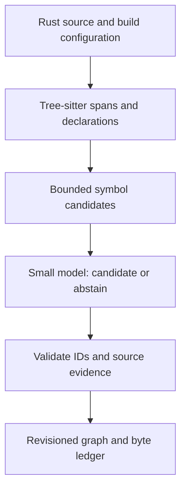

# Small Models for Rust Interface Dependency Graphs

Research brief, 30 October 2026. Status: hypotheses and experiment design, not measured results.

**Scope update:** The subsequent [learned graph compiler thesis](02-learned-graph-compiler-thesis.md) narrows the product to constructing and reasoning over Rust public-interface dependency graphs. The implementation language and deployment platform are open. Establish graph quality on CPU below a measured 4 GB application budget first; sub-100 MB inference is a later compression objective. This earlier brief is retained as research history, including its original parser-guided recommendation.

## Premise Check

**Working question:** Can a small, locally runnable model improve the accuracy of a Rust interface dependency graph under a 100 MB runtime memory constraint, compared with a reproducible Tree-sitter-based baseline?

The most promising initial experiment is a small **candidate-edge classifier**, paired with deterministic syntax extraction and candidate generation. It predicts whether a particular source occurrence resolves to a particular target and can abstain. This is a narrower and more testable problem than generating an entire repository graph in one response.

The idea is plausible, but the claim that a small model will outperform Tree-sitter is not established. Tree-sitter provides syntax trees; a graph system adds extraction, scope handling and resolution. The fair comparison is against a specified **Tree-sitter graph pipeline**, plus a Rust-aware semantic baseline. A model could improve one class of errors while degrading another. No model card cited here demonstrates this exact task under the proposed RAM limit.

The [residency announcement](https://x.com/paraschopra/status/2115054527883964702) describes Parseltongue as producing a compact code map and proposes a model under 100 MB of RAM that maps Rust more accurately than parser tools. The stated 5% map-size figure and accuracy goal are claims and objectives, not benchmarks independently verified in this brief.

**Lossfunk context:** The visible `#parseltongue-public-interface-dependency-graph` channel contained its creation and join event but no substantive project messages when inspected. The visible `#residency-batch-9` messages concerned scheduling and offers to brainstorm; they did not provide a technical experiment specification. This is not a claim about all Slack history or threads. The announcement and the user's requests provide the project direction.

## What Exactly Is the Graph?

Define two related projections and measure them separately:

1. **Public API graph:** Rust items externally reachable from a crate, including effective visibility and re-exports. Edges may include signature type references and public re-export relationships.
2. **Callable dependency graph:** directly addressable functions and methods, including private ones when needed to understand execution, with source-backed call edges. A public API node can call private implementation nodes.

Do not call every syntactically `pub` declaration externally accessible. Ancestor visibility, `pub(crate)`, `pub(in ...)`, public re-exports, trait items, `cfg` and build configuration all matter. The [Rust visibility reference](https://doc.rust-lang.org/reference/visibility-and-privacy.html) and [use-declaration reference](https://doc.rust-lang.org/reference/items/use-declarations.html) describe these rules. The previous product discussion also included private top-level functions and direct members; a public-only graph would be a product scope change, not a mere implementation detail.

Represent each edge as `(source symbol, relation, target symbol, source occurrence, configuration, provenance, status)`. Relations should begin with `calls`, `signature_type`, and `reexports`, evaluated independently. Status is `resolved`, `ambiguous`, `external`, or `unresolved`. Static call edges are lexical and may represent dynamic dispatch candidates; they are not proof of runtime execution.

## Expert Lenses

| Lens | Core concern |
|---|---|
| Rust semantics | Can the target be identified through imports, receiver types, traits, macros and conditional compilation? |
| Small-model training | Can a constrained model learn the hard disambiguation cases from clean labels and focused context? |
| Systems engineering | Does the entire deployed process meet the memory, latency, determinism and reproducibility contract? |
| Agent workflow | Does the resulting map reduce wrong navigation and useful-context cost on real tasks? |
| Skeptical evaluation | Are we comparing against a weak straw man or learning the evaluator's mistakes? |

## Candidate Approaches

| Approach | What the model does | Main benefit | Principal risk |
|---|---|---|---|
| Conventional parser plus resolver | No model. Tree-sitter finds syntax; rules resolve scopes and imports. | Deterministic, measurable baseline. | Resolution rules may be incomplete. |
| A. Parser-guided edge adjudicator | Chooses a candidate target or abstains for each occurrence. | Bounded output, easy evidence checks, efficient supervision. | Candidate recall caps final recall. |
| B. Compiler-apprentice | Distills a Rust-aware index into a model operating on local context. | Learns difficult name and type resolution patterns. | Copies teacher errors and inherits build-configuration blind spots. |
| C. Graph cartographer | Builds per-file interface summaries, then links bounded summaries across files. | Fits large repositories through hierarchical processing. | Early summary omissions compound downstream. |
| D. Error-correcting auditor | Examines disagreements and suspicious edges from multiple analyzers. | Focuses scarce model compute on likely mistakes. | Disagreements miss shared blind spots; hard to define unbiased coverage. |

These are conceptual blends with compiler apprenticeship, cartography and error-correcting systems. They are design proposals, not established results. The preferred sequence is A as the main experiment, B for labels, C as a later context strategy, and D as an ablation.

## Chosen Thesis

Use deterministic tools to establish **what exists and where**, then train a small model to improve **which candidate is the intended relationship**. Maintain byte-level source accounting and graph identity independently from the model. The model returns candidate IDs and evidence, never invented paths or source offsets. An unresolved answer is a valid result.

This can be tested without deciding today whether a model must ultimately replace every parser component. Keep a model-only extraction arm in the benchmark; it can win if the evidence supports it.

### Proposed data flow



The unchanged byte ledger tracks comments, interface-owned source and unknown source, preserving exact source snapshots. The model does not decide whether bytes exist, fabricate byte offsets, or silently turn uncertain observations into facts. This builds on the local [PRD](../docs/research004/prd-v20260710.md) and [architecture](../docs/research004/Arch-v202607210.md); those are proposals and contain a broader current-state capture design, not evidence that the model works.

## Hugging Face Precedents

Approximate weight-only floors below use `parameters * bits / 8`, in decimal MB. They exclude quantization metadata, tokenizer, buffers, model runtime, KV cache, activations, allocator overhead and graph/parser state. File size is not measured process RAM. Architectures, licenses and model revisions must be pinned before training.

| Candidate | Published evidence | 4-bit ideal weight floor | Proposed role and caveat |
|---|---|---:|---|
| [AMD-Llama-135m-code](https://huggingface.co/amd/AMD-Llama-135m-code) | Card describes 135M, 2,048-token context, code model; Apache 2.0. | 67.5 MB | Most direct small code-model starting point. Rust training share and task performance require verification. 4-bit feasibility under full-process budget is unproven. |
| [SmolLM2-135M](https://huggingface.co/HuggingFaceTB/SmolLM2-135M) | 135M small language-model family. | 67.5 MB | General small-model control. Compare base and instruct variants separately; Rust suitability is not established by the card. |
| [CodeRankEmbed](https://huggingface.co/nomic-ai/CodeRankEmbed) | 137M bi-encoder for code retrieval; card reports 8,192 context. | 68.5 MB | Candidate-retrieval or ranking precedent, not an edge resolver. Verify license, quantization support and RAM independently. |
| [GraphCodeBERT](https://huggingface.co/microsoft/graphcodebert-base) | Code model trained with data-flow information; card reports 512-token maximum. | Determine from pinned configuration | Architecture precedent for code plus structure, not evidence for Rust graph extraction or budget compliance. |
| [CodeBERT](https://huggingface.co/microsoft/codebert-base) | Code-oriented pretrained encoder. | Determine from pinned configuration | Encoder baseline for candidate classification; verify model size, license and Rust coverage. |
| [CodeParrot-small](https://huggingface.co/codeparrot/codeparrot-small) | [Hugging Face's model overview](https://huggingface.co/spaces/codeparrot/code-generation-models/blob/main/architectures/codeparrot.md) identifies 110M and Python-focused training. | 55 MB | Useful negative/control precedent for domain mismatch; not a Rust specialist. |
| [Qwen2.5-Coder-0.5B](https://huggingface.co/Qwen/Qwen2.5-Coder-0.5B) | Card reports 0.49B parameters and Apache 2.0. | 245 MB | Teacher or unconstrained accuracy ceiling. The official [instruct GGUF files](https://huggingface.co/Qwen/Qwen2.5-Coder-0.5B-Instruct-GGUF/tree/main) list Q2_K at 415 MB; not a 100 MB deployment candidate. |
| [TinyForge-60M](https://huggingface.co/Juanillaberia/TinyForge-60M) | Card reports ~64.7M total parameters and 1,024-token context; trained on general educational text. | 32.4 MB | Memory-first research control, with substantial task/domain uncertainty; inspect license and maturity. |

The LoRA adapter alone is not the deployed model: base weights, adapter, runtime and buffers must all count. Quantization can reduce weight memory but may affect model quality. A task-specific encoder or smaller distilled student may fit more comfortably than an autoregressive model, but that is a hypothesis to test.

### What does 100 MB mean?

Pre-register both readings rather than silently switching between them:

- **Model-process cap:** peak resident memory of a fresh inference process including model, tokenizer, buffers, context and runtime; parser/DB processes measured separately.
- **End-to-end cap:** peak memory attributable to the complete local pipeline, including parser, candidate index, model and database. Measure overlapping processes as well as device memory; report shared/mapped pages and measurement method.

Report MB versus MiB explicitly, hardware, OS, context length, batch size, thread count, model format, cold/warm state and peak measurement. Weights-only numbers are feasibility estimates. No candidate above has demonstrated either cap for this task in the evidence inspected.

## Evidence and Verification

### The baseline must resolve symbols

The repository [README](../README.md) describes Tree-sitter extraction and forward/reverse graph APIs. It does not prove semantic call accuracy. A fair benchmark needs the current Parseltongue pipeline at a pinned commit, a strengthened deterministic Tree-sitter resolver, and a Rust-aware reference. Use the same source, build configuration and output schema.

[rust-analyzer](https://rust-analyzer.github.io/book/features.html) supports references and macro-related navigation. [SCIP](https://github.com/scip-code/scip) is a code-intelligence format with Rust bindings; [scip-rust](https://github.com/scip-code/scip-rust) documents `rust-analyzer scip .`. SCIP references are not automatically call edges: an adapter must classify call sites and normalize owners. Rust-analyzer is a strong reference, not an infallible oracle, especially for incomplete code, macros, dynamic dispatch and build configurations.

### A concrete ambiguous example

```rust
mod alpha { pub fn run() {} }
mod beta  { pub fn run() {} }
use alpha::run as execute;
pub fn start() { execute(); }
```

The target is `alpha::run` via the alias, not whichever `run` appears first. A Tree-sitter system can solve this deterministically; a small model must beat an implementation that actually handles aliases, not a name-only lookup. Further fixtures should add same-named methods, `self` versus trait methods, generic bounds, re-exports, `cfg`, macros, partial files and external symbols.

### Verification questions

| Question | Answer from available evidence |
|---|---|
| Has an under-100 MB model beaten a strong Rust graph pipeline here? | No benchmark or local experiment has been inspected that establishes this. |
| Is Tree-sitter itself a symbol resolver? | Its role in the proposed pipeline is syntax parsing; edge resolution is additional system logic. Compare end-to-end pipelines. |
| Does `pub` guarantee external reachability? | No. Ancestors, restricted visibility and re-exports matter, per the Rust reference. |
| Does a 4-bit weight estimate prove runtime fits? | No. Measure peak total memory with the actual runtime and workload. |
| Is a SCIP reference automatically a call edge? | No. A reference-to-call adapter and labeled validation are needed. |
| Does a content hash establish entity identity? | No. Local [ISGL1-v2 matching](../crates/parseltongue-core/src/isgl1_v2.rs) uses content and positional heuristics; edits and duplicates make matching ambiguous. |
| Can the model prove complete source coverage? | No. Exact byte accounting must be independently enforced by the capture system. |

## Experimental Design

### 1. Define a frozen target

- Pin Rust edition, toolchain, target triple, feature set, `cfg` and workspace dependencies. Model build-specific graphs explicitly.
- Start with direct calls between addressable functions and methods. Evaluate public reachability and signature-type edges as separate tasks.
- Use source spans and qualified target identifiers, preserving uncertain and external cases.
- Establish a reviewed annotation guide with examples of direct calls, trait calls, macros, function pointers, aliases and incomplete code.

### 2. Create an independently reviewed dataset

- Select permissively usable repositories with diverse owners, sizes and domain styles; record license, commit, toolchain and build status.
- Split by repository and near-duplicate cluster, not individual lines. Hold out complete projects and, separately, newer revisions. Audit model pretraining leakage where possible; acknowledge unknown contamination.
- Generate candidate labels with rust-analyzer/SCIP and deterministic parsing, then have reviewers adjudicate a stratified sample and analyzer disagreements. Track inter-reviewer agreement and unresolved adjudications.
- Sample negatives deliberately: same-name decoys, wrong modules, wrong methods, misleading aliases, missing candidates and external calls. A random-negative-only test would inflate performance.
- Include incomplete files and compile-failing repos in a separately labeled slice; compiler-derived labels may be unavailable there.
- Keep generated/synthetic examples and real hand-reviewed examples distinct. Synthetic code must not leak templates into the held-out test.

### 3. Compare five arms

1. Existing Parseltongue, pinned version and documented settings.
2. Tree-sitter plus a reasonable deterministic scope/import resolver.
3. Rust-analyzer-derived graph with explicit reference-to-call conversion.
4. Model-only structured extraction, subject to the same input and budget constraints.
5. Tree-sitter candidates plus trained small-model adjudication, with and without abstention.

Measure candidate generation recall independently. The hybrid cannot recover a target it never receives. Provide the same allowed evidence to comparable arms and report separate build-aware and source-only tracks.

### 4. Report accuracy and usefulness

- Exact edge precision, recall and F1, micro and macro by repository and edge kind.
- False edges per 1,000 opportunities; unresolved/abstention rate; precision at fixed coverage and coverage at fixed precision.
- Candidate recall at K; classification accuracy conditional on target being in the set; end-to-end edge accuracy.
- Public API node precision/recall, visibility and re-export accuracy separately.
- Call-site span accuracy, source-evidence validity, invalid target IDs and malformed output rate.
- Forward and reverse query agreement, plus retrieval usefulness on a small human-reviewed set of real investigation tasks.
- Confidence calibration, with an explicitly held-out calibration set. Confidence is not proof.
- Results by Rust construct and by buildable versus incomplete code, including counts and uncertainty intervals clustered by repository.
- Full index time, per-edit time, peak RAM, disk use, CPU/GPU consumption and graph output size. Measure the post's 5% claim with a specified numerator, denominator, corpus and serialization.

Do not treat an LLM judge as sole truth. Do not count an ambiguous or missing ground-truth case as a model error without specifying the policy. Avoid publishing a single aggregate that hides severe false-positive rates.

### 5. Train in stages

1. Reproduce baseline graph and inspect the largest error categories before spending on training.
2. Convert reviewed candidate choices to compact supervised examples. Inputs contain call occurrence, bounded enclosing context, imports and candidate signatures with stable local IDs. Outputs select an ID or `ABSTAIN`.
3. Establish no-training heuristics and a code encoder classifier as controls. Fine-tune a 135M model with supervised learning; compare full fine-tuning and adapters if resources permit.
4. Use larger models only as auxiliary teachers; verify their predictions against source and independent labels. Preserve label provenance.
5. Quantize candidate students and re-evaluate each actual artifact for accuracy and peak memory; calibrate abstention after quantization.
6. Run full-repository evaluation, including incremental edits and comment-only changes. Confirm source accounting and graph identity stay correct.

Example training record, illustrative rather than an existing format:

```json
{"source":"crate::app::start","call":"execute()","context":"use alpha::run as execute;","candidates":[{"id":"c0","symbol":"crate::alpha::run"},{"id":"c1","symbol":"crate::beta::run"}],"label":"c0","label_source":"reviewed","config":"linux-default"}
```

No probabilities or performance numbers in this document are measured model outcomes.

### Decision gates

Proposed gates to agree before training, not promises:

- **G0:** A versioned fixture dataset and independent adjudication exist.
- **G1:** Every arm emits comparable evidence and respects build configuration.
- **G2:** The hybrid improves held-out edge precision/recall over both deterministic Tree-sitter baselines, with repository-level uncertainty reported and no unacceptable false-edge regression.
- **G3:** The improvement persists on unseen repositories, difficult cases, and post-quantization weights.
- **G4:** Measured peak memory meets the chosen interpretation of 100 MB; the end-to-end budget is separately disclosed.
- **G5:** Users complete real navigation tasks with better outcomes or lower total cost, not merely a higher synthetic score.

If G2 fails, analyze candidate recall and label quality before scaling the model. If G4 fails, try a smaller encoder/student, shorter inputs, dynamic loading or a revised budget. If G5 fails, reconsider whether the graph addresses the user's job.

## Structured Challenge

**Skeptic:** A 135M model may just memorize common naming patterns and confidently select a wrong target. Rust-analyzer already resolves complex Rust semantics; a model may add cost without exceeding it.

**Response:** Treat the model as an uncertain candidate adjudicator, compare against a capable deterministic resolver and Rust-aware reference, test repository-held-out cases, and publish precision versus coverage. The model earns its place only through measured net improvement.

**Skeptic:** A parser-generated candidate list may omit the correct target. The model cannot fix missing candidates.

**Response:** Measure candidate recall separately, include `NONE_OF_THE_ABOVE`, and compare wider context and compiler-derived candidates. Do not report conditional classifier accuracy as graph recall.

**Skeptic:** Compiler-derived training labels may reward imitation of compiler limitations, and references are not calls.

**Response:** Use compiler output as weak supervision, validate reference-to-call conversion, hand-adjudicate disagreements and sample points, and keep unresolved labels out of definitive training targets.

**Skeptic:** A compact file does not imply an under-100 MB application.

**Response:** Measure process and end-to-end peak memory independently, including KV cache and parser/index overhead. Publish actual workload and hardware.

## Final Synthesis

The strongest research bet is a **small, source-grounded resolver for difficult Rust dependency edges**. Tree-sitter supplies reproducible syntax and spans; compiler-aware tools supply a strong baseline and imperfect supervision; the student learns a constrained choice with abstention. A model-only mapper remains an experimental arm, not a foregone conclusion.

The valuable outcome is an auditable graph that improves real navigation without inventing relationships. The experiment must establish whether that improvement exists, what it costs, and where it breaks.

## Open Questions

1. Does the 100 MB limit apply to inference alone or the complete Parseltongue process?
2. Is the first deliverable externally reachable public API, all direct callables, or both as separate projections?
3. Are trait dispatch targets represented as one static target, a set of possible implementations, or a distinct relation?
4. Which Rust repositories and hardware define the first held-out benchmark?
5. What minimum improvement and maximum false-edge rate would justify a model dependency?
6. Are build artifacts and dependencies available during indexing, or must the model work from source alone?
7. Which training corpora, licenses and compute budget are available for the residency?
8. What user task will validate the 5% map claim and overall usefulness?
