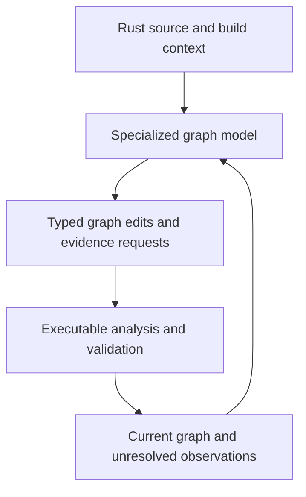

# Parseltongue as a Learned Graph Compiler for Rust

Status: research thesis and four design options. No model accuracy, memory fit, or implementation result is claimed by this document.

Product follow-up: [Five Product Futures for a Rust Interface Graph Model](03-five-product-timelines-and-ramifications.md) compares five user segments, product shapes, conditional timelines, and the experiments needed to choose among them.

## Premise Check

### The product does exactly one job

> Given Rust source and an explicit build context, construct a graph of public interfaces and their dependencies, then use that graph to investigate and resolve the relationships needed to improve the graph itself.

This is a specialized model-plus-program system. Training examples, output formats, runtime operations, and evaluation should all serve this job. General conversation, writing code, answering unrelated questions, and supporting other source languages are outside the thesis.

Rust is the analyzed language. The application could be implemented in Rust, Python, C++, another language, or a combination. A macOS-only prototype is acceptable. Choose implementation and platform to test the thesis effectively, rather than treating either as the innovation.

The current preference is **quality first on CPU, with a measured application memory ceiling of 4 GB for a declared repository workload**. Sub-100 MB model inference remains an attractive compression research goal. A database or model file below a budget does not demonstrate peak application RAM below that budget. Training and benchmark-oracle processes have separate budgets and must be disclosed.

The main research bet is that the **model constructs the graph**. Its role must not silently shrink to ranking edges in a graph already supplied by a parser. Parser-assisted and compiler-assisted systems remain valuable comparison arms.

### A new thesis

> Parseltongue can be a learned compiler whose output is an explicit, revisable interface graph. A small model proposes source-grounded graph structure; executable routines maintain identities, evaluate graph operations, and expose missing evidence. The model consumes that external state to decide the next construction step.

The graph is both the output and the working memory. Weights learn reusable Rust-analysis behavior; the graph stores repository-specific knowledge. That division lets the same small model work on repositories larger than its context window without retraining for each repository.

This is a proposal. Existing small-model research does not establish that such a system can comprehensively resolve arbitrary Rust projects, outperform compiler analysis, or fit the proposed memory budget at useful accuracy.

## Expert Lenses

| Lens | Requirement imposed on the thesis |
|---|---|
| Rust language semantics | Visibility, re-exports, traits, macros, build configuration, and callable ownership must have explicit meanings. |
| Specialized learning | Learn graph-construction actions and relationships rather than spend scarce capacity on broad conversational behavior. |
| Compiler and representation design | Make intermediate results inspectable, typed, replayable, and usable across multiple passes. |
| CPU systems engineering | Bound active source, graph neighborhoods, runtime memory, and repeated computation; measure total cost. |
| Skeptical evaluation | Distinguish a graph that looks plausible from a graph with independently supported nodes and edges. |

## Candidate Approaches

The conventional baseline parses Rust, extracts declarations, applies resolution rules, and stores edges. The four options below deliberately move graph construction into a learned system. They differ in what the model predicts and where executable computation participates.

| Option | Model output | Representation | Where reasoning happens | Principal tradeoff |
|---|---|---|---|---|
| 1. Source-to-graph transducer | Symbol, occurrence, and dependency records | Typed property graph | Learned extraction and linking passes over bounded source | Fastest way to test whether a model can build the graph; prone to omissions and unsupported edges. |
| 2. Iterative graph constructor | Graph edits and requests for missing evidence | Graph plus assertion/evidence records | Model repeatedly reads source and graph state; code performs requested operations | Best match for a tool that builds and consumes its own graph; needs stopping, invalidation, and provenance discipline. |
| 3. Executable graph recipe | A constrained program that constructs graph facts | Graph plus replayable construction programs | Generated procedures execute searches, joins, and graph operations | Can amortize repeated work; generated procedures can be systematically wrong. |
| 4. Recurrent constraint solver | Updates to structured symbol, ownership, and target hypotheses | Sparse constraint graph, materialized as a public graph | Small shared network refines state over multiple steps | Strong compression research direction; hardest data and training problem. |

### Option 1: Source-to-graph transducer

Conceptual blend: machine translation from Rust source into a graph language.

The model receives a source window, file identity, crate context, and a compact table of symbols discovered in earlier passes. It outputs bounded records:

```text
DECLARE symbol_local_1, function, name_span_7, signature_span_9
OWN symbol_local_1, module_local_2
OBSERVE_CALL occurrence_4, symbol_local_1, callee_span_12
PROPOSE_TARGET occurrence_4, symbol_local_8
```

These are illustrative operations, not existing Parseltongue APIs. The host validates ranges and local references, assigns durable IDs, and stores source evidence. The model discovers declarations and relationships; the host does not hand it a completed Tree-sitter symbol graph.

Use two learned passes: declaration discovery, then cross-file linking. Raw source bytes and deterministic file/window boundaries are permitted infrastructure. A lightweight tokenizer or lexer may expose source positions, but compare that assistance explicitly against a raw-source arm.

Example: a file imports `crate::storage::Store as Repository`. The first pass finds the alias and a public function signature. The second pass links the signature's `Repository` type to the canonical `Store` definition using the repository symbol table.

Benefits: compact target language, direct supervised learning, and a clean baseline for the central claim. Training data can pair source with reviewed compiler-derived graph records. Constrained decoding improves structural validity without establishing semantic correctness.

Risks: missing declarations are easy to overlook; windows can split important constructs; invented names can look plausible; early mistakes contaminate linking. The model must be able to request another window or emit an unresolved record. A successful JSON parse is not a correct graph.

Falsifying test: if declaration recall and edge precision remain materially below a reasonable deterministic baseline on held-out repositories after equivalent context and training, this approach has not earned deployment.

### Option 2: Iterative graph constructor

Conceptual blend: an incremental compiler worklist and a small scientific investigator.

The model constructs a partial graph, sees what is unknown or inconsistent, asks for relevant source or graph results, and proposes another edit. The graph feeds the next model step:



An example sequence:

1. The model declares `Client::send` and records an occurrence of `backend.commit()`.
2. It cannot identify the receiver type from the current window and requests the field declaration for `backend`.
3. The host returns the exact source slice and the already discovered type neighborhood.
4. The model proposes a target and records the evidence used.
5. Validation checks that references, spans, configuration, and ownership are internally consistent. Semantic confirmation remains separate.
6. Another pass visits affected unresolved occurrences after new declarations become available.

The model has the narrow capability to construct and revise the graph. It does not need a natural-language chat interface. Its internal requests are operations such as read a source span, find candidate declarations, inspect an owner, or compute a graph projection.

Run a bounded dirty worklist after indexing or an edit. Stop on completed work, no new accepted evidence, a repeated state, or a configured time/step budget. Preserve unresolved work when the budget expires. More iterations and self-agreement do not prove a target is correct.

Benefits: context grows through investigation rather than one enormous prompt; partial source can still be represented; the model can discover nodes absent from an initial candidate set. This most directly realizes the proposed build-and-consume loop.

Risks: correlated errors can reinforce each other; an incorrect node can redirect later investigation; repeated attempts can waste CPU; missing source and missing model knowledge look similar. Record dependency evidence so an invalidated assumption retracts dependent proposals.

Falsifying test: compare one pass with bounded iterative passes at equal total compute. Reject the loop if it adds unsupported edges, fails to improve coverage, or buys little accuracy for excessive latency.

### Option 3: Executable graph recipe

Conceptual blend: a compiler that emits a program for constructing its own intermediate representation.

Instead of generating every graph record independently, the model emits a small constrained procedure:

```text
symbols = discover_declarations(file_window)
aliases = bind_imports(symbols, source_window)
observations = discover_dependency_occurrences(source_window, symbols)
for observation in observations:
    candidates = lookup_symbols(observation.name, aliases, observation.owner)
    propose_relationship(observation, candidates)
```

The procedure above illustrates an action vocabulary, not proof that generic routines already solve extraction. Document which operations are learned and which are deterministic so this option cannot hide a full parser behind `discover_declarations`.

The most useful variant learns a reusable recipe for a specific pattern: a re-export chain, an associated-type reference, or a particular macro convention. The host executes it over matching source and records both the recipe identity and resulting evidence. A recipe is cached only under source, tool, model, and configuration fingerprints that keep it applicable.

Initially use an allowlisted graph instruction set or a constrained interpreter. Arbitrary Rust compilation is unnecessary for the first experiment. A Rust-hosted interpreter such as [Monty](https://github.com/pydantic/monty) is a precedent for executable model actions, not a requirement. The final implementation may use another language or runtime.

Benefits: deterministic replay, visible computations, fewer output tokens, and potential reuse across similar source patterns. The learned part chooses and composes procedures; native operations do exact range arithmetic, lookup, joins, and traversal.

Risks: a bad procedure repeats the same error broadly; program validity says nothing about relationship validity; compilation or interpretation can dominate small tasks. Cache invalidation and distribution shift need explicit tests.

A literal computer inside model weights, as explored by [Qwenputer](https://github.com/divagr18/qwenputer), is a separate experimental variant. Its authors report a compiled RISC-V computer inside a 4B model. This does not demonstrate arbitrary Rust analysis, CPU efficiency, or small-memory deployment. Compare it with native execution before treating in-weight execution as an advantage.

Falsifying test: executable recipes must beat direct graph generation on held-out correctness or total indexing cost. A more elaborate execution mechanism without measurable benefit is not progress.

### Option 4: Recurrent constraint solver

Conceptual blend: a neural constraint engine that gradually fills in an incomplete program map.

The model does not write prose. A compact encoder proposes source spans and symbol features. A shared refinement network repeatedly updates sparse hypotheses about ownership, visibility, aliases, and dependency targets.

For one occurrence, the internal state can represent:

```text
Occurrence O is owned by function A.
O could refer to B, C, an external symbol, or an unknown target.
Import evidence excludes C.
Receiver evidence supports B.
The public projection includes A only if its exposure conditions hold.
```

The internal representation resembles a factor or constraint graph. The exported result remains an ordinary typed graph with evidence. Keep candidates sparse and create new candidates from source as needed; a dense matrix of every symbol pair becomes quadratic in repository size.

[Tiny Recursive Models](https://arxiv.org/abs/2510.04871) establish a precedent for small shared networks refining structured answers on puzzle tasks. They do not establish this architecture for Rust. A [transfer study](https://arxiv.org/abs/2603.14593) reports that recursion can hurt in another domain. Count the encoder, tokenizer, embeddings, persistent state, and runtime in the memory budget; a tiny refinement head alone is not a tiny application.

Benefits: potentially compact models, bounded structured state, explicit ambiguity, and an architecture aligned with repeated graph reasoning. This is the most ambitious route toward a truly small specialized system.

Risks: expensive dataset construction, weak source representations, premature elimination of valid hypotheses, and false certainty from convergence. Training must reward unknown outcomes and penalize confident false edges.

Falsifying test: compare with a nonrecurrent model of similar total size and compute. Require repository-held-out gains, including malformed source, rather than transfer claims from unrelated benchmarks.

## Chosen Thesis

**Lead with Option 2, build Option 1 as its controlled baseline, and investigate Options 3 and 4 as distinct research paths.** This is a research recommendation, not a commitment to an implementation framework.

The choice keeps the model responsible for constructing declarations and relationships. Execution makes the work inspectable and supplies exact operations. The graph gives the model persistent repository memory and a record of outstanding questions. A generic chat assistant would spend capacity outside the task and is not the intended product.

### What should a public interface look like?

Define an interface as an accessible program contract, not a copied function header. It can include a function, type, trait, associated item, public field, variant, constant, static, module, or macro export. A macro's public contract may be represented even when its generated implementation is unavailable.

Keep four concepts separate:

| Concept | Example | Why it matters |
|---|---|---|
| Definition identity | The canonical `storage::Store` item | One definition can have several exported names. |
| Public exposure | `mycrate::Repository` re-exports that definition | Users depend on exposed paths, not just canonical locations. |
| Contract | Generics, arguments, return type, bounds, associated items, ABI and relevant attributes | Interface meaning exceeds name and argument text. |
| Relationship evidence | A type occurrence, import, re-export, or call site in exact source | Every relationship needs a reason to exist. |

Rust visibility is context-dependent: restricted visibility, ancestor modules, and re-exports affect accessibility. Public trait items and enum variants also have rules that differ from scanning for `pub`. See the [Rust visibility reference](https://doc.rust-lang.org/reference/visibility-and-privacy.html).

For a workspace, public means exposed across a stated crate boundary. A binary with no external library surface can have little external public API while still containing useful internal boundaries. Report that distinction; do not relabel all private functions as public to make the picture larger.

### The canonical representation

Use a typed property graph with explicit observation and assertion records. Plain node-edge-node triples are a useful export, but they discard important meaning unless attributes and evidence accompany them.

Proposed conceptual records:

```text
Definition(id, crate, kind, name, owner, source_span, source_hash)
Exposure(id, definition_id, exposed_path, visibility_scope, build_context)
Contract(definition_id, signature, generic_parameters, bounds, attributes)
Observation(id, owner_id, kind, source_span, raw_target)
Assertion(id, subject_id, relation, object_id, evidence_ids, origin,
          resolution_status, validation_status, model_revision, build_context)
```

These records are a research representation, not a production database migration. Durable definition identity is separate from mutable locations and content fingerprints. A host may assign final IDs after reconciling model-local handles.

Start with distinct relations:

- `EXPOSES_AS`: public name to canonical definition.
- `SIGNATURE_USES`: a contract refers to a type, trait, or associated item.
- `IMPLEMENTS`: a type or implementation relates to a trait under stated bounds.
- `CALLS`: an implementation contains a resolved call occurrence.
- `CONTAINS`: lexical or declaration ownership.
- `MAY_CALL`: candidate dispatch or unresolved indirect call, never silently merged with `CALLS`.

These all serve graph construction and interpretation. They are not six separate general-purpose products. Exports can hide support relations when agents need a simpler view.

Use separate fields for origin, resolution, and validation. An assertion can be model-proposed, resolve to one target, and still have only structural validation. Exact spans and valid IDs prove source grounding and structural consistency; they do not prove that target resolution is semantically correct. Reserve compiler-confirmed status for independently obtained semantic evidence with its configuration and tool version.

### Worked public-contract example

```rust
mod internal {
    pub struct Request;
}

pub use internal::Request;

pub trait Service {
    type Error;
    fn send(&self, request: Request) -> Result<(), Self::Error>;
}
```

The model should discover one Request definition, its public re-export, the Service trait, its associated type, and its method contract. The graph links the method's parameter to Request and its result to the associated Error type. It does not duplicate Request merely because its exposed path differs from its defining module.

The `SIGNATURE_USES` relationships are supported by the contract. There is no method body here, so no implementation call edge should be invented. This distinction is central: a contract dependency graph and a call graph answer related but different questions.

### Public view versus internal support

The product presents public interfaces. It may retain private and nested definitions internally when needed to explain dependencies. That supporting detail is in service of the one job.

Offer three graph projections without duplicating canonical facts:

1. **Public contracts:** exposed items and signature, trait, and re-export relationships.
2. **Public implementation dependencies:** direct dependencies from public items, with private support nodes available for inspection.
3. **Expanded evidence:** nested callable ownership, call sites, candidate targets, and diagnostics.

For `public A -> private helper -> public B`, a public-only projection may show a derived relationship between A and B, but must retain the witness path and relation type. It must not label that shortcut a direct call.

### Functions inside functions

Do not force every nested declaration into the default public map. Also do not erase nested callables from the analysis merely because they are inside a function.

```rust
pub fn factory() -> fn() {
    fn local_worker() {}
    local_worker
}

pub fn run() {
    let callback = factory();
    callback();
}
```

The local function can later be invoked through its returned pointer. Its declaration is lexically owned by factory, but the later invocation is not evidence that factory directly calls it. Closures introduce a similar need, potentially with captured state.

Represent nested callable identity internally when observed, attach ownership, and keep returning a callable distinct from invoking it. If the target of `callback()` cannot be established, retain an indirect-call observation or candidate relationship. Do not fold that uncertainty into a false direct edge.

This revises the earlier research004 simplification that always attributes nested calls to an outer entity. Treat the revision explicitly as a proposal for this specialized Rust product; it does not silently rewrite the older PRD.

## Evidence and Verification

### Can the graph be comprehensive for every Rust codebase?

A common representation can be designed to express known, conditional, ambiguous, external, and unknown relationships. A guarantee of perfect semantic extraction from every arbitrary repository is not defensible.

Distinguish three kinds of completeness:

| Completeness | Defensible contract |
|---|---|
| Source accounting | Every captured file and byte has an explicit outcome, including comments and unknown code. |
| Interface inventory | Every supported declaration in the analyzed source/build configuration is represented or reported as unhandled; benchmark recall independently. |
| Dependency resolution | Every observed dependency has a target, candidate set, external marker, or unresolved state; this does not prove every real dependency was observed. |

Conditional compilation changes which items exist. Build scripts can generate source and configure a build. Procedural macros and external dependencies can add information absent from a file. See the [conditional-compilation reference](https://doc.rust-lang.org/reference/conditional-compilation.html) and [Cargo build-script documentation](https://doc.rust-lang.org/cargo/reference/build-scripts.html).

Represent one explicit build context at a time and retain conditional information where possible. A graph of the selected build is not a graph of every feature combination. Runtime-dependent calls, foreign code, function pointers, and unsafe behavior further limit exact call claims. Incomplete code may not have a single well-defined compiler interpretation.

The output must therefore include a coverage manifest. A macro invocation whose expansion is unavailable is a recorded analysis boundary. It is not evidence that no generated interface exists. Source-only and build-aware results need different scope labels.

Public contract extraction is more tractable than proving all possible runtime behavior. Evaluate it separately rather than using runtime uncertainty to excuse ordinary declaration misses.

### Physical capture and graph meaning

Retain the prior three-class ledger: `INTERFACE_CODE`, `COMMENT`, and `UNKNOWN_CODE`. It is physical accounting, not a claim that every interface-owned byte was semantically understood. Confirmed comments take precedence; nested entity overlays do not double-count bytes.

A comment insertion changes the source snapshot and ledger. Ordinary comments should not by themselves change public contracts or canonical relationships. An inserted comment that changes parsing, an operational directive, or a changed `#[doc = ...]` attribute needs language-specific treatment. Never remove comment-looking text from strings using a text substitution.

Use separate raw-source, normalized-contract, and relation fingerprints. Exact hashing validates bytes. Canonical symbol reconciliation preserves identity where evidence is strong. Neither a hash nor model confidence alone establishes logical continuity.

### What the recent research actually supports

The preceding investigation searched HN submissions in a bounded September 30 through October 30, 2026 window using queries about small models, recursion, Rust inference, tool calling, compiled weights, and code graphs. This was a scoped scan, not an exhaustive review of all innovations. Thread dates establish discovery; current upstream pages may describe later revisions and must be pinned for reproduction.

| Primary source and HN lead | Finding | Limit on the inference |
|---|---|---|
| [Qwenputer](https://github.com/divagr18/qwenputer), [HN October 28](https://news.ycombinator.com/item?id=50277757) | Author-reported computer execution inside a 4B model's weights. | Does not establish efficient Rust analysis or a small CPU deployment. |
| [Needle 2 model card](https://huggingface.co/Cactus-Compute/needle2), [HN tool-calling lead October 9](https://news.ycombinator.com/item?id=50024204) | Authors report a 45M specialized model and approximately 28 MB full-session RAM. | Tool calls and extraction benchmarks are not Rust graph benchmarks; runtime and model versions matter. |
| [Gutsy](https://github.com/kouhxp/gutsy), [HN October 6](https://news.ycombinator.com/item?id=49976996) | A local decision model exposes choices, probabilities, and rejection. | General calibration claims must be remeasured on Rust and after quantization. |
| [Nouli](https://github.com/nouli-ai/nouli), [HN October 29](https://news.ycombinator.com/item?id=50288442) | A decision network records evidence dependencies and prior answers. | Useful provenance precedent, not proof of a learned code compiler. |
| [Rai](https://github.com/Classevelabs/rai), [HN October 2](https://news.ycombinator.com/item?id=49936094) | A CPU inference implementation in Rust. | An inference runtime supplies execution, not graph accuracy. |
| [Local indexing discussion, HN October 12](https://news.ycombinator.com/item?id=50049508) | Discussion raises freshness, ambiguous names, and the need to measure usefulness against simpler search. | Community observations are design challenges, not controlled performance evidence. |

Older foundational sources remain relevant: [CodeAct](https://arxiv.org/abs/2402.01030) studies executable model actions; [Recursive Language Models](https://arxiv.org/abs/2512.24601) study external context and recursive inspection; [Learning to Represent Programs with Graphs](https://arxiv.org/abs/1711.00740) provides precedent for learning over program structure. None demonstrates this full proposed product under the memory ceiling.

### Initial model and execution experiments

Do not choose a permanent model family before measuring the specialized task. Compare these roles:

- A quantized [Qwen2.5-Coder-1.5B-Instruct](https://huggingface.co/Qwen/Qwen2.5-Coder-1.5B-Instruct) as an established code-oriented baseline.
- [Qwen3.5-0.8B](https://huggingface.co/Qwen/Qwen3.5-0.8B) and [Qwen3.5-2B](https://huggingface.co/Qwen/Qwen3.5-2B) as newer challengers, subject to actual CPU runtime and memory validation.
- Needle-style specialized extraction or action models as a smaller student direction. Their existing weights are deployment precedents, not trained Rust graph builders.
- A custom compact encoder plus recurrent graph updater for Option 4, with its complete parameter and runtime footprint counted.

The earlier ten-model shortlist was a starting point, not an exhaustive current catalog. Newer sources merit comparison; publication date alone does not establish superiority.

Use CPU inference with bounded windows and one active model session initially. Compare native executable routines with a constrained interpreter for Option 3. Embedded inference frameworks such as [Candle](https://github.com/huggingface/candle) demonstrate an implementation route; the implementation language remains open.

Do not claim sub-4 GB fit from nominal parameter count. Measure peak application RAM, tokenizer, active source, graph cache, buffers, context state, and mapped weights with a declared repository size and runtime. Report training and oracle costs separately. Unbounded repositories require disk-backed state and bounded working sets, not a promise that every graph fits in fixed RAM.

### Structured challenge

**Skeptical systems engineer:** Why use a model for Rust contracts when compiler tools already understand Rust?

**Response:** The research must show a concrete advantage: useful coverage on incomplete source, reduced deployment requirements, lower total cost, or better extraction than the current graph pipeline at comparable resources. Beating a weak name-matcher is insufficient. Compiler-aware extraction is a baseline and source of imperfect supervision.

**Skeptical systems engineer:** Does the verification layer secretly become a full compiler, making the model redundant?

**Response:** Report exactly what the host does. Structural checks establish ranges, references, and representation consistency. Semantic confirmation requires stronger independent evidence. If the host already derives every relationship, call the system parser-led and score it as a separate arm.

**Skeptical systems engineer:** Can the graph reinforce the model's own false assumptions?

**Response:** Yes. Persist assertion provenance and dependency links, distinguish proposal status from confirmation, and invalidate consequences when evidence changes. Repeated agreement does not raise an assertion to compiler-confirmed status.

**Skeptical systems engineer:** Is public-only output too small to explain dependencies?

**Response:** Public output and internal support are different projections. Keep private witnesses and nested callable identities where needed. Export derived public relationships with witness paths, never fabricated direct edges.

**Skeptical systems engineer:** Does compiling a CPU into weights improve the proposed system?

**Response:** Not yet established. Native computation is the baseline. In-weight execution must justify its extra machinery through measured correctness, portability, or resource improvements for this task.

### Verification questions

| Question | Answer supported today |
|---|---|
| Has a model in these sources built a comprehensive Rust public-interface graph? | No inspected source establishes that. |
| Can small models perform bounded extraction or tool selection locally? | Author-reported systems provide precedent; their task and memory measurements must be reproduced. |
| Does effective Rust visibility require more than finding `pub`? | Yes, according to the Rust reference. |
| Can a nested callable matter outside the enclosing invocation? | Yes; a returned function pointer or closure provides a concrete counterexample. |
| Does a valid graph operation prove its semantic relationship? | No. Structural validity and semantic evidence are separate. |
| Can more recurrence make predictions worse? | Yes; transfer research supplies a counterexample. |
| Does the existing Parseltongue already have the proposed model loop? | No. It currently provides parser-based extraction and graph infrastructure. |

## Evaluation and Experimental Sequence

### Define the task before training

Pin the Rust edition, toolchain, workspace, target, features, and analysis mode. Begin with public declaration inventory, public exposure paths, and signature dependencies. Then add implementation call relationships while preserving their separate meaning. This is still one graph product, developed in testable stages.

Generate reviewed training examples with source, graph state, model action, evidence, and outcome. Compiler/rustdoc/rust-analyzer output can supply labels for supported builds, but it requires normalization and review. Incomplete-source labels need explicit human adjudication. [Rustdoc JSON](https://doc.rust-lang.org/rustdoc/unstable-features.html) is an additional potential public-interface reference, with unstable toolchain and schema requirements to pin.

Hold out entire repositories, near-duplicate clusters, and structural patterns. Test renamed identifiers and shuffled candidates so a model cannot pass solely by familiar names. Keep teacher-generated labels, compiler labels, and human-reviewed labels distinguishable.

### Experimental arms

1. Current Parseltongue at a pinned commit.
2. A capable deterministic Rust extraction/resolution baseline.
3. Compiler-aware analysis normalized into the same graph contract.
4. Option 1 from source, without a parser-supplied graph.
5. Option 2 with executable graph operations and bounded iteration.
6. Options 3 and 4 only after the graph contract and evaluation are stable.

A parser-assisted model arm can show the value of hybrid construction, but must not be reported as evidence that a model independently replaced parsing.

### Test scenarios

- Public item behind a private module, with and without a public re-export.
- Multiple exposed names for one definition.
- Restricted visibility, trait methods, associated types, generic and lifetime bounds.
- Signature type dependency without any call body.
- Public function calling a private helper that calls another public function.
- Nested functions returned as pointers and closures that escape.
- Trait dispatch, external calls, aliases, and same-name decoys.
- Macros with and without available expansion; generated and missing source.
- Distinct feature/target configurations; source-only versus build-aware capture.
- Partial files, broken syntax, comments-only edits, deletions, renames, and repair.
- Model budget exhaustion, repeated states, invalid graph operations, and stale source references.

Measure inventory precision/recall, exposure accuracy, relationship precision/recall by type, false-edge rate, abstention coverage, source grounding, and derived-path validity. Report full graph construction quality rather than only accuracy on a supplied candidate set. Compare one-pass and iterative systems at matched compute.

Measure CPU wall time, indexing/update latency, graph storage, and peak application RAM. Success requires a useful accuracy/resource frontier on unseen repositories; neither a tiny checkpoint nor an attractive diagram meets that bar.

### Where the experiments can change the conclusion

If the model misses ordinary public declarations, improve the representation or training before celebrating sophisticated reasoning. If native graph operations do all the semantic work, acknowledge the model's actual role. If compiler-aware tooling remains more accurate and cheaper, the learned construction thesis has failed for that operating point. If the 4 GB limit is met only on toy files, report the repository boundary instead of generalizing.

## Relationship to Current Parseltongue

The current workspace declares Tree-sitter language bindings, Cozo storage, Notify file watching, and graph-related dependencies in [Cargo.toml](../Cargo.toml). This specialized research targets Rust input even though the current application supports other languages.

The existing [query extractor](../crates/parseltongue-core/src/query_extractor.rs) produces parsed entities and dependency edges. Its ownership helper chooses a containing entity using line ranges. The existing [adjacency representation](../crates/parseltongue-core/src/graph_analysis/adjacency_list_graph_representation.rs) builds graph state from edge triples. These are possible integration points, not implementations of the richer proposal.

Keep the new construction engine behind an extraction boundary so model-led and deterministic results can be compared in the same application. No backend migration is required to test the idea. The separate [research004 architecture](../docs/research004/Arch-v202607210.md) proposes Turso, but the current workspace is not already that rewrite.

The earlier [Lossfunk brief](01-small-model-interface-graph-research.md) favored parser-guided edge adjudication. This document deliberately advances a different leading hypothesis: learned graph construction with executable support and external graph memory. It also updates the immediate budget preference to 4 GB first.

## Final Synthesis

The most promising thesis is **a specialized learned compiler for Rust interface graphs**. The model discovers graph structure, requests source evidence, and revises its graph. Code executes exact operations and preserves the distinction between proposed and independently supported relationships. The graph supplies the working memory needed to continue construction beyond one context window.

Use a comprehensive internal representation and a compact public projection. Preserve private witnesses and nested callables when semantics require them, while keeping the visible map centered on public contracts. Completeness is a scoped, measured claim tied to source and build context.

Option 2 is the lead design because it directly combines building the graph with reasoning through it. Option 1 provides the simplest test of model-led construction. Option 3 explores whether the learned work should produce reusable executable analysis. Option 4 explores whether structured recurrence can eventually compress the capability into a much smaller model.

## Open Research Questions

1. Which public-interface relationships deliver the most useful first graph: signature types, trait contracts, or implementation calls?
2. How much source context is needed to generalize ownership and public exposure reliably across unseen Rust projects?
3. Can the model discover missing symbols without an external parser supplying the candidate universe?
4. Which native operations improve reasoning without taking over the construction task being evaluated?
5. Can graph-state inputs improve unseen-repository accuracy at equal total compute?
6. Can learned executable recipes generalize safely enough to amortize inference?
7. Does recurrent graph refinement outperform a simpler trained transducer?
8. After graph quality is established below 4 GB, which capability can be distilled toward sub-100 MB inference without unacceptable false edges?
