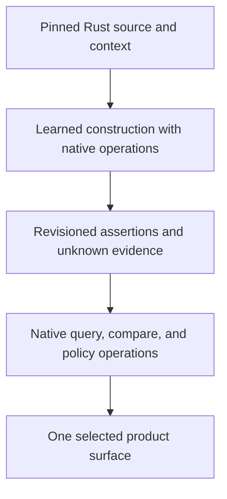

# Five Product Futures for a Rust Interface Graph Model

Research date: 2026-11-03.

Status: product hypotheses, architecture options, and conditional timelines. This document does not report a trained model, customer interviews, measured product-market fit, or benchmark results. The timelines describe what could happen after choosing a path; they are not delivery commitments.

Companion thesis: [Parseltongue as a Learned Graph Compiler for Rust](02-learned-graph-compiler-thesis.md). Historical model research: [Small Models for Rust Interface Dependency Graphs](01-small-model-interface-graph-research.md).

## Decision Frame

### Governing conclusion

**Build one specialized graph-construction capability, but choose one decision it helps a specific person make. Do not launch five products at once.**

The strongest first product hypothesis is a **Rust PR Change Witness**: a source-linked account of which public contracts and dependency relationships a patch changed, including what the system could not establish. Its advantage would have to be better review decisions, not prettier graphs or a smaller model file.

This recommendation is conditional. Before investing in a review application, prove that the graph engine is useful on unseen Rust repositories, and that reviewers actually change or accelerate a decision because of its evidence. A current-state local explorer is the lower-complexity experiment if two-revision reconciliation is not yet reliable. An agent integration is a possible distribution route, not a reason to build an unrelated general assistant.

### The actual fork

The research fork is not simply Tree-sitter versus an LLM. There are two separate decisions:

1. **Technical hypothesis:** can a specialized small model construct and refine useful Rust interface graphs, assisted by exact native operations, within a measured local resource budget?
2. **Product hypothesis:** whose repeated decision becomes meaningfully better because that graph exists?

One can succeed while the other fails. A learned constructor could outperform a baseline without finding buyers. A valuable review workflow could work better with compiler-derived graphs than with a model. Report these outcomes separately instead of redefining success after an experiment.

### Scope and non-negotiables

| Dimension | Working boundary |
|---|---|
| Input language | Rust only, including the Rust portions of a mixed-language repository. Foreign implementation behavior remains outside the graph's semantic claim. |
| Model's job | Discover and revise interface definitions, exposure paths, and dependency assertions; inspect graph state to choose further evidence requests. Not general chat or code generation. |
| Assistance | Native source access, ID reconciliation, range checks, joins, traversal, persistence, and optional independent semantic validation. Explicitly disclose any parser/compiler-supplied structure. |
| Memory | First test useful quality below 4 GB peak application RAM on a declared workload. Sub-100 MB inference is a later objective, not an established capability. |
| Platform | Implementation language is open. A macOS-first prototype is acceptable; CPU-only and Apple-GPU-assisted results must be reported separately. |
| Graph trust | Model origin, structural validity, semantic confirmation, uncertainty, freshness, and build context are separate fields. |
| Completeness | Distinguish byte accounting, interface inventory, and relationship resolution. None implies the other two. |
| Product restraint | All five options consume the same narrow graph capability. They do not require a general coding agent or support for other source languages. |

The [approved current-state PRD](../docs/research004/prd-v20260710.md) intentionally excludes history, PR comparison, visualization, and transitive analysis. This document explores **future alternatives**, not a silent expansion of that MVP. Timelines A, C, and E require explicit scope decisions before implementation; D may require an adapter; B can begin much closer to the present three-query scope.

### Evidence boundaries

- **Local evidence:** the current extractor returns entities and dependency edges; prior documents discuss source accounting, public projections, and visual trust. They do not demonstrate a learned constructor.
- **External evidence:** official Rust documentation, model cards, primary research, and project READMEs establish precedents and competing functionality. A README claim is not an independently reproduced result.
- **Product inference:** segments, willingness to pay, prioritization, proposed thresholds, and all future reactions below are hypotheses.
- **Creative speculation:** graph-assisted rehearsal, bounded graph-construction procedures, and very small recurrent specialists remain experiments until measured.

Sources were inspected on the research date. Links usually point to moving upstream pages; pin exact commits, model revisions, runtime versions, and licenses before reproducing anything. This is a targeted research pass, not an exhaustive market census or an exhaustive read of every file under `docs`.

### Expert lenses and challenge

| Lens | Contribution | Skeptical objection | Resulting constraint |
|---|---|---|---|
| Product strategy | Start with a repeated, consequential decision rather than a technology category. | A memorable demo is not retention or a budget. | Each timeline names a trigger, user, buyer hypothesis, replacement behavior, and stopping test. |
| Rust semantics | Model public exposure, contracts, configuration, and dispatch explicitly. | A small model may reproduce lexical patterns without resolving Rust. | Compare against capable Rust-aware baselines, not only name matching. |
| Specialized learning | Learn graph actions and evidence gathering, not broad conversation. | The host might do all semantic work while the model receives the credit. | Separate raw-source, assisted, and compiler-derived experimental arms. |
| Local systems | Bound source windows, active graph state, and repeated work. | Tiny weights can coexist with slow or memory-heavy applications. | Measure complete process families, cold indexing, updates, and idle behavior. |
| Skeptical systems engineer | Assume omissions, stale assertions, correlated model errors, and deceptive visual certainty. | The same agent could invent the change and its justification. | Independent evidence, explicit unknowns, immutable receipts, and no automatic merge permission. |

These are analytical perspectives, not claims that five independent human experts or agents performed this research.

### Conventional approach and three useful conceptual blends

The conventional approach is to adapt a Rust semantic index into a dependency graph and add a viewer or CI report. Keep this as a serious baseline: learning is not automatically an advantage.

| Blend | Product insight | Practical consequence |
|---|---|---|
| Scientific instrumentation | A graph is an observation with conditions and error bars, not an omniscient map. | Ship evidence and unknowns alongside every visual or machine answer. |
| Accounting and chain of custody | Source capture and derived claims need reconciliation and attributable changes. | Separate source ledger, graph assertions, revision manifests, and reviewer acknowledgments. |
| Rehearsal and counterfactual planning | A proposed interface move is a hypothesis about future dependencies. | Keep simulated edges separate from observed graphs; recapture actual code before claiming the plan worked. |

The chosen hybrid is a learned constructor plus native verification and an evidence-bearing artifact. Which product should wrap that artifact is the decision explored below.

### Shared graph contract

Carry forward the conceptual records in the companion thesis:

```text
Definition: canonical item identity and owner
Exposure: externally accessible path, boundary, and build conditions
Contract: signature, generics, bounds, relevant attributes
Observation: source occurrence in an immutable file revision
Assertion: typed relationship, evidence, origin, resolution, validation
```

Keep `EXPOSES_AS`, `SIGNATURE_USES`, `IMPLEMENTS`, `CALLS`, `MAY_CALL`, and internal ownership distinct. A public function that reaches another through a private helper has a **derived path**, not a new direct call. A reference occurrence is not automatically a call. The [Rust visibility rules](https://doc.rust-lang.org/reference/visibility-and-privacy.html) also make a scan for `pub` insufficient for public exposure.

The default view can be compact while the evidence model retains private helpers, nested functions, closures, and unresolved occurrences when needed. This is a projection choice, not permission to throw away semantic distinctions.

### Horizon and assumptions

All timelines use the same relative horizon: Week 1, Month 1, Quarter 1, and Year 1. Assume a small team, access to a few consenting Rust maintainers, and no existing proprietary training corpus. A product surface can be prototyped using honestly labeled reference graphs before a trained constructor exists. That validates the workflow, not the model thesis.

The five timelines are mutually competing primary bets. Their week-one activities are alternatives, not a combined development schedule. Longer horizons are conditional on prior evidence, staffing, and a usable graph engine. No numerical probability of success is assigned because the available evidence does not support one.

| Timeline | Product type | Primary decision |
|---|---|---|
| A | PR Change Witness | What structurally changed, and what should I inspect before approving? |
| B | Offline Rust Interface Observatory | Where is this public contract, and what depends on it right now? |
| C | Boundary Regression Gate | Did this change introduce a prohibited dependency or exposure? |
| D | Agent Dependency Instrument | What source-backed graph neighborhood should an agent inspect next? |
| E | Interface Refactor Rehearsal Lab | Which interface migration plan has the fewest evidenced obstacles? |

## Timeline A: PR Change Witness

### Product and segment

**Job:** when a coding agent submits a Rust patch, help the human reviewer inspect its structural consequences without reconstructing the whole repository from a diff.

The initial segment is a maintainer of a multi-crate Rust library or service who repeatedly reviews interface-affecting changes. The buyer hypothesis is an engineering lead responsible for review throughput and regression risk. An open-source maintainer may be an excellent design partner without being a paying customer; do not conflate these roles.

The product is not an AI reviewer that declares a PR good or bad. Its narrow artifact is a change witness: public contracts and relationships before and after, source-backed paths, and unresolved questions. It should remain useful when the reviewer disagrees with every interpretation the model offers.

### Concrete journey and bidirectional workflows

1. A reviewer chooses a base and candidate Rust revision, plus matching analysis contexts.
2. The constructor creates each graph independently; the reconciler matches logical items and records ambiguous matches.
3. The report separates changed contracts, changed implementation dependencies, changed exposure, and unchanged graph structure.
4. The reviewer selects a new relationship and opens its exact source evidence.
5. From that source, the reviewer returns to the owning public contract and its observed consumers.
6. The reviewer accepts the explanation, flags a mistaken assertion, or asks for missing evidence. Acknowledgment changes review state, not semantic truth.

Bidirectional loops:

- Intent statement -> observed graph delta -> unaccounted structural changes -> revised review questions.
- Changed interface -> direct callers -> their source -> interface evidence.
- Added dependency -> private witness path -> public projection -> exact added lines.
- Unknown occurrence -> requested source or build evidence -> revised assertion -> original unresolved question.

An intent statement is optional. Without one, show observed change; do not infer that the author's unstated architectural intent was satisfied.

### A non-obvious example

A patch keeps `pub fn submit(Request) -> Result<Receipt, Error>` unchanged but adds a call from a private helper to an external persistence API. The public-contract view is unchanged. The implementation-dependency view changes and retains the helper path. The report says exactly that, not "no architecture change" and not "the behavior is correct."

Conversely, a one-comment insertion should move source locations without manufacturing removed-and-added interfaces. A model upgrade that changes predictions on identical source is labeled an **analyzer change**, not blamed on the PR.

### Architecture consequences

Use separate immutable captures and a deterministic comparison stage. Snapshot identity includes source manifest, build context, schema, constructor, and model revision. Hold analyzer versions equal when attributing a delta to source changes; otherwise show the confound explicitly.

The learned model remains responsible for graph construction. Native routines perform ID reconciliation, evidence checks, set comparison, and path materialization. Train/test graph construction independently from the change-report presentation. A graph receipt can include source fingerprints and counts, but checksums prove integrity, not semantic correctness.

This option requires history and reconciliation that the current PRD deliberately postponed. Build it as an explicit future experiment, possibly a CLI-generated local report first, not a new collection of public endpoints by accident.

### Causal timeline

| Horizon | Action -> consequence -> likely response | Evidence to collect |
|---|---|---|
| Week 1 | Reconstruct five recent interface-affecting reviews with maintainers. Produce manually checked witness reports. Reviewers reveal which structural questions they actually struggled with. | Do they discover a missing review question, or merely admire the picture? Record incorrect and distracting findings too. |
| Month 1 | Build a local two-revision report with immutable evidence and uncertainty. Run graph arms offline. Reviewers start using the artifact next to their ordinary diff rather than replacing the diff. | Task time, correctness, missed relevant relationships, unsupported claims, and repeat use without prompting. |
| Quarter 1 | If repeat use exists, integrate report artifacts into one team's review workflow. Improve the highest-cost error slice before adding features. | Team-level value beyond a champion; support cost; effect of model and toolchain upgrades; willingness to fund a pilot. |
| Year 1 | If evidence quality and buying behavior hold, sell a narrow Rust review product with local execution and shareable receipts. Otherwise retain the graph/report engine and abandon the review business. | Renewal and independent use; not screenshot shares, install counts, or graph size. |

### Lived experience and ramifications

For the reviewer, the desired feeling is relief: fewer tabs, visible reasons, and an honest boundary around what was not checked. The failure feeling is irritation: another bot that makes the reviewer verify its mistakes. A false positive can cost more attention than the original search.

For the author, a witness can make review less adversarial because disagreement points to source. It can also feel like surveillance if the product ranks developers, attributes model errors to authors, or turns uncertain relationships into performance scores. Do not build those interpretations into the product.

For the team operating it, the dominant work becomes identity reconciliation, reproducibility, configuration support, and false-edge triage. The attractive graph UI is not the hardest subsystem.

### Competition, economics, and falsification

[cargo-public-api](https://github.com/cargo-public-api/cargo-public-api) already lists and diffs Rust public APIs. [cargo-semver-checks](https://github.com/obi1kenobi/cargo-semver-checks) already checks API changes for semver violations. Their existence invalidates a claim that public-interface change inspection is an untouched category. The differentiation hypothesis is **relationship evidence for human review**, including private implementation witnesses and honest incomplete-source analysis, not a replacement for either tool.

Possible packaging: free local reports, a paid team workflow for reproducible sharing and review integration. This is a pricing hypothesis, not observed willingness to pay. Avoid per-edge pricing, which rewards larger graphs rather than better decisions.

Stop or narrow the product if reviewers cannot name a decision the artifact improved, if they must recheck nearly every edge, or if a simpler API diff plus rust-analyzer answers the same questions with lower total effort. This is the leading hypothesis because the user and decision are concrete, not because PMF is established.

**Key inflection:** if reviewers value the evidence but cross-revision matching creates noise, validate B/current-state evidence while repairing reconciliation. If reviewers do not value independently correct evidence, a larger model or more elaborate visualization will not rescue this product hypothesis.

## Timeline B: Offline Rust Interface Observatory

### Product and segment

**Job:** while working in an unfamiliar or changing Rust workspace, inspect a small, current interface map and immediately reach the evidence behind a relationship.

The segment is a Rust maintainer, consultant, or incoming engineer who repeatedly investigates large workspaces, particularly where uploading source is undesirable. The buyer hypothesis is initially an individual or small team. Offline operation is a useful constraint, not evidence that an enterprise security buyer will purchase it.

Creative blend: an interactive scientific instrument rather than an architecture poster. The product shows a particular observed neighborhood, its observation conditions, and its blind spots. It does not open with thousands of moving nodes.

### Concrete journey and bidirectional workflows

The user opens a workspace, chooses a crate boundary and build context, and finds `Repository::commit` through fuzzy search. A stable contract panel shows its exposed names and signature. Forward and reverse views show direct relationships with evidence. A private-helper path can be expanded without turning every block into a permanent visual node.

Bidirectional loops:

- Fuzzy result -> interface -> outgoing dependency -> source occurrence -> interface.
- Interface -> incoming consumer -> consuming contract -> original relationship.
- Unknown region -> exact file slice -> additional investigation -> revised current graph.
- Source selection -> owning definition -> public exposure -> source selection.

Selecting a scope must never silently alter the meaning of "public." Crate-external exposure and a chosen internal module boundary are different labeled projections. A binary crate with little public library API must not be made to look richer by relabeling all private functions.

### Architecture consequences

One current immutable capture plus atomic replacement is enough for the first experiment. A watcher marks stale state; a bounded construction worklist recomputes affected assertions. Queries choose a committed revision. If inference is still running, the user sees the last committed graph and the pending change, not a mix.

Use a compact public projection and fetch witness neighborhoods on demand. Display unknown evidence near the relevant interface, not only in a global dashboard. When the constructor cannot map a span to an owner, preserve the span rather than attach it to the nearest convenient function.

This is the closest option to the [current-state PRD](../docs/research004/prd-v20260710.md). A visual shell is still an explicit extension of that scope. Begin with the existing fuzzy, forward, and reverse operations; do not use this idea to justify a catalog of centrality algorithms.

### Causal timeline

| Horizon | Action -> consequence -> likely response | Evidence to collect |
|---|---|---|
| Week 1 | Hand-build several bounded interface neighborhoods for one real onboarding investigation. Users try to answer actual questions rather than explore a demo. | Whether the compact view beats source navigation, and which missing evidence blocks an answer. |
| Month 1 | A local current-state prototype adds visible freshness and click-through source. Users discover whether the model keeps up with edits and whether they tolerate an imperfect graph. | Correct task completion, stale-answer incidents, cold-start abandonment, CPU interference, and repeat investigation use. |
| Quarter 1 | If useful, integrate one editor or a lightweight Mac application. Invest in sleep/resume, branch switching, cancellation, and update correctness before visual polish. | Repeated use after onboarding ends; willingness to pay; time spent repairing the index. |
| Year 1 | It becomes a trusted local Rust instrument, or stalls as an occasional onboarding viewer. If the latter, preserve it as a debugging surface for another product rather than forcing a standalone business. | Habitual return for consequential work; not total nodes viewed. |

### Lived experience and ramifications

The positive daily experience is quiet availability: search, inspect, return to the editor. The negative is a laptop fan, a stale diagram, and another window to maintain. Idle power, memory release, and background scheduling are product features here, not merely optimization work.

A visually coherent graph can encourage excessive trust. Use visible labels for proposed, independently supported, stale, and unresolved relationships. Offer a text/list view containing the same evidence; measure whether the visualization adds understanding instead of assuming that seeing is believing.

Local-first does not mean automatically private. Source excerpts, exported graph names, crash logs, update checks, and analytics can disclose sensitive structure. Default to no source-bearing telemetry and make graph exports intentional. Do not promise security certification.

### Competition, economics, and falsification

[Vesalius](https://github.com/haplollc/Vesalius) publicly documents an on-device graph, a Mac app, CLI, editor extension, and agent tools. Its documented implementation emphasizes Swift and selected other languages; that is not evidence of Rust semantic coverage. It is direct counterevidence to a broad claim that local visual graph tooling is missing.

The [rust-analyzer architecture](https://rust-analyzer.github.io/book/contributing/architecture.html) is a strong technical baseline for incremental Rust analysis. The product must provide a distinctly better investigation loop, not simply recreate go-to-definition in a graph layout.

Potential commercial shape: a local application with paid team sharing or support. The major risk is low recurring urgency: onboarding happens, then usage disappears. Stop as a standalone product if users prefer the editor after the first session, even if they praise the demo. Relative to A, this path is easier to reverse and demands less cross-revision machinery, but its willingness-to-pay hypothesis is weaker.

**Key inflection:** if people return only after an incident or on a new project, test a portable investigation report rather than assuming a daily application. If they return throughout ordinary changes, freshness and background cost become more important than adding graph analytics.

## Timeline C: Boundary Regression Gate

### Product and segment

**Job:** prevent an interface-affecting Rust change from adding a prohibited dependency, unexpected exposure, or forbidden cross-boundary path.

The segment is a platform or library team with explicit architecture constraints and repeated changes across crate or module boundaries. The buyer hypothesis is the lead accountable for those boundaries. This is not a product for a team that cannot name any rule it wants enforced.

Creative blend: a jurisdiction-aware policy checker. The graph establishes what is observed; policy states what is permitted. Neither the model nor a graph metric invents the team's architectural law.

The narrow differentiated possibility is **evidence-aware enforcement**: a path can be prohibited, allowed, or undecidable because a necessary relation is unresolved. "No violation found" must not mean "policy proved" when graph coverage is inadequate.

### Concrete journey and bidirectional workflows

A team declares that a domain public contract must not expose a persistence type, and that a particular boundary must not directly call an I/O interface. The checker evaluates these as different relation types. A signature reference is not interchangeable with a call or a transitive path.

Bidirectional loops:

- Human policy -> exact graph predicate -> violating evidence path -> policy review.
- New edge -> responsible interface -> source -> allowed exception with owner and expiration.
- Indeterminate check -> missing analysis capability -> focused evidence request -> reevaluation.
- Existing baseline -> proposed rule -> historical violations -> deliberate adoption boundary.

An inferred repeated pattern may suggest a rule for human approval. It is never automatically promoted to policy just because most of the current repository follows it. Existing architecture can be accidental or undesirable.

### Architecture consequences

Keep construction and enforcement separate. The constructor emits a graph with assertion status; a deterministic rule evaluator reads an immutable snapshot. Policies specify which evidence classes are admissible, the scope/build matrix, and what to do with insufficient evidence.

Use distinct outcomes:

```text
VIOLATION_FOUND: an admissible witness satisfies a forbidden predicate
NO_VIOLATION_IN_DECLARED_SCOPE: the check completed under its coverage contract
INDETERMINATE: relevant evidence, configuration, or analysis is missing
ANALYSIS_FAILED: capture, execution, or persistence failed
```

These names are illustrative. A newly found path can establish a forbidden structural relationship if its constituent evidence is acceptable. Failure to find a path does not prove absence in an incomplete graph. Even a complete source inventory does not establish complete dispatch resolution.

Start in report-only mode. Use independently confirmed evidence for hard blocking until the model's task-specific error behavior is established. Model confidence alone must not block merges. A human exception records a governance decision; it does not transform an uncertain edge into a confirmed edge.

Protected policy and verification configuration must come from a trusted revision or review channel, not solely from the same patch being judged. This is important when coding agents can edit both code and checker configuration.

### Causal timeline

| Horizon | Action -> consequence -> likely response | Evidence to collect |
|---|---|---|
| Week 1 | Ask a team for one costly boundary regression and one rule they would actually maintain. Reconstruct its witness path. | Whether a precise predicate exists; whether an existing tool already enforces it adequately. |
| Month 1 | Run one rule in shadow mode. Separate graph errors, rule errors, and intentional violations. Developers start testing how to suppress noisy findings. | False alarms per reviewed change, unresolved cases, review effort, and whether policy owners respond. |
| Quarter 1 | Only trusted, stable checks become blocking. Add a baseline and explicit exceptions so legacy debt does not paralyze adoption. | Bypasses, disabling behavior, expired exceptions, toolchain changes, and regressions the rule actually catches. |
| Year 1 | If reliable, the product becomes part of release governance. If not, it becomes a frequently overridden gate or an abandoned configuration file. | Continued enforcement and budget ownership, not number of rules created. |

### Lived experience and ramifications

The desired experience is fewer recurring architecture arguments and a precise source-linked reason when CI blocks. The bad experience is fear of an opaque learned checker, especially during incidents. Provide deterministic reevaluation of a stored graph, a clearly owned override route, and a record of what an override waives.

This path has the largest institutional burden. Installation permissions, protected configuration, unavailable build environments, and rule maintenance become part of the product. A macOS-only runtime would conflict with many teams' preferred CI environment; validate that requirement before committing to a native-only stack.

Enforcement also changes incentives. Developers may route around rules, hide a dependency behind indirection, or relabel modules. The product should explain its supported predicates and blind spots, not claim that a gate makes architecture correct.

### Competition, economics, and falsification

[Cargo Bylaw](https://github.com/danielgerlag/cargo-bylaw) already documents Rust architecture rules over modules, workspace crates, external crates, layer directions, and cycles, including agent completion checks. Its repository existence establishes competing functionality, not adoption or independent accuracy. [cargo-semver-checks](https://github.com/obi1kenobi/cargo-semver-checks) is an adjacent established API-checking precedent.

Therefore, "ArchUnit for Rust" is not sufficient differentiation. A potential opening is a more usable evidence/unknown contract or a difficult relationship class existing analyzers mishandle. That opening must be demonstrated on customer examples.

Potential commercial shape: team subscription or supported local CI deployment. Do not infer willingness to pay from the severity of an imagined violation. Stop if teams cannot agree on rules, already solve them adequately, disable the checker, or need a level of semantic assurance the learned system cannot provide. This is a later expansion, not the recommended first bet.

**Key inflection:** frequent indeterminate checks justify better analysis or a narrower rule, not silently changing the outcome to pass. If developers consistently override correct findings, investigate the policy's usefulness and ownership before retraining the model.

## Timeline D: Agent Dependency Instrument

### Product and segment

**Job:** supply a coding agent with a fresh, source-backed Rust interface neighborhood so it can choose what to inspect next without treating a guessed graph as truth.

The segment is an agent-tool builder or a Rust team already using coding agents on nontrivial workspaces. There are two buyer hypotheses: end-user teams pay for reliable local navigation, or tool vendors pay for an embeddable engine and support. These are different businesses; validate one rather than mixing both in the first launch.

Creative blend: an operating-system service for a single kind of knowledge. The engine maintains graph state and answers bounded queries. The external coding agent remains responsible for editing code and answering broader questions. Parseltongue's small model is a graph constructor, not a smaller replacement coding agent.

### Concrete journey and bidirectional workflows

An external agent receives a task affecting `Client::send`. It fuzzy-searches the interface, inspects direct incoming and outgoing relationships, reads selected source, edits through its normal tools, and asks for a fresh graph after the daemon reconciles changes.

Bidirectional loops:

- Agent question -> graph neighborhood -> source inspection -> narrower graph question.
- Source edit -> invalidated assertions -> construction worklist -> committed graph -> updated agent context.
- Ambiguous relationship -> missing type/import evidence -> constructor investigation -> qualified answer.
- Suspected bad edge -> independently checked source -> retained correction evidence -> reevaluation.

The last loop must not accept an agent's assertion as ground truth merely because it is confident. Feedback can open a dispute or supply evidence; only a defined validator or adjudication process changes validation status.

### Architecture consequences

Start with the narrow search/forward/reverse concepts already present in the [current PRD](../docs/research004/prd-v20260710.md). Add a machine adapter only when a real client needs one. Indexing, revisions, and accounting can remain operational CLI concerns; this research does not authorize dozens of new public APIs.

Every response needs graph revision, source evidence references, relation type, resolution status, and truncation/unknown information. The external agent must not confuse "no matching callers returned" with a universal absence claim. Pagination and truncation also change meaning even if every returned edge is correct.

The learned constructor runs behind the service boundary. Query execution is native code over committed graph state; no model invocation is needed to reverse an edge list. A query may trigger a bounded request for additional evidence, but must identify whether its answer used the committed graph or a later refinement.

[SCIP](https://github.com/scip-code/scip) supplies a useful interchange precedent for symbols and occurrences. An adapter must preserve the distinction between occurrence references, interface exposure, and actual call relationships. Do not claim SCIP is already the full product graph or that its adoption validates this model.

### Causal timeline

| Horizon | Action -> consequence -> likely response | Evidence to collect |
|---|---|---|
| Week 1 | Attach hand-checked graph responses to one real agent investigation. Compare with its normal tools at the same task definition. | Whether the agent actually calls the tool and whether the answer changes a correct next action. |
| Month 1 | Run paired navigation tasks with fresh and deliberately stale graph variants. Investigate wrong turns, not only token totals. | Task success, incorrect target selection, source verification, end-to-end latency, and total inference plus integration cost. |
| Quarter 1 | If useful, maintain one client integration and a versioned schema. Other clients request adapters; resist multiplying support surfaces before adoption is demonstrated. | Repeat usage across users and repositories; integration breakage; support load; client-vendor feedback. |
| Year 1 | It becomes a reliable Rust dependency component or gets absorbed into an agent/editor's native index. The durable asset must be accuracy, deployment quality, or a valuable supported niche. | Renewed integrations and evidence that the engine outperforms simpler built-in alternatives. |

### Lived experience and ramifications

The positive experience is invisible: the agent opens the right files and the human sees fewer unsupported claims. The risk is equally invisible: one invented or stale edge guides several subsequent edits. A fluent final answer can hide the original navigation mistake.

Observe tool usage, graph revisions, and source reads without logging sensitive source by default. Count all model activity, including background construction, retries, and external-agent turns. Saving output tokens while running an expensive local refinement loop is not necessarily an improvement.

Agent distribution introduces platform dependency. Client policies, tool discovery, schema changes, and native competing indexes can change adoption. A good integration is distribution, not a moat by itself.

### Competition, economics, and falsification

[Vesalius](https://github.com/haplollc/Vesalius) already documents agent-oriented code-map and usage tools, including freshness and evidence-oriented outputs. Its author-reported benchmark is not independently reproduced here and does not establish Rust accuracy. [CoSIL](https://arxiv.org/abs/2503.22424) is research precedent for graph-guided repository investigation, not proof that a small learned constructor is required.

Potential commercial shape: open local engine with paid support/integration, or a paid team installation. The failure mode is a useful feature with no independent buyer. Stop if agents ignore the tool, or if a matched deterministic index delivers the same task quality and lower total cost. A token reduction without maintained correctness is not a win.

**Key inflection:** distinguish an unused integration from an inaccurate graph. Changing tool discovery can test the former; independent graph evaluation tests the latter. A benchmark that explicitly forces tool use can isolate capability, but must not be presented as organic adoption evidence.

## Timeline E: Interface Refactor Rehearsal Lab

### Product and segment

**Job:** before changing a Rust interface boundary, compare candidate migration plans against observed dependency evidence, then check the actual result against the chosen plan.

The segment is a Rust maintainer planning a crate split, public type replacement, re-export cleanup, or trait-boundary migration. The buyer hypothesis is a team lead funding a specific migration. This is an episodic, high-consequence workflow, not necessarily a daily subscription habit.

Creative blend: a rehearsal environment for architecture changes. A proposed graph is explicitly hypothetical. It helps enumerate questions and staged dependencies; it does not prove that unimplemented Rust will compile or preserve behavior.

### Concrete journey and bidirectional workflows

A team wants to move `Storage` behind a new `Repository` trait without exposing its database-specific `Error` type. They compare three plans: retain a compatibility re-export, introduce an adapter contract, or break the exposed path in one release.

The product starts from a captured graph, records the proposed operations, shows known consumers and witness paths affected, and identifies unknown dispatch or generated code requiring inspection. The external developer or coding agent implements the selected plan. Parseltongue then recaptures actual Rust and compares observed structure with the plan.

Bidirectional loops:

- Desired interface boundary -> observed consumers -> staged plan -> revised desired boundary.
- Hypothetical removal -> incoming relationships -> compatibility option -> revised hypothetical graph.
- Plan -> actual code change -> recaptured graph -> unexplained residual relationships.
- Uncertain witness -> source investigation -> revised migration order -> original plan.

No code-writing capability is required inside the small model. Its job remains construction and graph-grounded investigation; candidate operations come from the user or a constrained graph-planning vocabulary.

### Architecture consequences

Keep three layers separate: immutable observed graph, hypothetical overlay, and newly observed result. The overlay never overwrites evidence. Each planned operation records its assumptions, required follow-up checks, and the observed assertions it depends on.

Native algorithms compute neighborhoods and paths. A topological order applies only where the relevant plan graph is acyclic; detect cycles and expose them instead of pretending every migration admits a simple linear sequence. Do not introduce elaborate metrics unless they improve a specific planning decision.

The model may propose that moving one item requires inspecting several signatures. It may not claim that a signature edit preserves semantics merely because the projected graph looks unchanged. A compile/test receipt, when available, is a separate observation with its own scope.

Counterfactual questions can be useful without a second real revision, but validating the realized plan requires comparison infrastructure. This goes beyond the current-state PRD and should follow, not precede, reliable graph capture and reconciliation.

### Causal timeline

| Horizon | Action -> consequence -> likely response | Evidence to collect |
|---|---|---|
| Week 1 | Join one real planned Rust migration. Reconstruct current consumers and compare the team's existing plan with a manually checked graph overlay. | Whether an overlooked dependency or sequencing constraint changes the plan. |
| Month 1 | Prototype a small operation set: move exposure, replace signature dependency, retain alias, and remove interface. Keep results explicitly hypothetical. | Useful discoveries, misleading recommendations, and effort needed to keep the plan aligned with code. |
| Quarter 1 | Follow the migration through actual changes. Compare the plan with recaptured graph structure and independently recorded build/test outcomes. | Surprises caught before edits, unexplained divergence, and coordination cost reduced or added. |
| Year 1 | If migrations repeatedly benefit, offer a specialized workbench or supported migration engagement. Otherwise retain overlays as a feature of A or B, not a separate company. | A second independently initiated migration and a buyer with a repeated need. |

### Lived experience and ramifications

The desired feeling is being able to discuss a difficult migration concretely before spending days implementing the wrong sequence. The bad experience is diagram maintenance: another plan that becomes stale while the team does real work.

This product creates a strong temptation to overpromise. A pleasing end-state graph is not evidence of behavior preservation, performance, compatibility, ownership feasibility, or dynamic dispatch correctness. Keep these limitations in the planning artifact itself, not hidden in documentation.

Teams may want project management, ticket generation, code rewriting, and automatic test generation. Those requests are adjacent products. The initial product should keep the graph's role narrow: expose evidenced constraints, preserve assumptions, and compare actual structural outcomes.

### Competition, economics, and falsification

Rust-aware navigation and refactoring already exist in [rust-analyzer](https://rust-analyzer.github.io/book/features.html); [cargo-public-api](https://github.com/cargo-public-api/cargo-public-api) already supplies API comparison. A new workbench must improve multi-step interface migration decisions beyond these tools and a written plan.

Potential commercial shape: a paid project workspace or supported migration engagement. This may generate early learning but can become a consulting business with bespoke models and no repeatable product. Stop as a separate offering if every engagement requires custom semantics, if plans decay faster than they help, or if customers only need a one-off diagram.

This is the most creatively distinct long-term option, but the weakest first experiment for a small team because it depends on graph quality, planning semantics, cross-revision identity, and a real migration opportunity at the same time.

**Key inflection:** if one migration benefits but a second requires a different bespoke representation, treat the result as project-specific consulting evidence. If the same small operation vocabulary works across unrelated migrations, a repeatable product becomes more plausible.

## Cross-Timeline Analysis

### Comparative product judgment

The assessments below are qualitative product judgments, not measured market scores. "High" does not imply a large market or a numerical probability of success.

| Product | Trigger and likely frequency | Potential upside | Main downside | Reversibility | Regret risk | Required cooperation |
|---|---|---|---|---|---|---|
| A: PR Change Witness | Each meaningful interface-affecting review | Concrete human decision; evidence can be evaluated against a real patch | Cross-revision identity and noisy findings can consume reviewer attention | Medium-high: reports and comparison engine transfer to other products | Building a reviewer before proving graph quality or repeat demand | Maintainers, review workflow, reproducible revisions |
| B: Interface Observatory | Investigation and onboarding; actual recurrence unknown | Low workflow permission; direct visibility into graph errors | May become an admired but rarely reopened viewer | High: current-state engine and debugging UI remain useful | Spending on visual polish instead of repeat utility | Individual developers and editor/desktop environment |
| C: Regression Gate | Every checked change or release | Can make explicit boundaries enforceable | Highest assurance and organizational burden; false blocks encourage bypasses | Medium: report-only rules can survive, but governance integration is costly | Becoming the noisy gate nobody trusts | Policy owner, developers, CI/security administrators |
| D: Agent Instrument | Potentially many queries per agent task | Reusable distribution and frequent machine interaction | Native indexes and client changes can erase differentiation | High technically; lower after many supported integrations | Mistaking tool calls or token savings for a business | Agent clients, tool vendors, end-user teams |
| E: Rehearsal Lab | During migrations, not necessarily weekly | Helps expensive decisions before code is changed | Multiple unproven subsystems and episodic demand | Medium-high if overlays stay small | Building bespoke consulting software with no repeatable buyer | Migration owner, maintainers, actual code/build feedback |

**Order of learning value:** first prove the common graph engine; test A's decision artifact with humans; use B as a cheap inspection/debugging surface; test D only with an actual integration partner; defer blocking C and standalone E. This is an experiment order, not a mandate to ship all five in sequence.

### Different products need different truth contracts

| Output | What a supported graph can establish | What it cannot establish alone |
|---|---|---|
| Contract inventory | Which interface items were captured under stated conditions | That every possible build configuration was covered |
| Observed call/dependency | A source-backed relationship of a defined kind | That the relationship executes at runtime, or that every possible target is known |
| Reverse query | Incoming stored relationships for the selected scope and revision | Absence of undiscovered consumers or external users |
| Change witness | Difference between comparable captures | Correctness, intent satisfaction, behavior preservation, or safe merging |
| Boundary check | An admissible witness violates an explicit predicate | Universal policy compliance when relevant evidence is incomplete |
| Refactor overlay | Consequences under explicit hypothetical graph assumptions | That proposed Rust compiles, has acceptable performance, or preserves behavior |

This distinction changes pricing, interface design, and liability expectations. Avoid selling an investigation aid as a safety proof. Formal verification tools and compiler checks can supply additional evidence, but their outputs must retain their own assumptions and scope.

### One kernel, five consumers



The storage engine remains an implementation choice. A relational store can persist assertions and evidence; in-memory adjacency indexes can serve graph operations. No product above requires a particular graph database, a database migration, or learned execution of ordinary traversal. Correctness comes from relation semantics, snapshot consistency, and implementation tests, not from choosing a library with "graph" in its name.

| Operation | Proposed execution location | Important boundary |
|---|---|---|
| Discover declarations and proposed relationships | Specialized model plus declared assistance | Raw-source discovery and parser-supplied candidates are different experimental arms. |
| Validate spans, IDs, schema, and source hashes | Native deterministic host | Valid structure is not proof of correct resolution. |
| Direct forward/reverse lookup | Native indexes over committed graph | Preserve relation filters, revision, unknowns, and truncation. |
| Materialize a bounded private witness path | Native traversal over admitted assertions | A path through uncertain edges remains uncertain. |
| Compare revisions and reconcile identities | Native matching plus explicitly tracked ambiguity | Equal text is not universal durable identity; duplicate items and edits complicate matching. |
| Check a boundary predicate | Deterministic evaluator | No-violation results need an explicit coverage contract. |
| Choose the next unresolved observation to investigate | Bounded model-guided worklist, with a simple scheduler baseline | Stop on budget, repeated state, or no useful evidence. |
| Format a report or graph view | Ordinary application code | Presentation cannot upgrade an assertion's validation status. |

The four construction architectures from [document 02](02-learned-graph-compiler-thesis.md) are not five product categories. Any product can use a transducer, iterative constructor, constrained recipe engine, or recurrent specialist. Prefer an iterative constructor as the leading technical hypothesis, with the direct transducer as its controlled comparison. Do not attach an exotic architecture to every product just to make the table look diverse.

### What actually changes in the existing codebase?

Source was discovered through the indexed codebase-memory graph and the relevant snippets were checked against local files:

- [QueryBasedExtractor::parse_source](../crates/parseltongue-core/src/query_extractor.rs) at lines 358-388 parses source with Tree-sitter, executes entity/dependency queries, and returns entities plus edges. It is a candidate comparison/integration boundary, not a learned constructor. In this function, absence of a dependency query yields an empty vector; the new graph contract must not interpret an empty result as semantic proof of no dependencies.
- [AdjacencyListGraphRepresentation::build_from_dependency_edges](../crates/parseltongue-core/src/graph_analysis/adjacency_list_graph_representation.rs) at lines 131-139 builds graph state from `(from, to, edge_type)` triples. That is useful for native graph operations, but the proposed evidence-rich assertion model needs more than the triple representation at its canonical boundary.
- The [current-state PRD](../docs/research004/prd-v20260710.md), [visual-trust synthesis](../docs/research004/Sol-Insights-02.md), and [public-interface/source-accounting synthesis](../docs/research004/Sol-Insights-03.md) are product proposals with different historical scopes. Keep their ideas, but do not claim those documents establish implemented functionality.

This research makes no application-code changes. The narrowest eventual experiment is a separate constructor adapter and shared evaluation contract, not a rewrite of every service and storage layer.

### Fresh evidence: reasons for both ambition and restraint

**The strongest contrary evidence matters.** The revised [empirical study of type and call-graph analysis](https://arxiv.org/abs/2410.00603v2) reports that traditional Python and JavaScript call-graph tools outperform the tested LLMs and identifies completeness/soundness problems. It is not a Rust benchmark, nor does it settle whether a future specialized model can win. It does mean a model-led graph cannot be justified from general coding fluency.

[CG-Bench](https://conf.researchr.org/details/icfp-splash-2025/lmpl-2025-papers/3/CG-Bench-Can-Language-Models-Assist-Call-Graph-Construction-in-the-Real-World-) studies 104 call sites from seven C/C++ projects. That is useful precedent for reviewed call-target examples, not evidence of comprehensive repository graph construction, Rust transfer, or tiny CPU deployment. Candidate-target accuracy must not be substituted for discovering the whole graph.

[CodeAct](https://arxiv.org/abs/2402.01030) supports the idea of executable model actions. [Recursive Language Models](https://arxiv.org/abs/2512.24601) support externalized context inspection. Both inform the host/model loop; neither establishes that this task works below 4 GB or with a sub-100 MB specialist.

[Tiny Recursive Models](https://arxiv.org/abs/2510.04871) make structured recurrence worth investigating. A [quality-estimation transfer study](https://arxiv.org/abs/2603.14593) finds that recurrence does not automatically transfer and can hurt. Therefore evaluate refinement against an equal-compute one-pass/nonrecurrent baseline. Do not count only a small recurrent head while ignoring its encoder and embeddings.

### Small-model shortlist and what each would test

These are research candidates, not five proven deployable Rust graph models. Published card claims are distinguished from proposed uses. No checkpoint was downloaded, trained, quantized, or benchmarked in this research pass.

| Candidate | Published precedent | Proposed experiment | Tradeoff and RAM caveat |
|---|---|---|---|
| [Qwen2.5-Coder-0.5B-Instruct](https://huggingface.co/Qwen/Qwen2.5-Coder-0.5B-Instruct) | Code model; card lists 0.49B parameters and Apache-2.0 | First direct source-to-graph and iterative-action baseline | Coding prior is useful, but not proof of Rust resolution. Ideal 4-bit weights alone are about 245 MB; runtime, context, graph, and buffers are extra. |
| [Qwen3.5-0.8B](https://huggingface.co/Qwen/Qwen3.5-0.8B) | Card positions the scale for prototyping/task-specific fine-tuning; lists a 0.8B language model plus vision encoder | Test a newer small action/structured-output candidate against the code-specialized baseline | Pin the exact text-serving path and account for all shipped components. A 400 MB ideal 4-bit floor for the stated language-model count is not whole-model or application RAM. |
| [AMD-Llama-135m-code](https://huggingface.co/amd/AMD-Llama-135m-code) | 135M code-oriented model with 2,048-token context; Apache-2.0 card | A genuinely small code-model control and possible distillation student | Short context makes source/graph window design central. An ideal 4-bit weight floor is about 67.5 MB, not a demonstrated sub-100 MB process. |
| [Needle 3](https://huggingface.co/Cactus-Compute/needle3) | Authors report specialized tool calling/extraction, a 121M architecture, and 8-29 MB deployable artifacts; Apache-2.0 card | Test whether narrow graph actions and extraction can be learned with a deployment-oriented specialist | Published artifact sizes vary with the deployable configuration. General structured extraction is not Rust semantic analysis; verify training/export/runtime support and actual RAM. |
| [Gutsy](https://github.com/kouhxp/gutsy) | Local 0.8B CPU decision-model precedent with typed choices and probability outputs | An auxiliary experiment for target disambiguation or whether to request more evidence | It does not itself establish declaration discovery or full graph construction. A classifier-only win cannot be reported as a model-builds-graph win; domain calibration must be remeasured. |

The weight-only arithmetic uses decimal MB and `parameters * bits / 8`; actual quantization includes additional representation overhead. It is a feasibility calculation, not a RAM prediction. Author-reported compression formats cannot be assumed to match this simple arithmetic.

Proposed order: compare the 0.5B code model and one alternative capable of the required structured actions, then distill toward the 135M or smaller specialist only if graph quality is useful. Keep the tiny candidate in the experiment early, but do not make a hard size target the excuse for poor inventory recall.

Licenses shown by cards are not a substitute for reviewing the exact weights, tokenizer, derived quantization, training data, and distribution terms. Keep upstream licenses and dataset provenance attached to pinned artifacts; no legal clearance is asserted here.

### Native execution versus computation inside weights

There are three distinct mechanisms, and they should not be conflated:

1. **Model plus native host:** the model emits typed operations; ordinary code executes exact computation. This is the clearest initial system to benchmark.
2. **Model emits a constrained program:** a sandbox runs an analysis recipe over allowlisted source/graph operations. [Monty](https://github.com/pydantic/monty) is a Rust-hosted Python sandbox precedent whose host access is explicitly provided. Its existence is not a correctness guarantee for generated recipes.
3. **Computation compiled into model weights:** [Qwenputer](https://github.com/divagr18/qwenputer) reports a RISC-V computer embedded in Qwen3.5-4B, with compiled rather than learned machinery. This is a genuine conceptual precedent, not proof of Rust graph extraction, CPU efficiency, or our application memory goal.

The creative possibility is a specialized graph machine: learned operations choose where to inspect; exact routines perform lookup, range arithmetic, and propagation; repository-specific state stays external. There is no need to place a CPU inside weights merely to avoid calling native Rust or another host language. That variant earns consideration only if it improves a measured accuracy/cost frontier.

### Deployment options without prematurely fixing implementation language

| Runtime path | Why consider it | What must be tested |
|---|---|---|
| [llama.cpp](https://github.com/ggml-org/llama.cpp) with a small quantized model | CPU/Apple-silicon and quantized inference precedent; native host integration | Actual model architecture, conversion fidelity, constrained output, cancellation, memory, and CPU-only performance |
| [MLX LM](https://github.com/ml-explore/mlx-lm) for an Apple-silicon experiment | Python tooling for local generation, fine-tuning, and quantization | Accelerator use and unified-memory accounting; do not report an Apple-GPU run as CPU-only |
| [Candle](https://github.com/huggingface/candle) if a Rust-hosted runtime becomes useful | Rust ML framework with CPU and accelerated examples | Exact architecture coverage and artifact fidelity; implementation-language purity is not the research outcome |
| Specialist's native engine, such as Needle's | May preserve custom compression and decoding behavior | Training path, export compatibility, supported targets, reproducibility, and full process memory |

One tested runtime is better than four nominally supported ones. A Mac-first experiment reduces integration scope but does not prove Linux CI deployability, an important difference between B and C.

### The last-month discovery pass

To extend the earlier research, a bounded Hacker News Algolia pass searched story titles/content for `small model`, `code graph`, `Rust architecture`, and `Qwenputer`, filtering 2026-10-04 through 2026-11-03 as available at retrieval. The API returned 85, 34, 7, and 4 matches respectively; up to the latest 12 per query were retrieved in this pass. Overlap and irrelevant matches were not treated as separate evidence. This is discovery sampling, not an exhaustive survey or a popularity ranking.

| Discovery | Discussion date/link | Primary source | Lesson for Parseltongue, not a transfer claim |
|---|---|---|---|
| Vesalius | [2026-10-26 HN post](https://news.ycombinator.com/item?id=50250206) | [Project](https://github.com/haplollc/Vesalius) | Local graph distribution already exists. |
| Qwenputer | [2026-10-28 HN post](https://news.ycombinator.com/item?id=50277757) | [Project](https://github.com/divagr18/qwenputer) | Executable machinery inside weights is possible in a different setting; test native execution first. |
| Nouli | [2026-10-29 HN post](https://news.ycombinator.com/item?id=50288442) | [Project](https://github.com/nouli-ai/nouli) | A ledger connecting decisions and supporting facts is useful inspiration for assertion provenance. |
| Cerebellum | [2026-10-30 HN post](https://news.ycombinator.com/item?id=50309386) | [Project](https://github.com/cerebellum-labs/cerebellum) | Its reversible/irreversible action routing suggests separating graph investigation from consequential authorization. |
| bootgpt | [2026-10-31 HN post](https://news.ycombinator.com/item?id=50315782) | [Project](https://github.com/kerlenton/bootgpt) | Extremely small single-purpose inference can be engineered; its generated boot-log task says nothing about Rust graph accuracy. |
| Nomos | [2026-11-02 HN post](https://news.ycombinator.com/item?id=50337394) | [Project](https://github.com/mgantlett/nomos) | Protected checks and attributable receipts are relevant when the agent can edit the code being evaluated. |

These dates identify discussion events, not necessarily first project releases. Project descriptions above are author-reported. No security, accuracy, performance, or production-readiness claim was independently reproduced.

The useful cross-domain synthesis is **consequence-sensitive verification**: a proposed graph edge can be explored cheaply; a relationship used to block a release needs stronger independent evidence; neither a tiny model nor a clean decision journal grants merge authority.

### Product ramifications shared by every timeline

#### 1. The central asset may be the evidence corpus, not the checkpoint

A versioned set of independently reviewed Rust graph fixtures, hard negatives, incomplete-source cases, and adjudications makes improvements measurable. Repeated model changes can be tested against the same contract. A small model file without this corpus is easily impressive and hard to trust.

This does not establish a defensible moat. Open tooling can reproduce ideas and customers may not permit their private source or corrections to become training data. Separate local repository memory from weight updates. No silent continual fine-tuning on customer code.

#### 2. Visual trust can become false confidence

Show a relationship's evidence, revision, and uncertainty at the point of use. Avoid a single green "verified" badge that conflates byte accounting, structural validity, semantic resolution, and human approval. An unknown count of zero may mean the constructor failed to discover a problem; independently measured recall still matters.

For A, test a plain evidence table against the same table plus graph. For B, test focused neighborhoods against a global map. Visualization is a hypothesis about comprehension, not a requirement to make every output animated.

#### 3. Source accounting is exact; semantic extraction is measured

Preserve the three physical classes from the current PRD: `INTERFACE_CODE`, `COMMENT`, and `UNKNOWN_CODE`. Gaps and overlap are accounting failures. Malformed or unresolved non-comment material must survive as unknown code. Byte equality does not establish correct interface classification or complete edge resolution.

Retain a ledger independently of model-generated offsets. The host maps references into immutable source and rejects fabricated or out-of-bounds spans. Model-discovered ownership is a semantic proposal, not a prerequisite for preserving bytes.

Ordinary comments can change raw-source hashes and positions without changing the contract graph. Documentation-bearing changes, attributes, malformed delimiters, and macro-sensitive text need separate handling; do not remove comments with regex or assume every text edit is semantically inert. Stable identity, raw content hash, normalized contract fingerprint, and relationship fingerprint remain separate.

#### 4. Configuration creates several valid graphs

[Conditional compilation](https://doc.rust-lang.org/reference/conditional-compilation.html) makes target/features part of the analysis context. Capture toolchain, edition, package selection, target, features, and relevant configuration. A source-only union of possible items is not the same as the active graph for one build.

An "all features" run is not automatically every valid configuration. Record supported scenarios, unavailable dependencies, and unexpanded/generated regions. For source-only analysis, preserve conditional assertions rather than pretending one guessed configuration is universal.

#### 5. Verification itself can execute untrusted code

[Cargo build scripts](https://doc.rust-lang.org/cargo/reference/build-scripts.html) execute programs before building. Build-aware analysis, procedural macros, and generated analysis recipes therefore need an explicit trust boundary. A read-only graph product must not silently acquire broad code-execution permissions in the name of verification.

Keep safe source-only capture distinct from opt-in sandboxed build-aware capture. Restrict filesystem/network access, enforce time/memory/action budgets, and log which operations ran. Source comments and strings are untrusted analysis data, not instructions that may expand the host's tool permissions. A small model is not intrinsically resistant to prompt injection.

Nomos and Cerebellum are useful design analogies here, not assurance providers. Prefer a minimal allowlisted graph action language before general shell access. Mount only necessary source revisions into any recipe sandbox.

#### 6. Incrementality is an evidence dependency problem

Changing an import can invalidate resolutions outside the edited body. Changing a re-export or feature setting can alter exposure across files. Updating a model can alter predictions on unchanged source. Track the dependencies of assertions, not merely which files contain their output nodes.

Bound the affected worklist and publish a coherent revision atomically. Include model/runtime/schema/context fingerprints in cache keys. Preserve disputed or budget-exhausted work; do not report its absence as a successful clean update. A full rebuild is a valid fallback, with cost disclosed.

#### 7. Resource limits are part of the user experience

Measure whole-application peak memory for a declared repository, not model file size. Include tokenizer, context state, graph, source snapshots, database caches, interpreter, UI, and concurrent workers. Account for shared/mapped memory and Apple unified memory explicitly. Measure concurrent aggregate usage rather than adding unrelated per-process peaks.

Bound CPU threads, source windows, refinement steps, and active neighborhoods. Report cold indexing, warm querying, comment edits, public-signature edits, and branch-switch invalidation separately. Thousands of individually cheap model calls can still make indexing unusable. Sub-100 MB is not synonymous with low latency, and a 4 GB fit on a toy file is not a repository-scale result.

#### 8. Backward compatibility includes analyzer behavior

Version the graph schema and construction policy. A new model can change graph facts even with identical source. Offer replay using the same artifact where practical, and show analyzer-induced changes separately. Exact bitwise determinism may depend on runtime/hardware; test it and describe the actual guarantee.

Human corrections should remain evidence-bearing overrides or adjudications with scope and history. Do not automatically train on them, and do not let a stale correction silently survive a source/configuration change.

### Verification questions and corrections

| Question | Answer supported by this research |
|---|---|
| Does an inspected model already construct comprehensive Rust interface graphs within the proposed RAM cap? | No such result was established. The model shortlist contains candidates and adjacent precedents. |
| Is there no existing public-API diff or architecture enforcement product for Rust? | False. cargo-public-api, cargo-semver-checks, and Cargo Bylaw supply direct counterexamples to that broad framing. |
| Does a tiny single-purpose model demonstrate that Rust semantics can fit into the same size? | No. Needle's extraction task and bootgpt's log generation do not establish that transfer. |
| Does executing a generated recipe prove its assertions? | No. It proves that the recipe ran; its semantic assumptions may still be wrong. |
| Does matching a byte ledger prove graph completeness? | No. It proves source accounting under the ledger contract. |
| Is a crate's public API just explicit `pub fn` text? | No. Public exposure, re-exports, associated items, types, and build context matter. |
| Can missing private witnesses change the public dependency picture? | Yes. Omitting them can turn derived paths into false direct edges or hide implementation dependencies. |
| Can a graph say whether a PR is in the right direction without intent or policy? | It can report observed structural changes, not establish desirability. |
| Are all five timelines compatible with the approved MVP today? | No. Several intentionally explore deferred capabilities and require a new scope decision. |
| Have customer demand, pricing, renewal, or PMF been demonstrated? | No. All commercial judgments are hypotheses. |
| Is an Apple-silicon local inference run necessarily CPU-only? | No. Backend and accelerator usage must be recorded separately. |
| Are every upstream source, HN result, and codebase file exhaustively inspected? | No. This is a targeted, bounded research pass with explicit discovery limits. |

One correction to a tempting interpretation of the older research: evaluating a model on a list of candidate targets is not the same task as discovering the graph from source. Another: a public-interface graph can be a compact architecture projection, but cannot certify unchanged behavior when bodies change under unchanged signatures.

### Reference register

The links below collect the sources actually used for the analysis. The annotations state their role; they do not imply independent reproduction. The HN discovery links are collected in the preceding table. Older documents contain additional historical references that were not all reverified here.

| Reference | Use and limit |
|---|---|
| [Rust visibility and privacy](https://doc.rust-lang.org/reference/visibility-and-privacy.html) | Exposure semantics, restricted visibility, and associated-item rules. |
| [Rust conditional compilation](https://doc.rust-lang.org/reference/conditional-compilation.html) | Configuration-dependent source and analysis scope. |
| [Cargo build scripts](https://doc.rust-lang.org/cargo/reference/build-scripts.html) | Build-time execution and generated-code boundary. |
| [rustdoc unstable features](https://doc.rust-lang.org/rustdoc/unstable-features.html) | JSON/toolchain compatibility must be pinned; potential reference data. |
| [cargo-public-api](https://github.com/cargo-public-api/cargo-public-api) | Existing public API inventory and comparison; product baseline. |
| [cargo-semver-checks](https://github.com/obi1kenobi/cargo-semver-checks) | Existing API checks; README describes rustdoc compatibility and query-driven lints. |
| [Cargo Bylaw](https://github.com/danielgerlag/cargo-bylaw) | Existing Rust architecture enforcement; not independently benchmarked here. |
| [rust-analyzer features](https://rust-analyzer.github.io/book/features.html) | Existing Rust navigation/refactoring baseline. |
| [rust-analyzer architecture](https://rust-analyzer.github.io/book/contributing/architecture.html) | Incremental semantic-analysis and crate-context precedent. |
| [SCIP](https://github.com/scip-code/scip) | Symbol/occurrence interchange; not identical to call semantics. |
| [Vesalius](https://github.com/haplollc/Vesalius) | Competing local graph distribution. |
| [Empirical type/call-graph study, revision 2](https://arxiv.org/abs/2410.00603v2) | Contrary evidence from Python/JavaScript; not a Rust result. |
| [CG-Bench conference abstract](https://conf.researchr.org/details/icfp-splash-2025/lmpl-2025-papers/3/CG-Bench-Can-Language-Models-Assist-Call-Graph-Construction-in-the-Real-World-) | Small reviewed C/C++ call-target study; not full-graph evaluation. |
| [CodeAct](https://arxiv.org/abs/2402.01030) | Executable action-loop precedent. |
| [Recursive Language Models](https://arxiv.org/abs/2512.24601) | External context inspection; different scale/task. |
| [Tiny Recursive Models](https://arxiv.org/abs/2510.04871) | Structured recurrent refinement on puzzle tasks. |
| [Recursive-model quality-estimation transfer](https://arxiv.org/abs/2603.14593) | Counterexample to automatic recurrence transfer. |
| [CoSIL](https://arxiv.org/abs/2503.22424) | Iterative graph-guided issue localization, not tiny Rust construction. |
| [Qwen2.5-Coder-0.5B-Instruct](https://huggingface.co/Qwen/Qwen2.5-Coder-0.5B-Instruct) | Small code-model candidate and card metadata. |
| [Qwen3.5-0.8B](https://huggingface.co/Qwen/Qwen3.5-0.8B) | Task-specific fine-tuning candidate; multimodal packaging caveat. |
| [AMD-Llama-135m-code](https://huggingface.co/amd/AMD-Llama-135m-code) | Smaller code-model control and context limitation. |
| [Needle 3](https://huggingface.co/Cactus-Compute/needle3) | Tiny structured-action/extraction precedent; author-reported artifact sizes. |
| [Gutsy](https://github.com/kouhxp/gutsy) | CPU decision-model precedent, not declaration discovery evidence. |
| [llama.cpp](https://github.com/ggml-org/llama.cpp) | Native quantized runtime option; exact architecture support requires testing. |
| [MLX LM](https://github.com/ml-explore/mlx-lm) | Apple-silicon fine-tuning/inference option. |
| [Candle](https://github.com/huggingface/candle) | Rust ML runtime option, not required implementation language. |
| [Monty](https://github.com/pydantic/monty) | Constrained execution with explicit host access. |
| [Qwenputer](https://github.com/divagr18/qwenputer) | Compiled in-weight computation precedent; no claimed budget/task transfer. |
| [Nouli](https://github.com/nouli-ai/nouli) | Ledger-backed decision/fact provenance inspiration. |
| [Cerebellum](https://github.com/cerebellum-labs/cerebellum) | Consequence-sensitive routing analogy, not code-analysis validation. |
| [bootgpt](https://github.com/kerlenton/bootgpt) | Extreme single-purpose model packaging; unrelated semantic task. |
| [Nomos](https://github.com/mgantlett/nomos) | Protected-check/receipt inspiration; no security audit performed. |

Local sources:

- [Learned graph compiler thesis](02-learned-graph-compiler-thesis.md): primary technical hypothesis and representation.
- [Earlier small-model research](01-small-model-interface-graph-research.md): original parser-guided proposal, retained as history.
- [Current-state PRD](../docs/research004/prd-v20260710.md): approved narrow query/capture scope.
- [Current-state architecture proposal](../docs/research004/Arch-v202607210.md): proposed capture/accounting system, not an implemented rewrite.
- [Visual trust and change evidence](../docs/research004/Sol-Insights-02.md): preceding product framing.
- [Public-interface graphs and source accounting](../docs/research004/Sol-Insights-03.md): earlier projection/identity thesis.
- [Query extractor](../crates/parseltongue-core/src/query_extractor.rs): current entity/edge extraction evidence.
- [Adjacency representation](../crates/parseltongue-core/src/graph_analysis/adjacency_list_graph_representation.rs): current native graph integration evidence.

## Decision Filter

### Recommendation under ordinary conditions

**Validate A as the customer-facing hypothesis, using the smallest possible B-style inspection surface and the shared graph benchmark.** Do not build a full review platform, architecture gate, agent ecosystem, or migration planner before these tests work.

Why A: it has a concrete trigger, an identifiable human decision, and a falsifiable benefit. Why not immediately C: enforcement raises the evidence bar and governance cost before accuracy is proven. Why not immediately D: tool accessibility is useful but already present in competing systems. Why not immediately E: it stacks too many uncertain capabilities. Why not simply B: daily recurrence and payment remain particularly uncertain.

This does not reverse the current PRD without approval. Validate A's workflow with manually checked artifacts while the engine work remains narrow. If A wins, explicitly propose the next PRD revision; if it does not, do not smuggle review comparison into the current-state MVP.

### Safest path if the ambitious thesis fails

Keep the graph contract, byte ledger, fixture corpus, native queries, and inspected evidence. A deterministic or compiler-aware constructor can still serve useful workflows. Label that outcome honestly: the product hypothesis may survive while the learned-construction hypothesis fails.

If a model is useful only for disputed edges, preserve it as an optional specialist rather than describing it as the engine that discovered the whole graph. If no constructor produces a useful decision artifact, retain the research and stop expanding the product surface.

### The next experiment that collapses uncertainty

Run two separate tracks after this research, with a shared target contract but independent pass/fail outcomes. These are proposed experiments; they were not performed while writing this document.

| Track | Smallest credible action | Primary observation | What would change the decision |
|---|---|---|---|
| Product utility | Reconstruct five real Rust PRs with two or three consenting maintainers; use independently checked graph evidence before building a polished application. | Did evidence reveal a relevant structural question or reduce effort without reducing decision quality? | If no repeated useful decision appears, deprioritize A regardless of model novelty. |
| Graph feasibility | Pin a small fixture suite and repository-held-out test slice; compare direct learned construction, bounded iteration, and capable deterministic/semantic baselines. | Inventory and typed-edge precision/recall, unknown behavior, source grounding, CPU time, and peak application memory. | If learning loses on the useful quality/cost frontier, stop claiming model-led construction is the advantage. |

For product testing, compare ordinary diff/tools, a plain evidence table, and table-plus-graph where practical. Counterbalance tasks or use independent reviewers to reduce learning effects from seeing the same PR repeatedly. Record wrong decisions and distracting evidence, not only speed or stated confidence. A handful of maintainers is discovery evidence, not PMF or a statistically representative market study.

For technical testing, begin with public declarations, exposure/re-export relationships, and signature dependencies; add implementation calls as a separately reported slice. Proposed initial fixtures should include private ancestors, multiple re-exports, restricted visibility, trait/associated items, same-name decoys, nested callables, macro/generated regions, and differing feature/target contexts. Also include broken source, comment-only edits, identifier renames, deletions, and stale/budget-exhausted inference.

Use repository/near-duplicate holdouts rather than a random split of nearby functions. Keep compiler-derived, human-reviewed, and model-suggested labels distinguishable. A small initial fixture suite tests the harness; it is not a claim of coverage over the Rust ecosystem. Independently inspect both missed declarations and false relationships so evaluation is not limited to the candidate universe a baseline happened to discover.

### Proposed gates, not achieved results

| Gate | Required evidence before proceeding |
|---|---|
| G0: Meaning | A written annotation guide distinguishes definition, exposure, signature dependency, call, candidate dispatch, and derived path. |
| G1: Fair comparison | All arms use declared inputs, build contexts, resource accounting, and comparable outputs. Assistance is disclosed. |
| G2: Usable construction | Held-out inventory/edge results and uncertainty are acceptable for the selected advisory workflow; targets are agreed before inspecting the final test. |
| G3: Local viability | Peak application RAM fits the 4 GB workload contract and latency/CPU interference are acceptable to real users. No file-size proxy. |
| G4: Useful decision | Maintainers voluntarily reuse the artifact for another real review and identify what it changed. |
| G5: Paid value | A buyer funds a bounded pilot for the actual workflow, not a hypothetical future general agent. |
| G6: Enforcement readiness | A separate, stricter policy/evidence/coverage contract is demonstrated before any hard gate or absence guarantee. |

Do not choose a universal "99% accurate" target before defining the denominator and consequence. Node recall, rare exposure errors, false call targets, and stale-update failures have different costs. Set separate advisory and blocking thresholds, report results by relation and Rust construct, and show repository-level uncertainty. Zero observed mistakes in a tiny sample is not proof of a very small production error rate.

### Open questions that could reorder the timelines

1. Can the constructor discover overlooked public items and exposures, rather than only resolve supplied candidates?
2. Which Rust constructs dominate consequential errors after comparison with a capable semantic baseline?
3. Do users need compact contract dependencies first, or implementation-call witnesses to get any value?
4. Is the useful niche source-only/broken repositories, restricted local environments, or simply a better decision artifact? Each requires a different proof.
5. Will reviewers inspect uncertainty, or will the visual projection cause overconfidence?
6. Does bounded iteration improve unseen-repository quality at equal total compute?
7. Can an actually useful constructor be distilled toward sub-100 MB inference without unacceptable omissions?
8. Is there a repeated paying workflow among Rust teams large enough to support a standalone product?
9. Does a macOS-first experiment accelerate learning enough to justify delaying Linux/CI users?
10. If the learned engine loses but the evidence artifact wins, are we willing to change the technical thesis?

### Final decision rule

Choose **A** if trustworthy structural evidence improves real review decisions. Choose **B** if current-state investigation recurs but comparison adds little. Choose **C** only when a team owns explicit rules and the evidence supports enforcement. Choose **D** when a committed client/agent partner demonstrates task-level gains. Choose **E** when a real migration exposes planning value that simpler tools cannot supply.

**The product is not "a tiny LLM with a graph." It is a reliable Rust dependency instrument that makes one consequential decision easier to inspect. The model is the construction hypothesis; the evidence-bearing graph is the durable contract; user behavior decides which product deserves to exist.**
