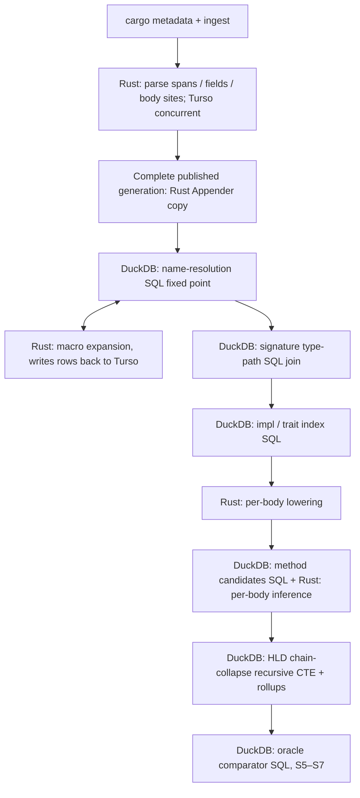

# Executable specs — phase-20261111: HLD for Rust code that compiles

> History. Replaced on 2026-11-13 by `docs/phase-20261111/SPEC-wider-scope-requirements-not-current.md`,
> which keeps every requirement id and test name and states only what is in force. Do not edit or
> cite this file as current.

Status: draft contracts; implementation not yet measured. Source: PRD decisions D1–D6, D-A–D-N.
SPEC owns the executable contracts and M0–M8 ordering; PRD owns product intent; SOP executes the gates.
These three phase-prefixed document basenames are an explicit naming exception. **M** denotes observations,
not targets. All new owned identifiers, columns and artifact basenames use four words.

## 1. Scope and oracle

Map lib + bin targets of workspace members and their normal dependency closure. Do not map test, bench,
example or build-script targets or dev-dependencies. Record proc-macro/build dependency host contexts in the
crate graph for provenance, not as mapped application targets. Proc-macro shapes are the only production
substitute for executing proc macros. Test cfg is OFF; default feature selection is per compilation unit.
The active source closure is files reachable from those targets' module trees under active cfg, including
ordinary file includes and expansions discovered during resolution. Store other .rs files as bytes only.
Inactive items encountered in reached files are counted; unreachable files are not required to parse.
A successful external cargo check does not imply arbitrary repository files parse.

The offline answer key is `oracle-semantic-export-harness`, built from the rust-analyzer commit in §8.
Record its executable digest, source commit, toolchain and configuration. The installed rust-analyzer
1.99.1 (58cf8f9) is NOT the oracle for checkout 2a362a41a. The harness may link ide/hir/salsa and run proc
macros: it is outside Parseltongue's production dependency/process boundary. No LLM or training anywhere.

- PRIMARY: build scripts disabled; proc macros enabled; mapped target/feature/cfg/edition policy identical
  to production, including the --no-test equivalent. Shape comparisons use real proc-macro expansions.
- SECONDARY: identical inputs except build scripts enabled, also with proc macros enabled. Export per-site
  semantic rows, not analysis-stats aggregates. PRIMARY versus SECONDARY identifies the KL1 difference set;
  aggregate timing/statistics cannot attribute individual missing edges.
- Persist path targets, invocation-keyed expansion items/signatures and body sites, impl relations,
  method/call targets, signature type references, and effective visibility/reachability.
  SCIP is optional secondary occurrence evidence only; it does not export these complete semantic relations.
- Oracle source omissions, failed proc-macro loading or unexportable relations BLOCK the affected gate;
  never manufacture agreement or silently remove unsupported oracle sites.

## 2. Executable requirements

Each numbered contract includes its clauses and the normalization/scoring rules in §2.1–2.4.

### REQ-RUST-001.2 — offline graph and process boundary

WHEN production mapping starts, THEN check Cargo.lock exists before metadata, hash it before/after
`cargo metadata --offline`, and reject absence or mutation with CrateGraphLoadError before publishing rows.
Missing dependencies/metadata failure SHALL preserve stderr and publish no graph rows.
Write one crate-dependency-graph-table row per selected package/target plus explicitly tagged dependency
contexts (§1), preserving Cargo package ID/source, target name/kind, root, edition, features, cfg, host/target
role and dependency alias. Alias is not crate identity. Parseltongue's direct children SHALL be only
`cargo metadata --offline`, `rustc --print cfg`, `rustc --print sysroot`; reject other executable requests.
Under the metadata Cargo process only, permit rustc discovery descendants: `rustc -vV` or
`rustc - --crate-name ___` with approved discovery `--print=` flags, exactly the six
`--crate-type` selectors bin/rlib/dylib/cdylib/staticlib/proc-macro, and `-Wwarnings`.
No other flags, real source inputs or output artifacts are permitted. Approved print kinds are
file-names/sysroot/split-debuginfo/crate-name/cfg; version-only `rustc -vV` remains permitted.
Reject every other descendant, including real-crate compilation, build-script binaries and network activity.
The strace audit SHALL reconstruct ancestry and validate full argument vectors, not executable names alone.
SOP S2 scope pagination requires a stable generation, strictly advancing next_offset, has_more=false,
and accumulated entry count equal to scope_total. The per-page scope_truncated flag is informational.
Harness builds/exports, version recording and corpus qualification are outside this allowlist.
Metadata SHALL use a read-only input checkout or equivalent write guard; lock mutation fails before publication
and leaves the original lock bytes intact (test with a writable isolated fixture and restoration guard).

### REQ-RUST-002.0 — bytes and no-op ingest

WHEN any source file is ingested, THEN stored bytes SHALL equal disk bytes, including non-UTF-8 and line endings.
An unchanged content digest SHALL cause zero file-content writes; a new generation may add references/markers.
Bytes-only files SHALL not be parsed or assigned semantic spans.

### REQ-RUST-003.1 — source coverage

WHEN an active-closure file is walked, THEN its flattened ownership partition (item-owned ranges plus classified
gaps) SHALL tile its bytes contiguously without overlap and with zero "other" bytes. Nested semantic spans
may overlap their parents; count bytes once in the ownership partition, not once per nested span.

### REQ-RUST-004.2 — parser boundary

WHEN an active-closure file has a pinned-parser error or non-UTF-8 bytes, THEN stop with
WorkspaceNotCompilingError carrying path and first error/byte offset; do not recover or publish the generation.
The same bytes in an unreachable fixture SHALL be stored only, not reject the workspace.
Pin parser compatibility to the selected toolchain/editions; an incompatibility blocks corpus acceptance.

### REQ-RUST-014.1 — compilation contexts

WHEN a unit is loaded, THEN store cfg/features/edition on that unit, not a universal cfg set.
Use rustc print cfg for the selected target; host proc-macro/build contexts are tagged separately; sysroot
crates use target cfg. Features are package/unit-specific normal-dependency resolution from metadata.
Record the Cargo resolver version and derive selected-unit feature contexts from declared dependency kinds
and metadata, rather than copying one globally unified resolve-node feature list into every target.
The target triple is recorded (host triple by default); an explicit --target argument is permitted only on
the print-cfg command, never to compile. Preserve each unit's own edition and edition-specific prelude.
Cfg(test) is OFF. Inactive items in reached files SHALL be unresolved(cfg_inactive) and counted.
Cfg/edition differences never share semantic rows solely because file bytes match.

### REQ-RUST-015.1 — build-script limitation

WHEN a crate has build.rs, THEN production SHALL neither execute that target nor read saved outputs under
target/ (including symlink escapes). OUT_DIR-dependent includes and unavailable env!/option_env! inputs
SHALL be unresolved(build_script). Populate CARGO_PKG_* and CARGO_MANIFEST_DIR from metadata.
Build-script-only cfg is OFF; count its inactive items as cfg_inactive, with KL1 attribution only when
the paired oracle exports establish that cause. Banner SHALL report build_script counts per crate.
Ordinary non-generated include! files are allowed through file-source-text-table, not target/ reads.

### REQ-RUST-005.1 — paths

WHEN name resolution completes, THEN use-tree and signature-path targets SHALL match PRIMARY in ≥99.5%
of eligible path sites (§2.1). Persist every mismatch, unresolved answer and exclusion with a reason in
oracle-edge-agreement-table. M2 alone excludes-and-reports proc-macro-dependent sites; M3 removes that
temporary exclusion. Unknown proc macros are not a blanket exemption from final coverage.

### REQ-RUST-016.1 — fixed point and module semantics

WHEN resolving a crate, THEN imports and item-position macro expansion SHALL share one fixed point.
Pin the external rust-analyzer constant FIXED_POINT_LIMIT = 8192; our loop permits 8192 changing
macro-expansion rounds, then errors on an attempted 8193rd round with NameResolutionStuckError.
Count progress by newly canonicalized items/bindings, not duplicate writes. Include attribute reseeding.
Publish complete bindings/expanded items per crate atomically; no reader sees an intermediate round.
Implement the module, hygiene, glob and prelude fixtures in §2.3.

### REQ-RUST-006.2 — declarative/built-in expansion

WHEN macro_rules! or built-in macros expand at item/body position, THEN ≥99% of eligible invocations
SHALL match PRIMARY's canonical produced-item and body-site sets. Each expanded item SHALL carry
macro origin, invocation occurrence key and expansion provenance. Ordinary include! files join the closure.

#### Authorized declarative body-macro delivery slice

For this slice, an internal `MacroExpansionFragmentKind` discriminator SHALL have exactly the
`Items`, `Statements`, and `Expression` variants. Item invocations SHALL retain the existing
`SourceFile` parse behavior; statement fragments SHALL use the parser's genuine `MacroStmts`
entrypoint, and expression fragments SHALL use its genuine `Expr` entrypoint. No source wrapper,
synthetic offset, or module boundary may be added around an expansion.

The visitor SHALL classify direct item-list calls as `Items`, block statement invocations as
`Statements` (including expression-statement macros where the AST establishes statement context),
and initializer, argument, and tail-expression `MacroExpr` calls as `Expression`. `MacroType` and
`MacroPat` positions SHALL remain deferred. Expanded body-site rows SHALL preserve exact source byte
ranges/text, owner occurrence identity, provenance, token-origin mapping, and an explicit link to
the originating invocation. Ownerless sites SHALL inherit the enclosing body owner derived using
the same syntax-occurrence fields as `build_syntax_occurrence_key`; an AST-local item owner SHALL
take precedence. Nested calls in generated function bodies SHALL retain their immediate invocation
identity and a provenance chain connecting the outer invocation.

Body expansions SHALL use `body-site-reference-table` and its existing `name-resolution` write
allowance, plus the existing macro-expansion evidence table; no parallel expansion engine or table
is allowed. Fragment kind and invocation identity SHALL be persisted in existing expansion
evidence. Expanded local items/imports SHALL remain in the invocation block's lexical scope, and
generated local items SHALL own their own body-site rows. Resolution targets SHALL remain pending;
this slice SHALL NOT perform type inference. Built-in expression expansion remains unavailable for
the separate follow-up, while existing `include!` behavior SHALL not regress.

Focused executable test mapping for this delivery slice:

| req_id | test_id | test_type | persisted assertion |
| --- | --- | --- | --- |
| REQ-RUST-006.2 | `test_macro_rules_items_match` | CLI integration | Exact structured set of item/body invocation identities, fragment kinds, generated items, provenance, and token-origin rows. |
| REQ-RUST-006.2 | `test_body_macro_sites_match` | CLI integration | Exact structured set of nested body-site kind/range/text/owner/invocation/provenance tuples and origin rows. |
| REQ-RUST-006.2 | `test_body_fragment_context_routing` | CLI integration | Initializer and tail calls are expressions; direct block macros use statements; no fabricated sites. |
| REQ-RUST-006.2 | `test_generated_function_owner_identity` | CLI integration | Exact nested invocation identity and chain; generated FN owner is hashed from the expected virtual source path, range, kind, and parent chain. |
| REQ-RUST-006.2 | `test_local_scope_binding_isolation` | CLI integration | Every matching local_function and LocalMarker item/import shares the expected non-module block scope; no matching binding is at module scope. |
| REQ-RUST-006.2 | `test_nested_macro_token_origins` | CLI integration | Nested $crate retains its definition-crate origin through expansion; a simple identifier argument maps to its nested invocation virtual-source range. |
| REQ-RUST-006.2 | `test_legacy_macro_shadow_restoration` | CLI integration | Before-definition lookup remains unresolved; local shadow is selected and outer binding is restored. |
| REQ-RUST-006.2 | `test_macro_output_rerun_determinism` | CLI integration | Stable-input reruns yield the same sorted persisted structured sets. |
| REQ-RUST-006.2 | `test_malformed_fragment_publication_rollback` | CLI integration | Malformed fragment emits no failed completion/output and preserves the previous publication. |
| REQ-RUST-006.2 | `test_deferred_macro_position_retention` | CLI integration | Type/pattern invocations remain unexpanded; resolution is not inferred. |

### REQ-RUST-013.1 — proc-macro shapes

WHEN an invocation matches proc-macro-shape-table by Cargo package ID/version and macro name, THEN
its (kind, name, normalized signature) set SHALL equal PRIMARY's real expansion for 100% of matching
invocations, not just one example per shape row. Each shape row SHALL have a fixture exercising it.
Unknown macro/version SHALL be unresolved(proc_macro), not guessed. Store the checked-in shape data
as proc-macro-shape-records.toml and load it into its declared table at generation start.

### REQ-RUST-017.1 — lang items and incoherent impls

WHEN sysroot sources are resolved, THEN lang-item-definition-table SHALL contain every recognized
lang item present in the selected sysroot. M: the pinned lang_item.rs declaration has 169 sym rows;
this is a source observation, not a required sysroot count.
Include primitive and permitted incoherent inherent impls using rust-analyzer's type-attribute flag and
sysroot-origin search; distinguish rustc_has_incoherent_inherent_impls from rustc_allow_incoherent_impl.
Index population is tested at M2/M4 as available; primitive method lookup is tested at M5.

### REQ-RUST-018.1 — signatures and impls

WHEN signatures/impl headers are lowered, THEN every type path SHALL be resolved or carry one reason.
Canonical uses_type/implements relations SHALL match PRIMARY at ≥99.5% (§2.1); persist all disagreements.

### REQ-RUST-007.2 — site precision

WHEN an extracted call/method site is compared, THEN method-call target precision SHALL be ≥99%.
Count wrong or missing PRIMARY targets for extracted sites as incorrect; do not excuse an extracted guess
using a reason. Every unresolved site SHALL carry exactly one §2.2 reason. Compare ordinary call targets
as well, reporting their precision separately; method-call precision is this requirement's threshold.

### REQ-RUST-008.1 — mandatory final coverage

WHEN each selected inference sub-step finishes, THEN report method-call coverage. At M8, coverage after
the last selected sub-step SHALL be ≥95% on each of the five repos. M7 may be skipped only when 7b
already meets that gate on all five; skipping it does not remove the M8 gate.

### REQ-RUST-019.1 — D6 nodes and reexports

Superseded 2026-11-13 by REQ-RUST-019.2 (full graph first). Kept for history; its reexport and
reachability sentences still apply; "Private uses are evidence only" and "No use statement becomes a
node" do not.

WHEN nodes are selected, THEN use effective item visibility (§2.4), not only explicit pub syntax:
file-top-level, inline-module and top-level impl/trait associated items usable by another file qualify.
Items inside fn bodies never qualify. Private uses are evidence only; restricted/public uses create one
reexports edge per resolved exported binding (aliases/globs included), sourced at the nearest enclosing
selected module (the containing module when it qualifies, otherwise its nearest qualifying ancestor).
The implicit crate-root module is externally addressable and qualifies as the root module node; retain the
lexical reexporting module in evidence even when it is private. No use statement becomes a node.
Store node_reachable_outside_crate from complete module/reexport reachability, including private parents.

### REQ-RUST-009.2 — extracted HLD and collapse

WHEN HLD is built, THEN each edge connects selected nodes or a selected node and a canonical external item,
has extracted status only, and collapsed rows name their complete private evidence chain(s).
Apply §2.4's cycle/diamond/self-edge rules. Unresolved intermediate links SHALL not yield extracted edges.
File/folder roll-ups SHALL equal the deduplicated HLD aggregation for the published generation.

### REQ-RUST-010.2 — dependency boundary

WHEN the production binary is built, THEN cargo tree SHALL contain no ra_ap_hir*, ra_ap_ide*,
ra_ap_base_db or salsa; parseltongue-core-row-types SHALL have zero dependencies.
Copy-adapt mbe into parseltongue-port-macro-expander (L2); never link unchanged mbe with its salsa
dependency. If span is needed, link it with default-features = false and verify the full dependency tree.
Offline harness ide/hir/salsa dependencies SHALL not leak into the production binary.

### REQ-RUST-020.1 — generations and stage isolation

WHEN a stage runs, THEN read only declared tables and rewrite only its generation's declared outputs.
Rows and markers SHALL carry run_generation_digest_value (§3.2); reject missing, stale or incompatible
input markers with StageInputMissingError. Identical inputs yield identical semantic output rows, excluding
operational timing/counter metadata. Shared library rows use the same compatibility key.
A new generation is invisible until atomically published; beginning a rerun invalidates its staging completion,
not the previously published generation. No cross-database partial generation may become visible.

### REQ-RUST-021.1 — concurrency

WHEN N workers write, THEN use Turso BEGIN CONCURRENT per unit, permit at most N units in flight,
and preserve exactly the 1-worker row set/digest. Retry a conflict at most 5 times after the initial attempt
(6 total attempts), with delays 10, 20, 40, 80, 160 ms; rollback and reread/recompute on retry.
Only conflict errors retry; other errors surface immediately. Exhaustion returns StoreWriteConflictError.
Cancellation interrupts backoff. No unbounded queues or cross-unit memory retention.

### REQ-RUST-022.1 — cancellation

WHEN Ctrl-C/SIGTERM interrupts a stage, THEN rollback any uncommitted unit, publish no partial unit
or new generation, and leave no completed marker for the interrupted staging stage.
Already committed staging units may be reused only under the same compatibility key.
Rerun SHALL equal an uninterrupted run. A previously published generation remains readable and immutable.

### REQ-RUST-011.1 — memory

WHEN mapping rust-analyzer plus its selected library roots, THEN peak simultaneous summed resident memory
of the production process tree SHALL be ≤2 GiB (2 × 1024³ bytes). Include allowed child processes, exclude
offline harness/indexers; record process-tree samples and cgroup memory telemetry, not just parent time -v RSS.
Sample summed RSS every 10 ms and record short-lived child peaks with OS accounting; report sampling limits.
The gate uses the larger observed process-tree RSS peak, converted from bytes to GiB, not cgroup page-cache usage.

### REQ-RUST-012.1 — determinism

WHEN the same source/config/tool compatibility key is mapped twice with 1, 4 and 16 workers, THEN sorted
semantic exports SHALL be byte-identical. Compare stable occurrence IDs and HLD including evidence counts;
exclude timings. Collision fixtures SHALL not merge unrelated semantic occurrences.

### 2.1 Matching and scoring

Normalize by workspace-relative or package-source-relative paths, UTF-8 byte ranges, compilation-unit key,
site kind and deterministic expansion provenance/invocation key. External targets use package source ID,
target name/kind and qualified item path, not crate@version alone. Align harness and production keys
before scoring. Duplicate occurrences collapse by this key; different compilation units never collapse.

- 005: numerator = exact target matches; denominator = eligible PRIMARY use/signature path sites.
  Missing/unresolved production answers count as nonmatches.
- 006: numerator = invocations with equal canonical item tuples AND body-site tuples; denominator =
  eligible PRIMARY declarative/built-in invocations. Compare sets sorted by provenance and occurrence;
  a missing expansion is a nonmatch. Body tuples include site kind, range/provenance and callee syntax;
  resolved call targets are scored by 007, not required to finish the M2 expansion gate.
- 013: numerator = matching invocation item/signature sets; denominator = all matching-shape PRIMARY
  invocations. Require a nonempty fixture for every shape row, including versions, plus the unknown-version case.
- 018: numerator = exact canonical relation tuples present in both; denominator = union of PRIMARY and
  extracted production signature/impl relation tuples. This penalizes both missing and extra relations.
- 007: numerator = correctly targeted extracted method sites; denominator = all extracted method sites.
  A site absent from PRIMARY but emitted as extracted counts as incorrect.
- 008: numerator = correctly targeted extracted method sites; denominator = eligible PRIMARY method sites.
  A wrong extracted answer does not increase coverage.
- 019: numerator = nodes with correct selection/effective visibility/reachability; denominator = union of
  PRIMARY and production candidate occurrence keys; require 100%, including correct rejection cases.

Eligibility excludes inactive cfg and source absent under PRIMARY's KL1 limitation; record each exclusion with
oracle evidence. PRIMARY-visible unknown_receiver, trait_solver_needed, proc_macro and external_source_missing
remain coverage/path failures as applicable, not removed denominators. Secondary-only sites are recorded
in the KL1 difference set and excluded from PRIMARY denominators. No exception for known oracle errors:
those block the gate. M2's temporary proc-macro exclusion is separately counted and ends at M3.
Compute every gate per repository, never pool the five to hide a failure. Empty denominator = N/A, not 100%;
corpus gates require at least one eligible observation per metric/repo or are BLOCKED. Empty fixture cases
assert zero rows without claiming percentage success. Report raw numerator, denominator, exclusions and rate.

### 2.2 Authoritative unresolved reasons

SiteUnresolvedReasonKind is the only reason enum for all stages; enum values remain exempt from naming.
Exactly one primary reason per unresolved site; select the earliest causal blocker in this precedence:
cfg_inactive → build_script → proc_macro → external_source_missing → unknown_receiver → trait_solver_needed.
Store additional causal evidence separately, not additional primary reasons.

- cfg_inactive: outside active analysis; counted, excluded from PRIMARY denominators.
- build_script: unavailable generated source/env; KL1 exemption requires a matched PRIMARY/SECONDARY diff.
  If PRIMARY exposes the site anyway, unresolved production remains a nonmatch.
- proc_macro: unknown/unsupported shape; counted, remains a nonmatch when PRIMARY exposes the site.
- external_source_missing: counted; gate BLOCKED if the required oracle source is missing too,
  otherwise unresolved production counts as a nonmatch.
- unknown_receiver: counted; unresolved production is a nonmatch, not an exception.
- trait_solver_needed: counted; unresolved production is a nonmatch, not an exception.

### 2.3 Required resolution fixtures

Each fixture has a normal, empty/inactive and conflicting/error case under test_module_resolution_fixture_rules.

- #[path] and nested modules: resolve relative to the declaring module's directory, including inline-module
  path rules; cfg_attr is evaluated before module discovery. Store reached ordinary files in the closure.
- include!: resolve relative to the invocation's source file, preserve included-file provenance and hygiene;
  nested includes join the closure. include_str!/include_bytes! read bytes only. Never follow target/ output.
- Hygiene: persist syntax contexts, definition/call-site provenance and $crate's defining crate; test
  identical macro text invoked in two crates without binding leakage.
- Globs/aliases: fixed point with explicit-import precedence, namespace separation and ambiguity detection;
  ambiguous bindings cannot become extracted targets. Reexports enumerate resolved exported bindings.
- Extern prelude: edition-specific 2015/2018/2021/2024 rules, renamed dependencies, no_std/no_core and
  implicit std/core/prelude suppression. Tests include multiple versions and identical names from distinct sources.
- Target/context fixtures: lib+bin sharing one file, differing features/cfg, host proc-macro context,
  sysroot target cfg, test cfg OFF and excluded dev/test/bench/example targets.

### 2.4 Visibility and collapse rules

Private-equivalent restrictions such as pub(self) do not qualify as non-private visibility.
Effective visibility follows Rust item-kind semantics: trait members and trait-impl members inherit their
trait/interface visibility; enum variants inherit enum visibility; inherent members use declared restrictions.
A node's local visibility is distinct from external reachability through ancestor modules and reexport aliases.
Fn-body ancestry always excludes nodes, including inline modules nested in a body.
The exporter and tests compare the same item-kind visibility model. Do not infer external reachability from pub alone.
Reexports use REQ 019's nearest selected enclosing module/root endpoint and retain the lexical module in evidence.

Emit direct resolved relations first. For each selected source, traverse resolved evidence through private
items, stopping at the first selected/external target; retain the terminal relation kind for collapsed edges.
Use visited occurrence keys per path to stop cycles; enumerate canonical simple paths in sorted order.
Keep one HLD row per (generation, source, target, relation kind, via kind); retain each distinct evidence path
and count unique evidence-row keys across those paths. Diamonds merge the HLD row, not provenance.
Retain genuine direct/finite-path self-edges once; never invent a self-edge from a cycle alone.
An unresolved link stops that path without an extracted successor. Roll-ups count HLD rows, not path multiplicity.

## 3. Rust design and persisted interfaces

### 3.1 Layers and stages

L1 parseltongue-core-row-types owns four-word ID/row/error types and has zero dependencies.
L2 contains parseltongue-table-store-traits, parseltongue-stage-worker-scheduler,
parseltongue-port-name-resolver, parseltongue-port-macro-expander,
parseltongue-port-signature-lowerer, parseltongue-port-body-inferencer and parseltongue-hld-edge-builder.
L2 accesses external storage/parser/cargo only through traits; copy-adapted pure macro algorithms are an
explicit L2 library dependency, not a hosted analysis engine.
L3 contains parseltongue-turso-store-adapter, parseltongue-syntax-span-extractor,
parseltongue-crate-graph-loader and (M7) parseltongue-trait-solver-adapter.
parseltongue-cli-dispatcher-binary wires adapters; parseltongue-oracle-edge-differ consumes harness files offline.

Stage interfaces are the PRD §5 table inventory. Stages 4+5 are one crate fixed point, with macro expansion
a library call inside it; expression expansion is also called inside stage 7. Stage 8 is deliberately merged
into stages 6/7: they write edge-evidence-record-table directly. There is no unpersisted inter-stage site handoff.
Stage-local per-body lowering may exist in memory, but nothing is retained across stages/units.
Expanded semantic spans are written by the combined resolver or body-inference unit, with provenance.
Per-crate read caching requires a measured budget miss and a recorded decision, never a cross-stage cache.

### 3.2 Identity, columns and generations

SpanDigestIdValue is a 16-byte truncated CONTENT identity only. Retain its complete 32-byte BLAKE3 digest
and canonical digest inputs; on truncation collision, preserve both full-digest records, never alias them.
SemanticOccurrenceKeyValue identifies (compilation unit, normalized file path, byte range, full content
digest, expansion provenance/invocation chain). Source bytes alone never identify a semantic occurrence.
CrateDenseIndexValue is assigned by sorted Cargo package ID + target name/kind + host/target context,
not sorted name/version alone. Alias is an edge property. Stable full semantic keys survive dense-ID rebuilding.
RunGenerationDigestValue hashes source snapshot digest, normalized per-unit configuration and tool versions
(including parser, shapes and schema). Identical inputs may reuse a generation; operational attempts are separate.
Source snapshots cover immutable input roots and lockfiles, excluding .git, target/ and oracle output locations.
An identical-key rerun uses a separate staging attempt; it never overwrites the immutable published attempt.
Publication selects that completed attempt, while deterministic semantic exports omit the attempt sequence.

Owned row fields/SQL columns (four semantic words, underscores in code; hyphens in artifact names):

```text
run_generation_digest_value: compatibility key on every semantic row and marker
stage_attempt_sequence_value: operational staging attempt, excluded from semantic identity/export
stage_unit_work_key: atomic file/crate/body work-unit identity
stage_input_generation_keys: exact compatible upstream generations
stage_owned_table_names: declared stage input/output table inventory
unit_cargo_package_identifier: full Cargo package ID, including source
unit_cargo_target_name: Cargo target name
unit_cargo_target_kind: lib/bin or explicitly tagged host dependency context
unit_dependency_alias_text: dependency edge's local alias
unit_target_cfg_values: normalized cfg set
unit_enabled_feature_names: normalized per-unit feature set
unit_rust_edition_value: selected edition
unit_compilation_role_kind: host or target
unit_source_root_path: normalized immutable source root
file_source_relative_path: normalized source-root-relative path
file_source_content_bytes: byte-exact input bytes
file_content_digest_full: complete BLAKE3 file digest
file_dependency_origin_kind: workspace/std/external source classification
span_content_digest_full: complete 32-byte content identity
span_semantic_occurrence_key: context-qualified occurrence
span_source_file_path: source-root-relative occurrence path
span_item_kind_value: parsed item kind
span_declared_visibility_kind: explicit syntax visibility
span_byte_start_offset: inclusive byte offset
span_byte_end_offset: exclusive byte offset
span_macro_invocation_key: invocation semantic occurrence
span_expansion_provenance_chain: syntax context and invocation ancestry
node_reachable_outside_crate: external reachability, yes/no
node_effective_visibility_scope: item-kind visibility after restrictions
site_unresolved_reason_kind: exactly one authoritative causal blocker
site_callee_syntax_text: expanded call's syntactic callee, separate from its resolved target
oracle_primary_target_reference: PRIMARY semantic target
oracle_secondary_target_reference: SECONDARY semantic target, if present
oracle_comparison_outcome_kind: match/mismatch/unresolved/excluded observation
oracle_semantic_record_kind: path/expansion/impl/call/signature/visibility observation
edge_source_occurrence_key: selected source occurrence
edge_target_reference_value: selected/external canonical target
edge_source_signature_text: assembled source signature
edge_target_signature_text: assembled target signature
edge_source_qualified_path: source path in compilation context
edge_target_qualified_path: canonical target path including package source/target
edge_relation_kind_value: calls/uses_type/implements/reexports/contains/derives/imports/reads (REQ-RUST-030.1)
edge_collapse_via_kind: direct/collapsed
edge_evidence_row_count: unique supporting evidence rows
edge_dependency_origin_kind: same_crate/workspace_crate/std/external_crate
edge_resolution_status_kind: extracted for HLD, unresolved allowed in evidence
stage_publication_state_kind: staging/complete/published
```

Use the above names in schemas; do not reintroduce short aliases in proposed owned structs.
SpanByteRangeValue rejects end before start. EdgeTargetReferenceValue carries semantic keys, not content IDs.
SiteUnresolvedReasonKind and BodySiteResolutionOutcome distinguish extracted and one-reason unresolved data.

stage-run-generation-records stores generation, stage/unit completion and publication manifests.
Workspace staging writes and shared-library staging writes are invisible. Commit immutable compatible library
rows first, then atomically switch the workspace publication manifest referencing those exact library generations.
Readers pin that manifest; library garbage collection cannot delete referenced generations. No distributed
transaction is assumed: library-first failures leave unreachable rows, not a partially published workspace.
A crate fixed point atomically publishes its bindings, spans and expansion rows within the staging generation.
A downstream stage requires the exact upstream generation/unit completion, not mere table existence.

### 3.3 Trait seams and errors

```text
CrateGraphReadStore: read_crate_dependency_rows, read_unit_dependency_rows
SpanRowReadStore: read_file_span_rows, read_crate_span_rows, read_span_by_digest
FieldDetailReadStore: read_span_field_rows
BodySiteReadStore: read_body_site_rows
ScopeBindingReadStore: resolve_module_name_target
ImplHeaderLookupIndex: read_self_impl_rows, read_trait_impl_rows
LangItemReadStore: read_named_lang_item
ProcMacroShapeLookup: read_macro_shape_rows
StageRowWriteSink: write_stage_unit_rows
StageRunMarkerStore: begin_stage_generation_write, complete_stage_generation_write,
                     check_stage_generation_complete, publish_workspace_generation_manifest
```

Closure-discovery requests are persisted work records in stage-run-generation-records; ingest/walker
complete those records before the crate fixed point resumes. No file request exists only in memory
across stage boundaries. Stage markers distinguish a complete discovery batch from final closure completion.
Every lookup is generation/context-qualified; span lookup takes full digest plus occurrence context.
Typed boundaries: CrateGraphLoadError, WorkspaceNotCompilingError, NameResolutionStuckError,
StageInputMissingError, StoreWriteConflictError, StoreBackendFailureError. Unresolved rows are data,
not fatal errors. Missing module/include files or ambiguous compiler-invalid inputs produce
WorkspaceNotCompilingError; unsupported but compiling semantics produce a counted reason, never a guess.

### 3.4 Turso and cancellation

Pin turso =0.9.0-pre.5. M: crates.io reports stable 0.8.3 and max prerelease 0.9.0-pre.5.
The inspected prerelease has async query/execute/prepare/build and TransactionBehavior::Concurrent.
parseltongue-turso-store-adapter owns a runtime and exposes synchronous traits; L2 holds no lock across await.
Use one connection/transaction per unit and the exact REQ 021 retry schedule; verify MVCC under 1/4/16 workers.
API availability is source-verified; throughput and conflict behavior are not yet measured.
A shared RunCancelFlagValue interrupts unit work/backoff; rollback before releasing an interrupted unit.

## 4. Requirement → test → SOP crosswalk

All names below have four words after test_. S3 includes a separate fixture/build suite, so negative tests
do not mutate corpus checkouts. S5 percentages use §2.1; S6–S9 cross-checks do not override PRIMARY.
Every entry names a clause assertion, not merely a requirement-level coverage claim.

```text
001 → S3
  test_crate_graph_offline_only: selected package/target fields, aliases, direct/descendant argument allowlists.
  test_lockfile_guard_preserves_bytes: absent lock rejects before spawn; mutation rejects and restores bytes.
  test_metadata_failure_writes_nothing: missing download/nonzero exit preserves stderr, publishes zero rows.
002 → S3
  test_ingest_bytes_stay_identical: random bytes including invalid UTF-8/newlines stored unchanged.
  test_unchanged_digest_skips_write: unchanged bytes write zero content rows; new marker allowed.
003 → S3
  test_span_gap_tiling_identity: nested spans flatten to one exact ownership partition; empty file valid.
004 → S3
  test_parse_error_stops_run: active error rejects with path, no publication.
  test_non_utf8_stops_run: active invalid bytes include offset; bytes-only fixture does not reject.
014 → S3
  test_cfg_from_rustc_print: per-unit features/cfg/edition, host/target and sysroot contexts agree.
    Include resolver-version/normal-dependency feature isolation and print-only target arguments.
  test_inactive_cfg_items_counted: test cfg OFF, inactive reached items counted; unreachable files bytes-only.
015 → S3, S4, S5
  test_build_script_never_executed: exec/read audit forbids scripts and target reads, including symlinks.
  test_out_dir_include_unresolved: generated include and unknown env/option_env get build_script.
  test_cargo_env_from_metadata: metadata env values; build-only cfg OFF; per-crate banner reasons exact.
005 → S4, S5
  test_nameres_matches_oracle_paths: per-repo formula, absent answers and M2 exclusions.
  test_oracle_disagreements_keep_reasons: every mismatch/unresolved/exclusion persisted; oracle missing blocks.
016 → S3, S5
  test_macro_import_fixed_point: generated use resolves inside same crate publication.
  test_fixed_point_limit_errors: 8192 changing rounds allowed, attempted 8193 errors.
  test_module_resolution_fixture_rules: all §2.3 normal/inactive/error variants.
006 → S4, S5
  test_macro_rules_items_match: item/body invocation sets and origin/invocation provenance.
  test_body_macro_sites_match: nested body expansions and matched call-site tuples.
029 → S4
  test_raw_macro_expansion_bytes: resolved FnLike declarative call, independent canonical bytes and ordered emitted-token intervals.
  test_macro_token_origin_positions: duplicate output occurrences retain separate positions and source span/context origins.
  test_expr_invisible_group_topology: real expression topology plus an isolated nested-invisible renderer proof preserve topology while flattening only invisible delimiters.
  test_joint_hidden_spacing_preserved: isolated raw-TT renderer proof asserts Joint and JointHidden event paths, intervals, spacing, and input spans.
  test_unicode_output_byte_ranges: UTF-8 canonical and source ranges use exact byte offsets.
  test_macro_token_limit_boundary: exact 2,097,152-token boundary accepted and boundary-plus-one rejected without large allocation.
  test_macro_expansion_error_typed: unmatched declarative rule preserves a typed expansion error.
013 → S4, S5
  test_macro_shapes_match_oracle: every invocation, each shape exercised, version/signature diff on failure.
  test_unknown_proc_macro_unresolved: absent shape/version produces one proc_macro reason.
017 → S3, S5
  test_lang_items_in_sysroot: recognized present items found, not hard-coded to 169.
  test_incoherent_impl_headers_indexed: M4 indexes sysroot primitive/flagged-type impls.
  test_incoherent_primitive_impls_indexed: M5 resolves f32::abs and str::len through the index.
018 → S4, S5
  test_signature_edges_match_oracle: resolved-or-reason type paths; union-denominator signature/impl agreement.
007 → S4, S5, S7
  test_method_target_precision_oracle: site-level ≥99%, extra/wrong sites penalized; calls reported separately.
  test_unresolved_has_one_reason: exact enum/precedence, unknown_receiver and build_script included.
008 → S3, S5, S10
  test_method_coverage_per_substep: report selected steps, mandatory ≥95% at M8, M7-skip case.
019 → S5, S9
  test_body_items_never_nodes: body ancestry rejects even pub nested modules.
  test_effective_visibility_node_selection: positive/negative item kinds and restricted visibility.
  test_pub_use_reexport_edge: aliases/globs one edge per binding, nearest selected module/root endpoints.
  test_reachable_outside_crate_flag: private parents and public reexports agree with PRIMARY.
009 → S6, S8, S9
  test_hld_rows_connect_nodes: selected/external endpoints, extracted-only status.
  test_private_chain_collapse_rules: cycles/diamonds/self-edges, unresolved stop, complete provenance/counts.
  test_hld_rollup_counts_match: file/folder aggregates match deduplicated HLD.
010 → S3
  test_no_analysis_crates_linked: production tree forbids ide/hir/base_db/salsa; L1 zero deps.
  test_macro_dependencies_exclude_salsa: copied mbe + optional span default-features=false has no salsa.
020 → S3
  test_stage_rerun_is_identical: stage outputs stable under same compatibility key.
  test_stage_refuses_missing_input: missing/stale/incompatible marker rejects.
  test_stage_table_access_restricted: spy-store rejects undeclared reads/writes.
  test_generation_publication_is_atomic: shared DB/library-first crash cases preserve old manifest.
021 → S3, S10
  test_concurrent_writers_lose_nothing: N=1/4/16 rows/digests equal.
  test_conflict_retry_is_bounded: six attempts, exact delays, nonconflicts not retried, cancellation interrupts.
  test_in_flight_units_bounded: observed maximum ≤N.
022 → S3
  test_cancel_then_rerun_identical: cancel within/between units, rerun equals clean.
  test_cancel_publication_stays_consistent: no partial reader visibility/completed staging marker.
011 → S10
  test_peak_memory_within_budget: process-tree peak ≤2 GiB, telemetry and limits recorded.
012 → S3, S10
  test_hld_export_is_deterministic: two runs per N=1/4/16, stable sorted semantic export.
  test_semantic_identity_collision_safety: forced truncation collisions, same bytes/different paths/contexts.
  test_oracle_matching_empty_cases: §2.1 empty/N/A, duplicate keys and per-repo aggregation.
009/019/020 → S6, S7, S8, S9
  test_crosscheck_evidence_never_overrules: CM-GAP cannot excuse oracle error; coverage pagination complete.
  test_sample_rows_record_keys: zero/small/large samples, explicit seed, every sampled miss fails.
028 → test-harness-only; no SOP/corpus execution
  test_child_stderr_live_visibility: diagnostic bytes are readable while the controlled child is blocked and alive.
  test_child_output_exit_preservation: fixture stdout/stderr payload bytes and nonzero exit status are preserved.
  test_child_spawn_error_propagation: spawn errors remain observable at the test-helper boundary.
  test_child_output_read_error: output-file read errors are returned after the child is reaped.
  test_child_fixture_waits_release: ignored subprocess fixture used by live-visibility, exit-preservation, and output-read cases.
```

Build gates: cargo fmt --check; cargo clippy --all-targets -- -D warnings; cargo test;
cargo build --release; production cargo tree. Oracle corpus suite is separate/ignored plus nightly,
never linked into production. S1/S2 are external-tool preconditions/coverage checks, not semantic requirements.

## 5. Implementation plan — authoritative M0–M8

Development order (2026-11-13): Phase 1 is the single pinned itoa library in
[SOP §1.1](SOP-phase-20261111-hld-current-e2e-test.md#11-phase-1--one-small-repeatedly-tested-hld-current-benchmark)
and [phase-one-benchmark-pin.json](phase-one-benchmark-pin.json).
Construct and independently verify its expected full-item-dependency-graph, and the HLD
derived from it, from source before production comparison, then repeatedly test each
available stage against that frozen reference.
The scoped expected node/edge sets, evidence and roll-ups require exact agreement;
REQ-RUST-009.2/012.1/019.2/020.1/032.0 apply (019.2 replaced 019.1 on 2026-11-13). A future stage is NOT STARTED,
not a passing empty table. This revision specifies a benchmark procedure, not
implemented runner support, a completed expected graph, or a passing run.

Phase 2 retains the original five-repository corpus, scored serde first, then
rust-analyzer, ripgrep, tokio and cargo-modules. M0–M8 completion and release gates
remain all-five; a Phase 1 benchmark PASS is separately named and does not satisfy
them. Optional model review remains non-authoritative under REQ-RUST-025.0.
The Phase 1 reference must account for the entire selected library and active
macro expansions, but not recursively enumerate external sysroot internals.
No proc-macro-shape result may be inferred from itoa with `no-panic` disabled.

- M0: workspace skeleton, L1 IDs/errors, fake store, dependency gates, pinned oracle harness/build manifest.
  RED: 010, identity fixtures under 012; no final HLD export expected yet.
- M1: graph/ingest/parser, Turso runtime, generation markers, scheduler.
  RED: 001–004, 014–015, 020–022; measure write throughput at 1/4/16 and publish file/span counts.
- M2: combined name-resolution/macro fixed point, built-ins, lang-item discovery.
  RED: 005, 006, 016, lang-item clause of 017. Proc-macro-dependent sites excluded-and-reported only here.
- M3: proc-macro shapes for serde, salsa, thiserror, tokio main/test and corpus derives.
  RED: 013; rerun 005/006 without M2's temporary exclusion.
- M4: signatures and impl index. RED: 018, test_incoherent_impl_headers_indexed.
- M5: body 7a, locals/inherent methods/autoderef. RED: 007 and 017 primitive lookup; report 008.
- M6: body 7b, traits in scope. Gate 007, report 008; all five ≥95% permits skipping M7.
- M7: optional 7c solver adapter; gate 007/010 and report 008.
- M8: HLD/collapse/roll-ups/banner. RED: 009/019/011/012; mandatory final 008 and all contracts green.

Owned milestone fixture gates run when their component exists; 012 identity fixtures start M0, final export
determinism starts M8. §4's future clauses are not required to pass before their milestone.
Use SOP §3 subsets at intermediate milestones, full S1–S10 on all five at M8/releases.
Record measured results as M; a proposed test is not a passed test.

## 6. Quality gate results

Documentation contracts only. Runtime tests/builds are not claimed executed; no implementation is supplied here.
Clause-level planned coverage is enumerated in §4. Naming/fence/stale-reference checks are documentation gates.

## 7. Resolved decisions and remaining measurements

Q1 resolved: turso =0.9.0-pre.5 async; L3 owns runtime, L2 sync. Stable observed: 0.8.3.
Q2 resolved: copy-adapt mbe; span only with default-features=false; production no-salsa dependency gate.
Q3 resolved: proc-macro-shape-records.toml feeds proc-macro-shape-table; invocation fixtures validate each row.
Q4 resolved: Phase 1 lib+bin, default features, test cfg OFF; test-enabled runs are a Phase 2 option.
Remaining measurements: corpus commit pins at M1, oracle executable digest after build, throughput/conflict
behavior and process-tree RSS. None is fabricated as an observed result.

## 8. Repositories we take from

Modes: copy-adapt keeps upstream headers and rewires inputs to tables; link-pinned uses an exact published
version; rewrite-from follows structure without copying; oracle runs offline outside production; idea-only
copies/links no code; tooling is for agents, never part of production. Record full chosen hashes before gates.

### Rust analysis sources

Repository: https://github.com/rust-lang/rust-analyzer
License: MIT OR Apache-2.0.
Pinned parser/oracle source: upstream 2a362a41 + patch bf6b2099d6351c37039b01447a9bb64f9a54a586.
Full upstream base: 2a362a41a8eb6e090f1a12d9b712df85af6f0c33.
The minimal opt_item grammar patch routes statement-position const move/pipe closures
to expression parsing, retaining source tokens. Upstream-style success/error snapshots
are included. Reviewable patch: tools/parser-const-closure-statements.patch.
Reproducible fork object: tools/parser-source-fork-bundle.bundle (base prerequisite).
After cloning upstream, fetch that bundle's HEAD and detach at the full patch hash.
The parser and oracle manifests require this same clean commit.
The earlier nameres/MBe copy-adaptations retain their recorded 6e37b2d62127d445d77069031b416c48c9b0b4f2 origin.
- Copy-adapt crates/hir-def/src/nameres/ collector/path resolution into the crate fixed point.
- Copy-adapt crates/mbe/src/ expander/transcriber without salsa; crates/hir-expand/src/builtin/
  fn_macro.rs, attr_macro.rs and derives; lang_item.rs recognized lang-item names.
- Rewrite-from hir-def/src/expr_store/lower.rs; hir-ty/src/lower.rs, infer/, method_resolution.rs,
  next_solver/interner.rs; project-model/ process/input handling; ide-db/src/prime_caches.rs scheduling.
- Link syntax/parser directly from the exact clean oracle checkout, with ra-ap-rustc_lexer 0.180.
  parser-source-pin-manifest.json and a shared build-time verifier enforce the source pin.
  M: registry 0.0.362 and the earlier checkout both reject Rust 1.99 final associated functions;
  the new checkout's grammar accepts them. Do not rewrite tokens to compensate.
- Build oracle-semantic-export-harness from this exact checkout with its ide/hir crates.
  Record executable digest/build manifest after build; the installed 58cf8f9 binary is not substituted.
- Never link ra_ap_hir*, ra_ap_ide*, ra_ap_base_db, salsa or the proc-macro server into production.
  Offline oracle dependencies are a separate build target, not an exception to production's cargo-tree gate.

Repository: https://github.com/rust-lang/rust
License: MIT OR Apache-2.0.
Solver source/version pin: at M7, compatible with the pinned rust-analyzer solver interface.
- Link-pinned ra-ap-rustc_type_ir / ra-ap-rustc_next_trait_solver only at M7.
- Input: toolchain library/ sources (core/alloc/std), found through rustc --print sysroot, parsed not compiled.
  Record toolchain/source hashes and target cfg; missing matching sources block affected gates.

### Database and support sources

Repository: https://github.com/tursodatabase/turso
License: MIT.
Pinned crate: turso =0.9.0-pre.5 (stable observed 0.8.3).
Mode: link-pinned; only database engine; async L3 runtime and BEGIN CONCURRENT / MVCC.
Source evidence: https://docs.rs/crate/turso/0.9.0-pre.5/source/src/connection.rs
and https://docs.rs/crate/turso/0.9.0-pre.5/source/src/transaction.rs.
Version evidence: https://crates.io/api/v1/crates/turso.
Write throughput/conflict correctness remains a measurement gate, not established by API inspection.

Repository: https://github.com/oli-obk/cargo_metadata
License: MIT.
Mode: link-pinned at M0; typed cargo metadata --offline JSON.
M: registry observations 0.19.2 and 0.23.1; chosen exact version is recorded before use.

Repository: https://github.com/BLAKE3-team/BLAKE3
License: CC0 / Apache-2.0.
Mode: link-pinned at M0; file/content/semantic/generation digest construction.

Repository: https://github.com/proptest-rs/proptest
License: MIT OR Apache-2.0.
Mode: pinned dev-dependency; byte, reason, identity and graph-invariant fixtures.

### Oracle corpus sources

All five are equal test cases; external offline lib+bin qualification once, never production compilation.
- https://github.com/rust-lang/rust-analyzer
  Commit: upstream 2a362a41 + patch bf6b2099d6351c37039b01447a9bb64f9a54a586.
- https://github.com/BurntSushi/ripgrep
  Full commit: 178cc027e283fd965cb72d0a7395b219eada170c.
- https://github.com/tokio-rs/tokio
  Full commit: ab0814fc8c62b3d8be40aad068e2fed6562cfeb0.
- https://github.com/serde-rs/serde
  Full commit: aa7913ad0211fef960df68e7812a6211145a888c.
- https://github.com/regexident/cargo-modules
  Full commit: 48455ca5961ccfc3196b5d6bd5dd3efec97374c0.

M1 source pins and one-time qualification outcomes: corpus-source-pin-manifest.json beside this SPEC.
All five cargo fetch and cargo check --workspace commands passed on 2026-11-11, outside production.
These checks do not establish semantic oracle agreement or a passing M1 mapping run.

Oracle capability clarification (REQ-RUST-027.0): a source pin identifies the checkout used by the
harness; it does not establish which semantic families the current exporter supports or qualify an
S4/S5 run. The current `mapped_semantic_paths` capability is limited to mapped path-resolution
envelopes. It does not claim full S4 family support, PASS/HLD status, or corpus qualification.

### Ideas without copying

- cargo-modules: MPL-2.0; visibility/module rendering for node_reachable_outside_crate.
  Never copy/link its code.
- https://github.com/cargo-public-api/cargo-public-api
  Observed short commit: 68b218915; public API/reachability comparison ideas.
- https://github.com/obi1kenobi/cargo-semver-checks
  Observed short commit: 161450e93; public items/reexport-path ideas.
- https://github.com/praezi/rust
  Observed short commit: ec5aa0ed2; ecosystem dependency/evidence graph ideas.
- https://github.com/willcrichton/flowistry
  Observed short commit: 693ceda92; body-flow ideas, not its compiler driver.

### Agent tooling sources

https://github.com/DeusData/codebase-memory-mcp
License: MIT. Version observed: 0.12.1. Agent exploration and independent structural cross-check only.

https://github.com/that-in-rust/agent-room-of-requirements
Observed short commit: 117afc24b; executable-spec/reliability method ideas.

Copied code keeps its original license header and a third-party-license-notices.md entry in the copying
crate. MPL-2.0 cargo-modules code is never copied. No source pin or runtime outcome is fabricated here.

## Architecture revision — Turso write side / DuckDB analysis side

This user-approved revision supersedes earlier Turso-only analysis constraints,
the in-memory optimization, and the Turso-SQL spike. Earlier text remains as
history; these revisions govern implementation.



### Crate inventory and stage ownership

- Existing `parseltongue-crate-graph-loader`: metadata and ingestion.
- Existing `parseltongue-syntax-span-extractor`: syntax and scope/import/item/
  visibility extraction; ordered textual macro scope; later per-body lowering.
- Existing `parseltongue-turso-store-adapter`: concurrent write-side evidence,
  BEGIN CONCURRENT/MVCC and complete generation publication.
- Existing `parseltongue-port-macro-expander`: Rust CPU expansion; output is
  persisted to Turso before the next frozen generation is copied.
- New `parseltongue-duckdb-analysis-adapter`: Appender handoff, resolution SQL,
  signature joins, impl/trait indexes, method candidates, HLD collapse/rollups
  and S5–S7 comparison. Inference remains Rust per body.
- Existing `parseltongue-table-store-traits`: L2 write and analysis ports.
- Existing `parseltongue-core-row-types`: dependency-free identities.
- Existing `parseltongue-stage-worker-scheduler`: bounded Rust stage workers.
- Existing `parseltongue-cli-dispatcher-binary`: composition and barriers.
- Existing `parseltongue-macro-span-records`: parser span compatibility.
- Deleted by this revision `parseltongue-port-name-resolver`: move its contract
  cases to DuckDB; remove its engine and obsolete in-memory orchestration.
- Oracle-only `offline-teacher-rust-analyzer`: external CPU oracle, never linked
  into production. Parser source pins remain unchanged.

### Revised requirements and named RED contracts

The names below specify required RED cases; they are not claims that those
tests have already been implemented or passed.

REQ-RUST-005.2: Turso is the concurrent write side; DuckDB is the analysis side.
No third database, LLM, salsa or native rust-analyzer semantic crate is allowed.
Rust owns syntax, macro expansion and per-body work, not a global definition map.

REQ-RUST-010.3: Resolution is NON-MONOTONE. Recompute the complete binding set
each round, stratifying explicit/named candidates before globs. Explicit
bindings shadow globs for the same scope/name/namespace even when the explicit
import resolves later. Distinct glob targets produce ambiguity rows, never an
arbitrary winner. Preserve determinate/indeterminate import states as in the
pinned RA semantics. A Rust driver compares canonical full binding-set digests;
stop only when unchanged, or fail at 8192 rounds. Append-only INSERT SELECT is
not sufficient. Required RED cases: `late-explicit-overrides-glob`,
`conflicting-glob-targets-ambiguous`, `cyclic-glob-imports-terminate`.

REQ-RUST-011.2: Compute textual macro_rules scope and macro_use module order
in Rust, per file, in source order. Emit `legacy-macro-scope-records`; SQL
joins those rows rather than reconstructing textual order. Alternate SQL
rounds with newly resolved item macro expansion in Rust. Persist hygiene,
defining-crate identity, invocation chains, virtual files and expanded syntax
in Turso before copying the next complete published generation.
Required RED case: `legacy-macro-textual-order`.

REQ-RUST-010.4: Preserve self/super/crate paths, 2015/2018 roots, extern crate
aliases, no_std/no_implicit_prelude, use Trait as _, use Enum::*, normalized raw
identifiers, pub(in path), visibility filtered at the importer, and block def
scopes chained to module scopes. Required RED cases:
`module-path-prefix-cases`, `edition-path-root-cases`,
`external-crate-alias-cases`, `disabled-prelude-context-cases`,
`anonymous-trait-import-cases`, `enum-glob-variant-cases`,
`raw-identifier-normalization-cases`, `restricted-visibility-path-cases`,
`glob-importer-visibility-cases`, `body-module-scope-chaining`.

REQ-RUST-016.2: DuckDB SQL owns signature joins, impl/trait indexes, method
candidate sets, HLD recursive chain collapse and rollups. Rust lowering and
inference are bounded per body. Do not restore the in-memory resolver fallback.

REQ-RUST-021.2: S5–S7 comparison runs in DuckDB SQL with exact mapped-unit,
PRIMARY/SECONDARY and proc-macro policies unchanged. Publish an exhaustive
oracle-row partition. M2 scores module-scope paths, including module-bound
primitive names and enum variants. Type-relative/associated paths requiring
lookup through a type, generic parameter, Self, trait or qualified projection
are counted/reported but scored at M4–M6. Enum variant lookup alone is not
associated-item lookup. Classify using oracle semantic resolution/container
kind, not spelling heuristics. Unknown classifications are reported as blocked,
not silently dropped. Reconcile all partition counts to the oracle rows;
preserve exclusions and top disagreement categories. Zero denominators are
N/A or BLOCKED. Required RED: `module-associated-denominator-partition`.

REQ-RUST-024.1: Copy only a COMPLETE PUBLISHED Turso generation using the Rust
duckdb Appender. No SQLite extension, database ATTACH, runtime download,
INSTALL or LOAD. Before any analysis, verify per-table row counts AND content
digests agree between Turso and DuckDB. Preserve keys, exact payloads,
generation/attempt identity and atomic snapshot completion; cancel/failure
leaves no usable partial snapshot.
Required RED: `published-generation-copy-equality`.

REQ-RUST-024.2: Every DuckDB row carries its generation key. DuckDB is the
analysis source of truth; only final HLD/product tables copy back into Turso,
with a digest check. Rust macro outputs are write-side evidence, not copied
analysis intermediates. Required RED: `product-publication-digest-equality`.

REQ-RUST-024.3: Every consumed query uses ORDER BY a total key; every tie-break
is total. Canonical digests include the complete sorted binding set and all
determinacy/ambiguity state. Single-thread and multi-thread DuckDB exports must
be byte-identical. Required RED: `duckdb-thread-export-determinism`.

REQ-RUST-024.4: Set autoinstall_known_extensions=false,
autoload_known_extensions=false, allow_community_extensions=false and
enable_external_access=false. Use bundled DuckDB without installing or loading
extensions, and keep temp_directory inside the run directory. Until all-five
DuckDB S5 results exist, do not set memory_limit or impose a memory cap; report
the effective DuckDB default, memory tags, phase duration and whole-process-tree
peak RSS under REQ-RUST-024.9 and SOP revision R9. Enforce the final
500,000,000-byte process-tree target only after all-five S5.
Required RED: `serde-analysis-residency-budget`.

### §3.1 layer-table appended revision

L1 stays dependency-free. L2 declares write/analysis ports. L3 includes Turso,
DuckDB, graph loading, syntax extraction and macro implementation. The CLI
composes these stages through ports. Delete the superseded in-memory engine;
retain/move its contract cases and syntax projection rather than discarding
their specification or extraction logic.

### §5 milestone-plan appended revision

The 2026-11-13 Phase 1 order above supersedes the serde-first development order
in the following historical plan; serde remains first for Phase 2 qualification.

Land bundled DuckDB skeleton and offline/budget/copy contracts; delete obsolete
in-memory/profiling paths, preserving resolver contracts. Then SQL resolution
GREEN, serde wall time/rounds/tree RSS, comparator SQL, all-five S5. Continue
S6/S7 with SOP codebase-memory: list_projects, exact root_path match, schema,
complete paginated coverage and reconciliation. Commit/push STUB, RED, GREEN,
REFACTOR separately. No success is inferred from unmeasured stages.

### Memory acceptance revision — correctness milestone first

REQ-RUST-024.5 supersedes the process-tree acceptance threshold in
REQ-RUST-024.4: the final target is peak RSS ≤500 MB (500,000,000 bytes) for
the whole process tree. Enforce this target after working end-to-end DuckDB M2
and S5 results exist for all five repositories. Until those S5 results exist,
prioritize correctness, do not optimize RAM or set an interim memory cap, and
record measured tree peaks, wall time, resolution rounds and DuckDB memory tags.
The historical 2 GiB gate and approximately 1.2 GiB engine cap are superseded.

### S5 semantic path partition — published classification rule

The oracle publishes `path_lookup_scope_kind` on every exported path row.
`module-scope` means its semantic targets are module-bound definitions or
builtin leaves, and each resolved qualifier is a module/crate or enum.
Enum variants remain module-scope; enum qualification alone is not an
associated-type lookup. `type-relative` means the oracle identifies a generic
type/const parameter, Self, an associated-item container, or qualification
through a non-module/non-enum type or trait. Generic parameter names alone
are in this deferred partition. Their namespaces must match the path context:
a same-spelled const parameter cannot capture a type-namespace definition.
The rule uses HIR resolution, semantic generic ownership and associated-item
containers, never capitalization, path spelling or suffix heuristics.

Missing, unsupported or conflicting semantic classification is `unknown`,
retained and reported BLOCKED rather than silently included or discarded.
When a known qualifier already proves type-relative lookup, that path stays
in the deferred partition even if another component remains unresolved.
M2 agreement scores the module-scope partition only; report type-relative
counts for M4–M6, unknown counts and proc-macro exclusions separately.

## REQ-RUST-024.6 — namespace-analysis-phase-diagnostics

WHEN copying, normalizing or resolving a frozen generation fails, the L3
analysis boundary SHALL return a distinct thiserror phase variant with the
original error as its source, not flatten the phase into a text-only store
error. Every phase SHALL emit start/completion status, elapsed seconds and
DuckDB memory/temporary-storage byte counts from duckdb_memory(), together
with database sizes from pragma_database_size(). Telemetry failure SHALL
not replace the original phase failure. Retained native fixture input SHALL
support separate phase replay at 1,288,490,188 bytes without re-ingestion.

Verification: `test_namespace_phase_failure_context` forces each phase to
fail and checks its variant/source; `test_namespace_phase_empty_success`
checks empty success and real memory diagnostics.

Additional verification: `test_namespace_telemetry_failure_preserves` keeps
the original failure when observation fails; `test_namespace_query_explain_rows`
and `test_namespace_query_explain_error` cover normal/empty/error operator
profiling; `test_namespace_insert_plan_rollback` proves diagnostic insertion
profiles leave preexisting candidate rows unchanged on success and error.

## REQ-RUST-024.7 — namespace-insertion-hypothesis-probes

WHEN diagnosing bounded namespace insertion, rollback-safe probes SHALL
report effective DuckDB version, threads, preserve_insertion_order and memory
limit, compare one setting at a time, and retain the frozen source. Probe
threads SHALL be limited to one or two and insertion-order preservation SHALL
remain disabled. The selected production correction SHALL preserve complete
small-fixture exports and finish resolution at 1288490188 bytes. Copy and
normalization RSS attribution SHALL distinguish measured allocator stacks
from tracked DuckDB bytes and from unassigned process RSS.

Verification matrix addition:

```text
req_id: REQ-RUST-024.7
test_id: test_namespace_probe_settings_limits
test_type: unit
assertion: effective false insertion order, threads 1/2 only, cap unchanged
metric: exact current_setting values and rejected invalid thread counts
```

```text
req_id: REQ-RUST-024.7
test_id: test_namespace_materialization_probe_rollback
test_type: unit
assertion: unconstrained CTAS followed by constrained INSERT; rollback on normal, empty and constraint-error cases
metric: original candidate rows unchanged; both successful operator profiles returned
```

## REQ-RUST-024.8 — bounded-projected-namespace-handoff

WHEN copying published namespace inputs, the adapter SHALL copy only declared
consumed columns/tables, retain compilation/source identities and required
macro/product metadata, and verify row count plus length-framed content digest
of exactly the projected rows on both sides of the Appender transfer (R4).
Unknown non-namespace table copies retain their existing full-row contract.
All namespace appenders SHALL flush at bounded row/byte intervals and be
dropped before CHECKPOINT after a committed copy/normalization. The native
analysis database SHALL be file-backed. Diagnostics SHALL distinguish live
post-phase tag residency from peak allocations and report database paths,
physical storage segments and logical column byte widths. Small-fixture
resolution products SHALL remain identical across handoff policy changes.

Verification additions:

```text
req_id: REQ-RUST-024.8
test_id: test_namespace_storage_snapshot_contents
test_type: unit
assertion: file-backed path, ordered tag/table/column/segment measurements
metric: exact payload logical byte length and populated database path
```

```text
req_id: REQ-RUST-024.8
test_id: test_namespace_source_projection_identity
test_type: unit
assertion: declared columns preserve identity/metadata; generic rows byte-exact; invalid objects rejected
metric: exact projected JSON and unchanged row key
req_id: REQ-RUST-024.8
test_id: test_namespace_copy_projection_columns
test_type: integration
assertion: full-source count accepted while undeclared data never stored
metric: four rows verified through projected count/digest handoff
req_id: REQ-RUST-024.8
test_id: test_namespace_projected_product_equality
test_type: integration
assertion: independently reconstructed full-row handoff exports exactly the same resolved products
metric: byte-identical nonempty ordered products
req_id: REQ-RUST-024.8
test_id: test_namespace_appender_batch_limits
test_type: unit
assertion: row/byte thresholds flush and reset, including oversized row
metric: 1024 rows or 1048576 value bytes
```
## REQ-RUST-024.9 — correctness-memory-observation-only

WHEN the correctness workspace is constructed before all-five DuckDB S5 results
exist, THEN it SHALL use DuckDB's effective default without setting an explicit
memory_limit. It SHALL report current_setting('memory_limit'), per-phase DuckDB
memory tags, elapsed time, and whole-process-tree peak RSS; it SHALL retain
run-local spilling, bundled-only extensions, and external-access denial. It
SHALL NOT enforce an interim RSS or memory-cap gate. After all-five S5 results
exist, it SHALL enforce whole-process-tree peak RSS ≤500,000,000 bytes.
Compatibility callers passing the former cap parameter SHALL NOT restore an
explicit limit.

```text
req_id: REQ-RUST-024.9
test_id: test_namespace_constructor_uses_default
test_type: unit
assertion: adapter effective memory_limit equals the independent DuckDB default and telemetry reports it
metric: exact setting equality, no explicit cap
```

```text
req_id: REQ-RUST-024.9
test_id: test_namespace_constructor_rejects_missing
test_type: unit
assertion: measured constructor rejects a missing run directory
metric: constructor error returned, no database opened
```

```text
req_id: REQ-RUST-024.9
test_id: test_legacy_constructor_ignores_limit
test_type: unit
assertion: compatibility constructor does not apply its former memory limit
metric: effective setting equals the independent DuckDB default
```

```text
req_id: REQ-RUST-024.9
test_id: test_constructor_rejects_invalid_inputs
test_type: unit
assertion: invalid compatibility-constructor inputs still return an error
metric: error propagated without opening an invalid analysis run
```

```text
req_id: REQ-RUST-024.9
test_id: test_namespace_probe_settings_limits
test_type: unit
assertion: phase diagnostics retain setting tags while reporting the default memory policy
metric: exact setting/tag values, no explicit cap
```

```text
req_id: REQ-RUST-024.9
test_id: test_namespace_phase_empty_success
test_type: unit
assertion: empty successful analysis still reports the effective memory setting
metric: diagnostics and phase completion are present
```

## REQ-RUST-024.10 — namespace-resolution-publication-receipts

WHEN the CLI maps a published workspace generation, THEN it SHALL order selected
compilation units dependency-first, publish Rust macro outputs through Turso,
and refresh frozen snapshots before continuing resolution. It SHALL publish
final DuckDB products to Turso only after fixed-point completion and verify
each product table's row count and ordered BLAKE3 row-leaf digest. It SHALL
publish a receipt containing those proofs for every product table, including
zero-row tables, before the name-resolution completion marker. Empty output
tables remain empty and receive no stale rows. A failed or cancelled attempt
SHALL not publish a completion marker or replace the previous workspace
generation. Re-running an unchanged source generation SHALL retain the same
semantic product counts and digests.

```text
req_id: REQ-RUST-024.10
test_id: test_empty_resolution_stage_rows
test_type: integration
assertion: empty path products remain empty, receipt proofs reconcile, and completion follows the receipt
metric: exact counts, ordered digest proof, published completion marker
```

```text
req_id: REQ-RUST-024.10
test_id: test_persisted_resolution_path_answers
test_type: integration
assertion: independently re-read nonempty published Turso products; unique keys, exact counts, and ordered BLAKE3 row-leaf digests match every receipt proof, including the zero-row product
metric: exact product-table set, row counts, unique keys, and per-table digest equality
```

```text
req_id: REQ-RUST-024.10
test_id: test_stage_rerun_is_identical
test_type: integration
assertion: deterministic rerun preserves semantic outputs and a failed rerun retains the previous generation
metric: stable generation/product counts, no failed-generation publication
```

## REQ-RUST-024.11 — published-stage-coverage-status

WHEN the CLI emits a coverage banner, THEN it SHALL retain the existing
`stage_implementation_status_values` availability map and add exactly four
`stage_publication_status_values` keys: `crate-graph`, `source-ingest`,
`syntax-spans`, and `name-resolution`. Each publication status SHALL be
`complete` only when that stage's persisted `__complete__` marker exists in the
currently published workspace generation and attempt; otherwise it SHALL be
`pending`. With no published generation, all four statuses SHALL be `pending`.
Markers persisted in another generation SHALL NOT complete the current
publication status.

```text
req_id: REQ-RUST-024.11
test_id: test_syntax_publication_status_complete
test_type: integration
assertion: syntax-spans publication is complete only for its published marker; exact four-key map
metric: published marker-to-status equality
```

```text
req_id: REQ-RUST-024.11
test_id: test_source_publication_status_pending
test_type: unit
assertion: source-only published scope with no syntax marker has vacuous tiling but pending syntax publication while the availability map remains compatible
metric: availability/publication distinction, vacuous tiling and pending syntax status
```

```text
req_id: REQ-RUST-024.11
test_id: test_stale_publication_marker_pending
test_type: integration
assertion: a name-resolution completion marker in an un-published other generation does not complete the current publication
metric: published-scope marker isolation
```

```text
req_id: REQ-RUST-024.11
test_id: test_publication_status_without_generation
test_type: integration
assertion: a database without a publication reports all four statuses pending
metric: all-pending status map without publication
```

```text
req_id: REQ-RUST-024.11
test_id: test_persisted_resolution_path_answers
test_type: integration
assertion: a full published namespace run reports all four stage markers complete in its generation
metric: exact publication-status map for name-resolution completion
```

## REQ-RUST-025.0 — independent-source-grounded-hld-current-audit

WHEN an independent model audits one pinned repository's HLD current, THEN
Pass A SHALL derive candidate nodes and dependencies from pinned source and
configuration without reading production HLD rows; record byte/line evidence,
canonical compilation and occurrence keys, examined scopes, exclusions,
unknowns and coverage limits; and freeze the canonical expected artifact digest
before Pass B. Pass B SHALL compare that frozen artifact with the matching
generation's production HLD current rows, including false/missing edges,
effective visibility, reexports, private-chain cycles/diamonds/self-edges,
provenance and deduplicated file/folder roll-ups.

Each repository SHALL be reported separately. A missing production export is
BLOCKED/NOT STARTED. Model results are non-authoritative candidate evidence:
model agreement SHALL NOT pass a gate or alter the PRIMARY denominator;
source-confirmed false edges SHALL fail, and unresolved disputes SHALL block
the scoped audit. The existing deterministic PRIMARY and S8/S9 acceptance
rules remain authoritative. The S8 sample algorithm is unchanged; source-first
supplementary samples SHALL cover possible missing edges. Denominators and
sampling limits SHALL be explicit, and no complete-golden-table claim is
allowed without exhaustive independently verified coverage.

For the bounded source audit, `source_pin.config_sha256` SHALL equal SHA-256 of
the separate immutable canonical audit configuration bundle. It SHALL NOT be
the mapper's per-unit BLAKE3 digest or `RunGenerationDigestValue`; the bundle
SHALL preserve the selected policy, exact tool inputs, and per-unit key and
configuration fields without inventing occurrence keys.

Verification matrix additions — all planned tests are PENDING and do not yet
exist in the source tree:

```text
req_id: REQ-RUST-025.0
test_id: test_pass_a_source_only
test_type: fixture
assertion: Pass A uses source/config evidence only, with no production HLD rows
metric: every candidate key has a pinned source digest and line range

req_id: REQ-RUST-025.0
test_id: test_frozen_artifact_digest_integrity
test_type: fixture
assertion: Pass B cannot begin with a missing or changed frozen Pass A digest
metric: exact SHA-256 over canonical expected-artifact bytes

req_id: REQ-RUST-025.0
test_id: test_false_edge_has_evidence
test_type: fixture
assertion: a source-confirmed extra HLD row is reported as false
metric: exact false-edge keys and source evidence references

req_id: REQ-RUST-025.0
test_id: test_missing_edge_source_first
test_type: fixture
assertion: source-selected expectations detect an absent production edge
metric: exact missing-edge keys, including source-first sample count

req_id: REQ-RUST-025.0
test_id: test_unresolved_dispute_blocks_audit
test_type: fixture
assertion: unsupported or disputed evidence blocks, never passes
metric: blocked finding count and explicit causal reason

req_id: REQ-RUST-025.0
test_id: test_source_digest_mismatch_blocks
test_type: fixture
assertion: an input source/config digest mismatch blocks comparison
metric: expected and observed SHA-256 values

req_id: REQ-RUST-025.0
test_id: test_cycle_no_fake_self
test_type: fixture
assertion: cycle traversal terminates without inventing a self-edge
metric: exact canonical edge-key set

req_id: REQ-RUST-025.0
test_id: test_diamond_dedup_keeps_paths
test_type: fixture
assertion: a diamond yields one HLD key and retains every evidence path
metric: unique row count and distinct path/evidence counts

req_id: REQ-RUST-025.0
test_id: test_rollup_counts_unique_rows
test_type: fixture
assertion: file/folder roll-ups count deduplicated HLD rows, not paths
metric: exact grouped row counts

req_id: REQ-RUST-025.0
test_id: test_missing_export_blocks_audit
test_type: fixture
assertion: absent HLD current export is BLOCKED/NOT STARTED
metric: zero comparisons and a non-success disposition

req_id: REQ-RUST-025.0
test_id: test_s8_sample_algorithm_unchanged
test_type: contract
assertion: the supplementary model audit does not alter SOP S8 sampling
metric: identical seed, algorithm, keys and deterministic sample count

req_id: REQ-RUST-025.0
test_id: test_config_bundle_digest_contract
test_type: fixture
assertion: source_pin.config_sha256 hashes the canonical immutable config bundle, not a unit or generation digest
metric: exact bundle SHA-256 and per-unit mapper BLAKE3 inputs
```

## REQ-RUST-026.0 — comparator-persisted-evidence-validation

WHEN the comparator validates a persisted oracle export for a source scope,
THEN it SHALL validate source scope, mapped unit configuration and context
resolution, the persisted oracle envelope and required arrays, actual
`oracle_proc_macro_rows` producer entries, typed enum/boolean/namespace
values, and required evidence strings. It SHALL reject malformed or failed
macro evidence, ambiguous or unmapped site units, invalid ranges/provenance,
and invalid reason or classification values before publication, and SHALL
never fabricate a production classification.

## REQ-RUST-026.1 — comparator-semantic-identity-canonicalization

WHEN the comparator canonicalizes semantic identities, THEN it SHALL match
the producer semantic-unit digest exactly as `[cfg, features, edition, role]`
with no alternate digest shapes; distinguish host/target roles; normalize
package-relative paths from persisted roots; preserve site context and
expansion provenance; canonicalize target kind/namespaces and builtin
identity; merge split namespace evidence for identical targets; collapse exact
duplicates; and reject conflicting duplicates.

## REQ-RUST-026.2 — comparator-primary-partition-semantics

WHEN the comparator partitions PRIMARY rows against production, THEN it SHALL
assign each PRIMARY raw row one explicit partition/reason while reconciling
duplicates; score only known module-scope sites; keep deferred and unknown
classifications explicit, with unknown blocked even when a reason exists;
exclude from the PRIMARY denominator only PRIMARY `cfg_inactive`; retain
production and SECONDARY reasons as evidence; preserve mismatch precedence
over exclusions; and use actual proc-macro evidence to exclude an empty PRIMARY
answer only when production is empty or absent, never for a wrong nonempty
target. An empty denominator SHALL report N/A.

## REQ-RUST-026.3 — comparator-secondary-evidence-visibility

WHEN the comparator reports production-only and SECONDARY differences, THEN it
SHALL retain production-only paths separately without changing the PRIMARY
denominator; preserve SECONDARY-only KL1 and same-site changed-target evidence;
and keep a production-only site that also appears in SECONDARY visible in both
the production-only count and SECONDARY evidence.

## REQ-RUST-026.4 — comparator-cancellation-safe-publication

WHEN the comparator builds or publishes an agreement generation, THEN it SHALL
carry source generation and attempt through copied, canonical, and evidence
DuckDB rows; qualify joins, filters, and ordering by both; verify per-table
counts and scope-framed digests; recheck source stability during reads and
before publication; and validate or cancel before publication. Source changes
or in-flight write cancellation SHALL preserve the prior agreement generation.
It SHALL persist to the distinct registered Turso agreement store without
mutating source evidence or exposing stale rows after repeated oracle changes.

## REQ-RUST-026.5 — comparator-deterministic-semantic-export

WHEN the comparator exports semantic results under supported thread counts,
THEN it SHALL produce deterministic semantic rows and summaries across those
counts and SHALL separate operational attempt identity from semantic export
identity.

### Authoritative REQ-RUST-026 test matrix

Each listed active test doc-tag is located under every matching requirement
identifier. Tests with duplicate names in different test modules/crates are
separately active tests; the shared name is listed once per requirement.

**REQ-RUST-026.0**
- `test_ambiguous_unit_contexts_fail`
- `test_invalid_context_kind_rejected`
- `test_invalid_reason_enum_rejected`
- `test_invalid_proc_flag_rejected`
- `test_invalid_namespace_enum_rejected`
- `test_unit_configuration_contracts_fail`
- `test_unmapped_site_units_rejected`
- `test_site_provenance_entries_validated`
- `test_site_evidence_required_values`
- `test_oracle_envelope_flags_strict`
- `test_scope_oracle_errors_block`
- `test_malformed_macro_record_rejected`
- `test_macro_failure_blocks_publish`
- `test_oracle_disagreements_keep_reasons`

**REQ-RUST-026.1**
- `test_site_context_identity_distinct`
- `test_exact_duplicates_collapse_rows`
- `test_conflicting_duplicate_payloads_fail`
- `test_expansion_provenance_separates_sites`
- `test_package_paths_normalize_lexically`
- `test_malformed_target_ranges_fail`
- `test_target_namespaces_are_canonicalized`
- `test_builtin_target_names_canonicalize`
- `test_builtin_namespace_changes_identity`
- `test_split_target_namespaces_merge`
- `test_role_changes_semantic_digest`
- `test_exact_comparison_publishes_turso`
- `test_oracle_disagreements_keep_reasons`

**REQ-RUST-026.2**
- `test_unknown_scope_is_blocked`
- `test_proc_wrong_target_mismatch`
- `test_proc_empty_answer_excluded`
- `test_proc_empty_primary_exclusions` — latest regression covers empty and absent production; wrong-target guard remains `test_proc_wrong_target_mismatch`.
- `test_blocked_partition_reconciles_duplicates`
- `test_enum_variant_module_scored`
- `test_primary_classes_partition_once`
- `test_external_source_blocked_rate`
- `test_primary_missing_production_nonmatch`
- `test_source_blocked_preserves_cfg`
- `test_production_reason_keeps_mismatch`
- `test_secondary_reason_nonimpact_primary`
- `test_empty_denominator_is_na`
- `test_unresolved_targets_remain_mismatch`
- `test_production_cfg_keeps_mismatch`
- `test_secondary_cfg_preserves_match`
- `test_cfg_wrong_target_mismatch`
- `test_unknown_cfg_remains_blocked`
- `test_primary_cfg_excludes_scored`
- `test_persisted_known_answer_matrix`
- `test_oracle_disagreements_keep_reasons`

**REQ-RUST-026.3**
- `test_extra_production_secondary_counts`
- `test_production_only_rows_visible`
- `test_primary_classes_partition_once`
- `test_external_source_blocked_rate`
- `test_changed_targets_persist_semantically`
- `test_persisted_known_answer_matrix`
- `test_oracle_disagreements_keep_reasons`

**REQ-RUST-026.4**
- `test_database_backing_uses_file`
- `test_published_comparison_is_deterministic`
- `test_comparison_settings_are_verified`
- `test_context_cleanup_sql_error`
- `test_context_cleanup_after_cancel`
- `test_exact_comparison_publishes_turso`
- `test_comparison_telemetry_survives_publication`
- `test_persisted_known_answer_matrix`
- `test_scope_oracle_errors_block`
- `test_oracle_agreement_registry_roundtrip`
- `test_cancel_prevents_agreement_publish`
- `test_source_changes_after_reads`
- `test_source_changes_before_publish`
- `test_write_cancellation_preserves_generation`
- `test_source_unpublished_generation_fails`
- `test_oracle_disagreements_keep_reasons`

**REQ-RUST-026.5**
- `test_published_comparison_is_deterministic`
- `test_thread_counts_export_identically`

## REQ-RUST-027.0 — mapped-path-export-capability

WHEN the oracle source manifest reports the current mapped exporter capability,
THEN `oracle_export_support_kind` SHALL be `mapped_semantic_paths`. This value
describes the existing mapped PRIMARY/SECONDARY path-resolution exporter only;
it is metadata, independent of REQ-RUST-026 comparator behavior, and SHALL NOT
imply a PASS, HLD status, complete S4 semantic-family support, or corpus/S5
qualification.

WHEN building the mapped artifact cache, the live harness arguments SHALL be
`--workspace-source-root-path PATH --mapped-unit-manifest-path FILE
--oracle-artifact-cache-output FILE`. WHEN exporting a mapped path envelope,
the arguments SHALL be ordered as
`--workspace-source-root-path PATH --mapped-unit-manifest-path FILE
--oracle-path-export-output FILE --oracle-configuration-kind PRIMARY|SECONDARY`
followed, when used, by `--oracle-macro-cache-manifest FILE`. Each export SHALL
write one pretty JSON envelope consumed as a single JSON value, not JSONL.

The current route fixes target context to the compiler default, enables no extra
features, keeps default features enabled, and disables test targets. It does not
implement the full invocation-expansion, signature, body-site, impl, method,
visibility, or reachability families; it also does not emit per-site expansion
provenance or proc-macro-dependence fields. Those broader S4 families remain
requirements and are not qualified by this metadata value.

Verification mapping:

```text
req_id: REQ-RUST-027.0
test_id: test_oracle_capability_reports_paths
test_type: unit
assertion: source manifest reports the limited mapped-path capability value
metric: exact oracle_export_support_kind value mapped_semantic_paths
```

## REQ-RUST-028.0 — child-stderr-live-visibility

WHEN the CLI integration-test harness launches a workspace-mapping child,
THEN it SHALL create retained stdout and diagnostic-stderr files beside the
fixture database before spawning the child, and diagnostic stderr bytes SHALL
be readable from the file while the child is still running. A retained native
fixture SHALL keep that file under `PARSELTONGUE_NATIVE_FIXTURE_DIRECTORY` so
an external timeout does not remove already-written diagnostics.

AND the helper SHALL return the child's exact exit status, stdout bytes, and
stderr bytes to existing assertions, including for a nonzero exit. Spawn and
output-read errors SHALL be surfaced, and dropping an unfinished capture SHALL
terminate and reap its child.

### Test-harness-only L3 design

This is a CLI integration-test harness defect, not a mapper, resolver, or
semantic-output defect. Private test utilities use `std::process::Command`,
`Stdio`, and adjacent files at the L3 boundary; no production module, trait,
dependency, pin, lockfile, or mapper behavior changes. Unique per-process
capture paths prevent concurrent fixture collisions. A controlled test-harness
subprocess writes a diagnostic, signals readiness, then blocks on parent input;
the test reads the retained file before releasing it and uses bounded readiness
and exit checks. The existing helper waits for normal child completion and
reconstructs `std::process::Output` from the captured files.

### Authoritative REQ-RUST-028 test matrix

- `test_child_stderr_live_visibility` — observes the diagnostic bytes before a synchronized child can finish.
- `test_child_output_exit_preservation` — checks fixture stdout/stderr payload bytes and exit code 23.
- `test_child_spawn_error_propagation` — checks a missing executable returns `NotFound`.
- `test_child_output_read_error` — checks a missing captured output file returns `NotFound` after completion.
- `test_child_fixture_waits_release` — ignored fixture process invoked by live-visibility, exit-preservation, and output-read cases; not an independent runtime gate.

## REQ-RUST-028.1 — per-refresh-namespace-operational-trace

WHEN the namespace pipeline starts a frozen-input refresh, completes its copied
source inputs, resolves those inputs, or exhausts a unit's macro-expansion port,
THEN it SHALL emit unconditional operational stderr diagnostics with structured
JSON values serialized by `serde_json`. Refresh-start diagnostics SHALL identify
the generation and frozen attempt, an explicit initial state or the triggering
unit and outer expansion ordinal, completed invocation occurrence identities,
and emitted semantic-row count. After copy, the pipeline SHALL report a stable
source INPUT digest composed from existing verified copied-table manifest table
names, row counts, and content digests in deterministic table order; the digest
SHALL exclude snapshot identity and timing and SHALL NOT rescan or rehash copied
row payloads. Successful resolver diagnostics SHALL report the binding digest
and inner SQL fixed-point round count separately. Per-unit macro-port exhaustion
SHALL be emitted only after the port returns `None`. These diagnostics SHALL not
change resolution scheduling, SQL, publication semantics, memory policy, or
semantic output tables.

### Authoritative REQ-RUST-028.1 test matrix

- `test_generated_import_refresh_trace` — proves a dependency-generated public
  type resolves at its importing consumer and checks the operational refresh,
  copied-input digest, fixed-point, and post-`None` exhaustion trace.
- `test_source_digest_snapshot_stable` — proves equal copied content has the
  same source-input digest across snapshot identities and changed manifest
  content changes that digest.
- `test_source_digest_empty_rejected` — proves an empty copied-manifest set
  cannot produce a source-input digest.
- `test_source_digest_duplicates_rejected` — proves duplicate table manifests
  cannot produce an ambiguous source-input digest.

## REQ-RUST-028.2 — namespace-import-statement-trace

WHEN the frozen namespace resolver runs the checked-in
`namespace-import-binding-rounds.sql` for an inner fixed-point round, THEN it
SHALL validate the complete fixed-script boundary contract before executing
any statement, preserve every SQL byte and its declared order, and execute
each of the nine statements with the existing DuckDB `execute_batch` API,
without adding a transaction. For every statement it SHALL emit JSON-serialized
operational `started` and `complete` or `failed` stderr events carrying the
generation, attempt, inner round, stable one-based ordinal, stable statement
name, and elapsed milliseconds. On the first DuckDB error it SHALL emit the
failure event, propagate the same underlying error through the existing
`NameResolutionStageError` boundary, and execute no later statement. An
unsupported or changed boundary contract SHALL fail before any statement is
executed or statement event is emitted. SQL semantics, binding digests,
publication behavior, fixed-point scheduling, engine settings, and semantic
outputs SHALL remain unchanged.

### Authoritative REQ-RUST-028.2 test matrix

- `test_import_sql_statement_boundaries` — checks the nine fixed named slices
  reconstruct the production SQL byte-for-byte.
- `test_sql_quoted_comment_boundaries` — checks quoted and commented
  semicolons are not treated as statement boundaries.
- `test_import_sql_rejects_unsupported` — checks changed/unsupported scripts
  fail before SQL execution or diagnostics.
- `test_import_batch_output_equivalence` — compares the old whole-batch and
  traced production SQL over direct-import, glob, macro-prelude, and visibility
  inputs, including exact sorted rows and binding digest.
- `test_import_batch_trace_markers` — checks successful per-statement JSON
  markers, identity fields, order, and elapsed-duration fields.
- `test_import_batch_failure_equivalence` — compares an injected middle
  statement failure under autocommit and explicit transaction rollback,
  including underlying error propagation and no later statement execution.

## Phase 1 revision — itoa graph-first construction

The source-derived reference and backward table design live in
[itoa-hld-current-benchmark](itoa-hld-current-benchmark/itoa-hld-backward-design.md).
The reference remains DRAFT until its compilation context, occurrence identities,
expansion provenance and external endpoints are verified. A source inventory or
passing synthetic HLD fixture is not a frozen golden or production comparison.

This revision adds the missing HLD boundary without changing the two-database
architecture. Turso stores durable semantic facts and atomic serving results;
DuckDB computes selection, collapse, deduplication and roll-ups over compatible
frozen inputs. Reuse `body-site-reference-table`; do not add a parallel call-site
store. No benchmark reference data may enter the production mapper.

### REQ-RUST-029.0 — source-derived reference separation

WHEN the itoa reference is constructed, THEN source-written items SHALL carry
exact source byte evidence and generated items SHALL distinguish template,
invocation, substitution and declaration/implementation owner. Each of the
twelve selected integer implementations has distinct associated occurrences;
the bodyless trait declaration never owns an implementation body's calls.
Local visibility and external reachability SHALL be evaluated separately under
REQ 019.1: public `Sealed` items under a private parent and `pub(crate) mulhi`
qualify locally. Impl blocks are header/evidence containers, not D6 nodes.

WHEN a required context, expansion identity or external target is unverified,
THEN the reference SHALL remain DRAFT and enumerate that gap. Semantic families,
display-name identifiers and source-only target guesses SHALL NOT count as
accepted canonical rows. Production SHALL NOT read expected-reference data.

### REQ-RUST-030.0 — typed HLD materialization

WHEN complete compatible semantic inputs are provided, THEN the HLD builder
SHALL emit REQ 019.1 selected nodes, REQ 009.2 extracted edges and every distinct
canonical simple evidence path. It SHALL retain selected zero-degree nodes.
Effective visibility facts include item kind, owner, fn-body ancestry and
outside-crate reachability; unknown visibility SHALL NOT silently mean private.
Resolved relations use only calls/uses_type/implements/reexports/contains/derives.
Generic/concrete dispatch is evidence metadata, not an additional relation kind.
(Revised 2026-11-13 by REQ-RUST-030.1: imports and reads are added.)

WHEN traversal reaches a selected or canonical external target, THEN it SHALL
stop; otherwise it SHALL traverse only extracted relations through private
items, preserving the terminal relation kind. Unresolved links terminate paths.
Cycles SHALL terminate using per-path occurrence identities. Diamonds SHALL
merge rows by (generation, source, target, relation kind, via kind), retain all
distinct paths, and count the union of original evidence-row keys. Genuine
direct/finite-path self-edges remain once; private cycles alone invent none.

WHEN a semantic input has a malformed identity, missing local endpoint,
conflicting duplicate, incompatible generation or missing completion marker,
THEN the builder SHALL return a structured typed error before publication.
Pure L1 types SHALL have zero dependencies and reuse the established full
compilation/occurrence identity, not a parallel display-name key scheme.

#### Historical bounded implementation checkpoint — direct projection only

The initial DuckDB materializer increment implements only SQL-based node
selection and direct extracted-edge projection. Its output SHALL identify itself
as direct-projection-only, and file/folder roll-ups SHALL remain explicitly
uncomputed. Any extracted relation requiring traversal through a nonselected
local item SHALL fail with an unsupported-traversal error until the recursive
collapse increment is implemented; it SHALL NOT be reported as a complete HLD.
This checkpoint does not satisfy the full path/cycle/diamond or publication
requirements above. Unit origin SHALL come from explicit unit-provenance input;
only identical full unit keys derive same_crate, and a typed builtin endpoint
uses the standard-library origin bucket.

#### Identity/input-validation increment

HLD Builtin node/target identities SHALL use only the primitive type vocabulary
seeded by the namespace extractor: bool, char, str, usize/isize, signed and
unsigned integers through 128 bits, and f16/f32/f64/f128. Ordinary definitions
including core functions and methods SHALL retain full Definition identity.
An ExternalDefinition whose full compilation-unit key is represented by a
LocalItem or CrateRoot in the same input SHALL be rejected; an external
definition in another explicitly classified workspace unit remains valid.
Evidence-site and owning-source occurrences SHALL share the full compilation
unit key, while their file paths may differ for macro provenance.

Local items SHALL carry known owner/item semantics. FunctionBody ownership
requires body ancestry; CrateRoot, Builtin and ExternalDefinition records SHALL
not carry body ancestry. Nested module items with body ancestry remain valid
input but unselected. Unsupported Field/EnumVariant ownership, Other/unknown
owners and inconsistent ancestry SHALL fail with a typed validation error.
Identical duplicate provenance/node/evidence records are legal; conflicting
duplicates fail. Inferred, Proposed and Unresolved evidence SHALL never become
extracted output, and unresolved reason metadata remains in its input record.

#### Historical recursive DuckDB path/collapse checkpoint

The DuckDB adapter SHALL seed a recursive CTE from extracted edges whose source
is selected, extend paths only through nonselected LocalItem endpoints, and
stop at selected or canonical external/builtin endpoints. Each path SHALL carry full
source identity, ordered endpoint identities and ordered original evidence-row
identities. The terminal edge's relation kind SHALL label the HLD row.

Per-path visited identities SHALL prevent repeating private endpoints while
allowing one finite return to the selected source as a terminal self-edge.
Private cycles alone SHALL emit no edge. Distinct ordered evidence paths SHALL
remain distinct even when endpoint sequences match. DuckDB SQL SHALL group HLD
rows and count the distinct original evidence-key union per
generation/source/target/relation/via group by UNNESTing ordered evidence
lists. Rust SHALL only decode and sort the typed output, without traversing
or aggregating the graph.

This checkpoint SHALL report GraphPathsOnly; file and folder roll-ups remain
None and CompleteGraph remains reserved until roll-ups exist. It does not
implement input-marker validation, durable publication or real-source
producers.

#### DuckDB file/folder roll-up checkpoint

The adapter SHALL materialize or reuse one deduplicated HLD edge relation in
SQL. File and folder roll-ups SHALL GROUP that relation, never raw paths or
unnested evidence; each full HLD edge key contributes exactly once at each
level. Relation and collapse-via kind SHALL remain grouping dimensions.

File buckets SHALL use SourceFile(full compilation-unit identity, normalized
relative path) for LocalItem and ExternalDefinition nodes with explicit
verified source-relative paths; CrateRoot nodes SHALL use the explicit
CrateRoot bucket. ExternalDefinition nodes without verified file metadata
and Builtin nodes SHALL use CanonicalExternalIdentity(full target key).
Missing external file paths SHALL never be guessed from labels or occurrence
names.

Folder buckets SHALL use the immediate parent directory of known files, with
`.` for root-level files and the full compilation-unit identity. CrateRoot
and CanonicalExternalIdentity buckets SHALL remain explicit. The L1
HldFolderEndpointBucket SHALL be distinct from HldEndpointRollupBucket so a
folder path is never stored as a file path.

For complete typed facts, output SHALL be CompleteGraph with Some(file rows)
and Some(folder rows), including Some(empty) for empty input. This denotes
complete materialization of the supplied facts only; it proves neither
frozen-stage-marker completion nor source-pipeline, publication or corpus
qualification. Rust may normalize/encode each endpoint bucket and decode/sort
typed rows; grouping and counting SHALL remain SQL operations.

### REQ-RUST-031.0 — transactional HLD serving

WHEN HLD output is persisted, THEN `hld-current-interface-nodes`,
`hld-current-dependency-edges`, `hld-edge-evidence-paths`,
`hld-file-level-rollup` and `hld-folder-level-rollup` SHALL be one atomic
stage-owned Turso work unit. Publication SHALL require exact compatible
semantic-input completion, not mere table existence. Cancellation or write
failure SHALL leave the preceding publication unchanged.

WHEN inputs are reordered or repeated in another operational attempt, THEN
sorted semantic output SHALL remain identical after excluding attempt identity.
Empty completed fixtures SHALL be distinguished from missing/incomplete input.
Roll-ups SHALL count each deduplicated HLD row once at each level, not path
multiplicity. File keys include compilation context and normalized relative
path; folder keys use immediate parent directories with root `.`. An external
target without verified definition-file evidence SHALL retain its canonical
external-identity bucket, explicitly distinct from a source-file bucket; no
guessed local file or silent edge exclusion is permitted.

### Authoritative Phase 1 HLD verification matrix

#### Durable Turso publication contract

The L2 HldGraphPublicationPort accepts immutable source snapshot scope, mutable
destination scope, typed HldMaterializationOutputRecord, and RunCancelFlagValue;
it returns the new frozen scope or typed HldPublicationPortError. The L3
TursoWorkspaceStoreAdapter uses the existing generic stage schema; L1 remains
dependency-free.

Register lowered-signature-type-table and impl-header-index-table under
signature-type-lowering-stage; item-effective-visibility-records under
item-effective-visibility-stage; edge-evidence-record-table under
semantic-edge-evidence-stage. Keep legacy owners unchanged. The five semantic
HLD tables remain hld-current-interface-nodes, hld-current-dependency-edges,
hld-edge-evidence-paths, hld-file-level-rollup, hld-folder-level-rollup;
owner: hld-current-materialization-stage. No input decoders/producers are
added.

Require source scope in frozen-stage-publication-records, resolve its base
attempt/revision, match destination generation/base attempt and all output
generation keys, require CompleteGraph and both Some roll-ups, and require
markers visible at that exact revision for crate-graph, source-ingest,
syntax-spans, syntax-namespace-input-records, name-resolution,
signature-type-lowering-stage, item-effective-visibility-stage, and
semantic-edge-evidence-stage. Later mutable-base markers cannot qualify an
older snapshot. Preserve workspace_required_stage_names and the generic gate.

One transaction writes all five tables under hld/current, writes unit/global
completion markers, seals a snapshot and switches the workspace manifest.
The global HLD completion marker payload records input snapshot alias, base
attempt and revision as persistence metadata, separate from semantic payloads.
Semantic keys/payloads use canonical JSON for full typed identities, enum
variants, optional signatures and ordered proofs; no Debug strings, guessed
fields, transient IDs or attempt IDs.

Cancellation is checked throughout and before commit; failure rolls back rows,
markers, snapshot metadata/sealing and manifest, preserving the previous view.
Reject sealed HLD units; clear only unpublished HLD rows/markers in the
destination scope. Retain bounded Busy retries without erasing typed errors.
For each required input owner, reject publication with typed
StaleInputSnapshot if any current-scope completion/work-unit marker is absent
from the supplied frozen revision. This exact-closure check is HLD-specific;
generic snapshot semantics remain unchanged. Generic writes owned by
hld-current-materialization-stage are rejected after any of its markers is
sealed, including global completion and work units other than hld/current.
Before publishing, clear all unsealed HLD-owned rows and markers in the
destination scope so stale work units cannot enter the new view.
This checks snapshot compatibility, not producer or source-pipeline completion.

| req_id | test_id | test_type | assertion | metric |
| --- | --- | --- | --- | --- |
| REQ-RUST-029.0 | test_itoa_reference_occurrence_inventory | reference contract | distinct generated owners, selected internal interfaces, explicit unfrozen gaps | exact inventory |
| REQ-RUST-030.0 | test_hld_identity_validation_rules | unit | full context identity and source-relative locations validated | invalid inputs rejected |
| REQ-RUST-030.0 / 019.1 | test_hld_node_visibility_rules | unit/integration | internal-public selected; body-local/private-equivalent excluded; degree-zero retained | exact node set |
| REQ-RUST-030.0 | test_hld_direct_edge_projection | integration | canonical local/external targets and extraction-only output | exact edge set |
| REQ-RUST-030.0 | test_hld_private_path_materialized | integration | prior private-path fixture now emits the terminal collapsed row | exact key, path and evidence |
| REQ-RUST-030.0 | test_hld_private_terminal_kind | integration | private Calls hop followed by terminal UsesType hop preserves UsesType | exact key, path and evidence |
| REQ-RUST-030.0 | test_hld_selected_target_stop | integration | traversal does not continue past a selected target | exact terminal rows only |
| REQ-RUST-030.0 | test_hld_diamond_evidence_union | integration | direct/collapsed buckets, evidence-separated paths and unique union | exact rows, paths and counts |
| REQ-RUST-030.0 | test_hld_cycle_self_edges | integration | private cycles terminate; finite and direct self-edges remain distinct | exact rows and paths |
| REQ-RUST-030.0 | test_hld_unresolved_path_stop | integration | unresolved, inferred and proposed hops stop while extracted branches remain | exact row/path set |
| REQ-RUST-030.0 | test_hld_invalid_input_rejection | negative integration | malformed identity/missing endpoint fails | typed error |
| REQ-RUST-030.0 | test_hld_duplicate_conflict_rejection | negative integration | conflicting duplicate is not overwritten | typed error |
| REQ-RUST-030.0 / 031.0 | test_hld_generation_input_isolation | integration | wrong generation/base attempt, partial graph, or unfrozen source cannot publish | typed rejection; zero foreign rows |
| REQ-RUST-030.0 / 031.0 | test_hld_missing_input_markers | negative integration | missing frozen marker and marker added after older snapshot are rejected | no publication |
| REQ-RUST-031.0 | test_hld_stale_input_snapshot | negative integration | a later semantic work-unit marker outside the frozen revision is rejected with typed error | no HLD rows or manifest switch |
| REQ-RUST-031.0 | test_hld_sealed_any_marker | negative integration | global HLD completion and another HLD unit in a frozen view cannot be replaced | sealed view unchanged |
| REQ-RUST-031.0 | test_hld_sealed_node_rewrite | negative integration | generic HLD owner writes through another unit or completion marker cannot mutate a sealed row | old payload unchanged |
| REQ-RUST-031.0 | test_hld_unsealed_other_staging | integration | stale unsealed HLD rows/markers from other units are cleared before publication | new view excludes stale unit |
| REQ-RUST-031.0 | test_hld_cancel_preserves_publication | integration | mid-transaction cancellation rolls back and preserves previous view | no partial rows; unchanged manifest/output |
| REQ-RUST-031.0 | test_hld_failed_write_rollback | integration | later SQL insert failure rolls back all outputs, markers, snapshot and manifest | old view unchanged; no partial rows |
| REQ-RUST-031.0 / 012.1 | test_hld_order_attempt_determinism | integration | reordered/duplicate inputs and attempt token preserve nodes, edges, paths and roll-ups; reused adapter clears on empty input | output equality including roll-ups; empty output |
| REQ-RUST-031.0 / 009.2 | test_hld_rollup_edge_counts | integration | path/evidence multiplicity never inflates deduplicated file/folder groups; relation/via stay distinct and functions merge by folder | exact group counts; sums at both levels equal HLD row count |
| REQ-RUST-031.0 / 009.2 | test_hld_rollup_bucket_context | integration | same relative path in distinct units, root file, CrateRoot, verified/missing external files and Builtin preserve typed buckets | exact typed bucket keys |
| REQ-RUST-031.0 | test_hld_empty_input_rollups | integration | completed empty typed input yields CompleteGraph and present empty roll-ups | Some(empty) at both levels |
| REQ-RUST-031.0 | test_hld_complete_empty_snapshot | integration | complete empty output is durably published, distinct from missing stage | five empty tables and visible markers |
| REQ-RUST-031.0 | test_hld_publication_round_trip | integration | DuckDB typed fixture is published/read through Turso; prior/new views remain isolated | exact five tables and snapshot metadata |

These are required test contracts, not passing evidence. Record STUB/RED/GREEN/
REFACTOR output and exact test implementation locations in the journal. The
pinned source-to-HLD comparison remains a separate Phase 1 end-to-end gate.

## Phase 1 revision — full graph first, levels derived (2026-11-13)

User decisions of 2026-11-13, consolidated with examples in
[Table-Specs-01](../phase-20261113/archive-folded-draft-files/Table-Specs-01.md). This revision changes
which rows exist and how the HLD is derived. It does not change the Turso /
DuckDB split, identities, generations or publication. Nothing below is
implemented; no producer of the two full-graph tables exists yet.

Supersession: REQ-RUST-019.2 replaces REQ-RUST-019.1, and REQ-RUST-030.1 revises
the relation-kind sentence of REQ-RUST-030.0. REQ-RUST-009.2, §2.4 and
REQ-RUST-031.0 stand, read with "selected" meaning REQ-RUST-019.2's filter.
The sentence "No use statement becomes a node" in REQ-RUST-019.1 is withdrawn.
Earlier text that cites REQ 019.1 for node selection (§2.1 metric 019, the §4
crosswalk, REQ-RUST-029.0, REQ-RUST-030.0, SOP §1.1) reads as 019.2. Metric 019
scores both the full-graph node set and the interface-level selection.
PRD §5 and §3.1 say stages 6 and 7 write edge-evidence-record-table directly;
the Turso registry in code gives each table one owner stage name
(semantic-edge-evidence-stage for edges, item-effective-visibility-stage for
nodes). The registry governs; which tool computes each fact is unchanged.

Owned names added: `full-item-dependency-graph` (the two tables below taken
together) and `file-public-area-node`. `file_public_area`, `imports` and `reads`
are enum values. Levels keep their AGENTS.md names: `public-item-l2-interface`
and `folder-file-l1-rollup`.

### REQ-RUST-032.0 — full item dependency graph

WHEN semantic facts are produced for a compilation unit, THEN the
full-item-dependency-graph SHALL be stored in two existing tables and no new
ones: item-effective-visibility-records holds one row per graph node and
edge-evidence-record-table holds one row per edge fact.

Nodes. Every module, function, struct, enum, trait, type alias, const, static,
associated function, associated const and associated type owned by the crate
root, a module, a trait or an impl SHALL be a node whatever its visibility,
private items included. Nothing with fn-body ancestry is a node. Each node
stores effective visibility under §2.4 and node_reachable_outside_crate as
separate facts; unknown visibility is a typed error, never private.

WHEN a source file belongs to the unit, THEN exactly one file-public-area-node
SHALL exist for it, distinct from the file's module node, with item kind
`file_public_area` and an identity made of the compilation unit and the file
path. WHEN a `use` declaration is outside fn bodies and cfg-active, THEN it
SHALL be a node with item kind `use_statement`, whatever its visibility. An
inline module is an ordinary module node with its own scope; it does not see
the imports of the file that contains it.

Edges. Every relation proven from source SHALL be stored with extracted status,
including relations between two private items. The full graph is never
collapsed. An unresolved site is stored with its reason and is not an edge.
Each file-public-area-node has one `contains` edge to each top-level node of
its file. Each use node has one `imports` edge per resolved binding, aliases
and globs included. A function that reads a const, static or associated const
has one `reads` edge to it.

An edge's source is a full-graph node. The one exception is an `implements`
fact whose self type is not local (`impl Integer for u8`): its source is the
builtin or external type, it is stored, and it never seeds an interface-level
edge; no local node is invented for the primitive (REQ-RUST-029.0). Impl blocks
are not nodes; an impl member's row names its impl block as owner evidence.

WHEN a call, type use or read resolves a name through an import, THEN the edge
SHALL target the resolved item, not the use node; the use node's occurrence is
retained in that edge's evidence. A function SHALL have edges only to items it
uses, never to every import visible in its scope.

### REQ-RUST-019.2 — interface level is a filter (replaces 019.1)

WHEN the public-item-l2-interface level is built, THEN it SHALL be derived from
the full-item-dependency-graph by filtering nodes, collapsing paths and
deduplicating, and SHALL add no fact that is absent from the full graph.

A full-graph node is selected when it is the crate root, or a
file-public-area-node, or a use node, or an item whose effective visibility is
public or restricted-non-private. File-public-area-nodes are selected even when
the file's module is private. Private items are not selected at this level;
they remain full-graph nodes and appear as intermediates in evidence paths.
Reexport edges, node_reachable_outside_crate and the collapse algorithm are
unchanged from REQ-RUST-019.1, REQ-RUST-009.2 and §2.4.

WHEN a collapsed path is built, THEN no hop of it SHALL be a `contains` or
`imports` edge, neither the first hop nor a later one (user decision,
2026-11-13). Collapse walks calls, uses_type, implements, reexports, derives
and reads. A `contains` or `imports` edge appears at this level only as a
direct edge whose target is selected or external; one whose target is an
unselected private item yields no interface-level row and stays in the full
graph. This changes REQ-RUST-009.2 as built: HLD_RECURSIVE_PATH_SQL walks every
relation kind today.

WHEN folder-file-l1-rollup rows are built, THEN they SHALL count interface-level
edges only. A file-public-area-node is bucketed in its own file.

### REQ-RUST-030.1 — relation kinds

Resolved relations use only calls / uses_type / implements / reexports /
contains / derives / imports / reads. Generic/concrete dispatch stays evidence
metadata. The typed materializer input and output records, their validation and
their canonical JSON SHALL accept the two added kinds and the
`file_public_area` item kind.

### Not decided in this revision

Do not implement a choice for these; each needs a decision first.

- Containment detail. Whether each node has exactly one container (its file's
  file-public-area-node for top-level items and impl members; the inline
  module or trait for nested ones), what relates a file's module node to its
  area node, and whether a `contains`-only chain may collapse through a
  dropped private module so that the area still contains `private::Sealed` at
  the interface level.
- Whether `reads` and `uses_type` may have a non-function source: a const
  initializer, an associated type, a struct field type or an array length
  (`const MAX_STR_LEN: usize = <u64 as Integer>::MAX_STR_LEN`).
- Whether a `pub use` carries both an `imports` edge from its use node and the
  module's `reexports` edge.
- Enum variants and struct fields as full-graph nodes; REQ-RUST-030.0 still
  rejects Field/EnumVariant ownership.
- How an item generated by a declarative macro is assigned to a source file for
  `contains` edges and roll-ups.
- Whether the agent reads the two full-graph tables directly or a published
  copy with path and signature text.
- Whether private items visible to several files appear at the interface level.

### Named RED contracts for this revision

These are required test contracts, not passing evidence, and none is written.
Component tests on typed fixtures do not replace the pinned-itoa real-source
acceptance of SOP §1.1.

| req_id | test_id | test_type | assertion | metric |
| --- | --- | --- | --- | --- |
| REQ-RUST-032.0 | test_graph_private_item_nodes | real-source integration | private items outside fn bodies are nodes; body items are not | exact node set |
| REQ-RUST-032.0 | test_graph_private_edge_retention | real-source integration | private → private relations are stored uncollapsed | exact edge set |
| REQ-RUST-032.0 | test_graph_file_area_containment | real-source integration | one area node per source file, distinct from the module node, containing its top-level nodes | exact nodes and edges |
| REQ-RUST-032.0 | test_graph_use_statement_nodes | real-source integration | each cfg-active use outside fn bodies is a node; cfg-inactive ones are absent | exact node set |
| REQ-RUST-032.0 | test_graph_import_binding_edges | real-source integration | one imports edge per resolved binding, aliases and globs included | exact edge set |
| REQ-RUST-032.0 | test_graph_constant_read_edges | real-source integration | a const, static or associated-const read yields one reads edge | exact edge set |
| REQ-RUST-032.0 | test_graph_real_item_targets | real-source integration | an edge resolved through an import targets the item and keeps the use node as evidence | exact target and evidence |
| REQ-RUST-032.0 | test_graph_import_access_exclusion | real-source integration | a function has no edge to an import it does not use | zero such edges |
| REQ-RUST-032.0 | test_graph_inline_module_scope | real-source integration | an inline module is a module node and does not resolve through its file's imports | exact resolution |
| REQ-RUST-019.2 | test_level_filter_adds_nothing | integration | every interface-level node and evidence hop exists in the full graph | zero additions |
| REQ-RUST-019.2 | test_level_area_use_selection | integration | area and use nodes are selected, including in a file whose module is private | exact node set |
| REQ-RUST-019.2 | test_level_private_item_exclusion | integration | private items are unselected but named in collapsed evidence paths | exact rows and paths |
| REQ-RUST-019.2 | test_level_collapse_kind_exclusion | integration | selected -contains-> private -calls-> X and use -imports-> private -calls-> X emit no collapsed edge; direct contains/imports rows to selected targets remain | exact rows |
| REQ-RUST-030.1 | test_hld_added_relation_kinds | unit/integration | imports and reads round-trip through typed input, DuckDB and output | exact rows |

## REQ-RUST-029.0 — raw-macro-expansion-proof

WHEN a test fixture contains a resolved function-like declarative macro call,
THEN the oracle-only test bridge SHALL obtain the actual MacroCallId through
Semantics, obtain its argument TopSubtree and span through the public
macro_arg_considering_derives chain, and expand the definition with that same
call ID. It SHALL preserve the matched-arm value and typed expansion error and
enforce the rust-analyzer token limit of 2,097,152 before rendering.

WHEN the bridge renders the raw expanded token tree, THEN it SHALL independently
produce the canonical text by rendering each leaf with to_string(), appending
a space except after Spacing::Joint, emitting concrete delimiters with no
extra space after an open delimiter and one space after a close delimiter, and
emitting no delimiter bytes for invisible subtrees. It SHALL retain the raw TT
path, delimiter topology, span range/anchor/context, spacing, and exact UTF-8
byte interval for each emitted event. It SHALL not call the production macro
expander/renderer or use production output as a byte expectation.
Concrete groups present in the RA raw expression expansion, including
precedence parentheses around expression captures, SHALL remain in the
canonical bytes; the renderer SHALL neither remove nor reinterpret them as
invisible delimiters.

WHEN a captured token is emitted more than once, THEN each output occurrence
SHALL have a distinct TT path and output interval even when source span and
context are shared. $crate, definition-only tokens, expression-capture
invisible topology, Unicode byte offsets, and Joint/JointHidden spacing SHALL
be covered explicitly. A nested invisible renderer fixture MAY be isolated
from RA expansion, but SHALL not be represented as a topology emitted by the
RA expression expansion. AST-token associations, where asserted, SHALL be
token-boundary checked and reject ambiguous matches; no whole-AST projection
or fabricated identity hash is part of this test-only proof.

This requirement qualifies only the bounded private oracle-test bridge. It
does not change production expansion, output schema, CLI capability, pins, or
the broader S4/S5 family gates and does not constitute corpus qualification.

Verification mapping:

```text
req_id: REQ-RUST-029.0
test_id: test_raw_macro_expansion_bytes
test_type: unit
assertion: resolved FnLike declarative call yields the hard-coded canonical byte string and ordered emitted-event intervals
metric: exact bytes, TT paths, event kinds, and UTF-8 ranges
req_id: REQ-RUST-029.0
test_id: test_macro_token_origin_positions
test_type: unit
assertion: duplicate captures resolve to one invocation source span; $crate and definition-only call resolve inside the template with definition-origin anchor/context
metric: exact output ranges, source slices (including the adjacent source dollar for $crate), distinct paths, and anchor/context equality/inequality checks
req_id: REQ-RUST-029.0
test_id: test_expr_invisible_group_topology
test_type: unit
assertion: real captured-expression output has exact invisible-root/concrete-parenthesis topology; an isolated nested-invisible tree flattens bytes while preserving topology/spans
metric: exact TT paths, delimiter kinds/ranges, emitted delimiter metadata, and equality of isolated root/nested spans with the input TT span
req_id: REQ-RUST-029.0
test_id: test_joint_hidden_spacing_preserved
test_type: unit
assertion: isolated renderer fixture emits no separator only for Joint punctuation, not JointHidden
metric: exact bytes, token paths [0]/[1], intervals 0..1/1..2, spacing values, and root delimiter spans equal to input TT span
req_id: REQ-RUST-029.0
test_id: test_unicode_output_byte_ranges
test_type: unit
assertion: Unicode emitted text and original source slices use UTF-8 byte offsets
metric: exact byte ranges and byte-slice equality
req_id: REQ-RUST-029.0
test_id: test_macro_token_limit_boundary
test_type: unit
assertion: count-only guard accepts 2,097,152 and returns typed TokenLimit at 2,097,153 without constructing a giant TT
metric: exact boundary values and typed error fields
req_id: REQ-RUST-029.0
test_id: test_macro_expansion_error_typed
test_type: unit
assertion: an actual resolved unmatched macro invocation retains the typed RA expansion error and does not become an empty success
metric: error variant present and expansion result remains unsuccessful
```
