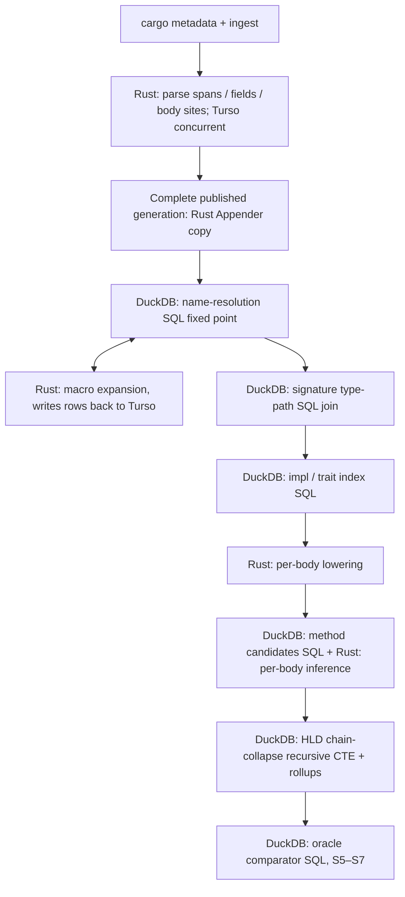

# Executable specs — phase-20261111: HLD for Rust code that compiles

Status: draft contracts; implementation not yet measured. Source: PRD decisions D1–D6, D-A–D-N.
SPEC owns the executable contracts and M0–M8 ordering; PRD owns product intent; SOP executes the gates.
These three phase-prefixed document basenames are an explicit naming exception. **M** denotes observations,
not targets. All new owned identifiers, columns and artifact basenames use four words.

## 1. Scope and oracle

Map lib + bin targets of workspace members and their normal dependency closure. Do not map test, bench,
example or build-script targets or dev-dependencies. Record proc-macro/build dependency host contexts in the
crate graph for provenance, not as mapped application targets. Proc-macro shapes are the only production
substitute for executing proc macros. Test cfg is OFF; default feature selection is per compilation unit.
The active source closure is files reachable from those targets' module trees under active cfg, including
ordinary file includes and expansions discovered during resolution. Store other .rs files as bytes only.
Inactive items encountered in reached files are counted; unreachable files are not required to parse.
A successful external cargo check does not imply arbitrary repository files parse.

The offline answer key is `oracle-semantic-export-harness`, built from the rust-analyzer commit in §8.
Record its executable digest, source commit, toolchain and configuration. The installed rust-analyzer
1.99.1 (58cf8f9) is NOT the oracle for checkout 2a362a41a. The harness may link ide/hir/salsa and run proc
macros: it is outside Parseltongue's production dependency/process boundary. No LLM or training anywhere.

- PRIMARY: build scripts disabled; proc macros enabled; mapped target/feature/cfg/edition policy identical
  to production, including the --no-test equivalent. Shape comparisons use real proc-macro expansions.
- SECONDARY: identical inputs except build scripts enabled, also with proc macros enabled. Export per-site
  semantic rows, not analysis-stats aggregates. PRIMARY versus SECONDARY identifies the KL1 difference set;
  aggregate timing/statistics cannot attribute individual missing edges.
- Persist path targets, invocation-keyed expansion items/signatures and body sites, impl relations,
  method/call targets, signature type references, and effective visibility/reachability.
  SCIP is optional secondary occurrence evidence only; it does not export these complete semantic relations.
- Oracle source omissions, failed proc-macro loading or unexportable relations BLOCK the affected gate;
  never manufacture agreement or silently remove unsupported oracle sites.

## 2. Executable requirements

Each numbered contract includes its clauses and the normalization/scoring rules in §2.1–2.4.

### REQ-RUST-001.2 — offline graph and process boundary

WHEN production mapping starts, THEN check Cargo.lock exists before metadata, hash it before/after
`cargo metadata --offline`, and reject absence or mutation with CrateGraphLoadError before publishing rows.
Missing dependencies/metadata failure SHALL preserve stderr and publish no graph rows.
Write one crate-dependency-graph-table row per selected package/target plus explicitly tagged dependency
contexts (§1), preserving Cargo package ID/source, target name/kind, root, edition, features, cfg, host/target
role and dependency alias. Alias is not crate identity. Parseltongue's direct children SHALL be only
`cargo metadata --offline`, `rustc --print cfg`, `rustc --print sysroot`; reject other executable requests.
Under the metadata Cargo process only, permit rustc discovery descendants: `rustc -vV` or
`rustc - --crate-name ___` with approved discovery `--print=` flags, exactly the six
`--crate-type` selectors bin/rlib/dylib/cdylib/staticlib/proc-macro, and `-Wwarnings`.
No other flags, real source inputs or output artifacts are permitted. Approved print kinds are
file-names/sysroot/split-debuginfo/crate-name/cfg; version-only `rustc -vV` remains permitted.
Reject every other descendant, including real-crate compilation, build-script binaries and network activity.
The strace audit SHALL reconstruct ancestry and validate full argument vectors, not executable names alone.
SOP S2 scope pagination requires a stable generation, strictly advancing next_offset, has_more=false,
and accumulated entry count equal to scope_total. The per-page scope_truncated flag is informational.
Harness builds/exports, version recording and corpus qualification are outside this allowlist.
Metadata SHALL use a read-only input checkout or equivalent write guard; lock mutation fails before publication
and leaves the original lock bytes intact (test with a writable isolated fixture and restoration guard).

### REQ-RUST-002.0 — bytes and no-op ingest

WHEN any source file is ingested, THEN stored bytes SHALL equal disk bytes, including non-UTF-8 and line endings.
An unchanged content digest SHALL cause zero file-content writes; a new generation may add references/markers.
Bytes-only files SHALL not be parsed or assigned semantic spans.

### REQ-RUST-003.1 — source coverage

WHEN an active-closure file is walked, THEN its flattened ownership partition (item-owned ranges plus classified
gaps) SHALL tile its bytes contiguously without overlap and with zero "other" bytes. Nested semantic spans
may overlap their parents; count bytes once in the ownership partition, not once per nested span.

### REQ-RUST-004.2 — parser boundary

WHEN an active-closure file has a pinned-parser error or non-UTF-8 bytes, THEN stop with
WorkspaceNotCompilingError carrying path and first error/byte offset; do not recover or publish the generation.
The same bytes in an unreachable fixture SHALL be stored only, not reject the workspace.
Pin parser compatibility to the selected toolchain/editions; an incompatibility blocks corpus acceptance.

### REQ-RUST-014.1 — compilation contexts

WHEN a unit is loaded, THEN store cfg/features/edition on that unit, not a universal cfg set.
Use rustc print cfg for the selected target; host proc-macro/build contexts are tagged separately; sysroot
crates use target cfg. Features are package/unit-specific normal-dependency resolution from metadata.
Record the Cargo resolver version and derive selected-unit feature contexts from declared dependency kinds
and metadata, rather than copying one globally unified resolve-node feature list into every target.
The target triple is recorded (host triple by default); an explicit --target argument is permitted only on
the print-cfg command, never to compile. Preserve each unit's own edition and edition-specific prelude.
Cfg(test) is OFF. Inactive items in reached files SHALL be unresolved(cfg_inactive) and counted.
Cfg/edition differences never share semantic rows solely because file bytes match.

### REQ-RUST-015.1 — build-script limitation

WHEN a crate has build.rs, THEN production SHALL neither execute that target nor read saved outputs under
target/ (including symlink escapes). OUT_DIR-dependent includes and unavailable env!/option_env! inputs
SHALL be unresolved(build_script). Populate CARGO_PKG_* and CARGO_MANIFEST_DIR from metadata.
Build-script-only cfg is OFF; count its inactive items as cfg_inactive, with KL1 attribution only when
the paired oracle exports establish that cause. Banner SHALL report build_script counts per crate.
Ordinary non-generated include! files are allowed through file-source-text-table, not target/ reads.

### REQ-RUST-005.1 — paths

WHEN name resolution completes, THEN use-tree and signature-path targets SHALL match PRIMARY in ≥99.5%
of eligible path sites (§2.1). Persist every mismatch, unresolved answer and exclusion with a reason in
oracle-edge-agreement-table. M2 alone excludes-and-reports proc-macro-dependent sites; M3 removes that
temporary exclusion. Unknown proc macros are not a blanket exemption from final coverage.

### REQ-RUST-016.1 — fixed point and module semantics

WHEN resolving a crate, THEN imports and item-position macro expansion SHALL share one fixed point.
Pin the external rust-analyzer constant FIXED_POINT_LIMIT = 8192; our loop permits 8192 changing
macro-expansion rounds, then errors on an attempted 8193rd round with NameResolutionStuckError.
Count progress by newly canonicalized items/bindings, not duplicate writes. Include attribute reseeding.
Publish complete bindings/expanded items per crate atomically; no reader sees an intermediate round.
Implement the module, hygiene, glob and prelude fixtures in §2.3.

### REQ-RUST-006.2 — declarative/built-in expansion

WHEN macro_rules! or built-in macros expand at item/body position, THEN ≥99% of eligible invocations
SHALL match PRIMARY's canonical produced-item and body-site sets. Each expanded item SHALL carry
macro origin, invocation occurrence key and expansion provenance. Ordinary include! files join the closure.

#### Authorized declarative body-macro delivery slice

For this slice, an internal `MacroExpansionFragmentKind` discriminator SHALL have exactly the
`Items`, `Statements`, and `Expression` variants. Item invocations SHALL retain the existing
`SourceFile` parse behavior; statement fragments SHALL use the parser's genuine `MacroStmts`
entrypoint, and expression fragments SHALL use its genuine `Expr` entrypoint. No source wrapper,
synthetic offset, or module boundary may be added around an expansion.

The visitor SHALL classify direct item-list calls as `Items`, block statement invocations as
`Statements` (including expression-statement macros where the AST establishes statement context),
and initializer, argument, and tail-expression `MacroExpr` calls as `Expression`. `MacroType` and
`MacroPat` positions SHALL remain deferred. Expanded body-site rows SHALL preserve exact source byte
ranges/text, owner occurrence identity, provenance, token-origin mapping, and an explicit link to
the originating invocation. Ownerless sites SHALL inherit the enclosing body owner derived using
the same syntax-occurrence fields as `build_syntax_occurrence_key`; an AST-local item owner SHALL
take precedence. Nested calls in generated function bodies SHALL retain their immediate invocation
identity and a provenance chain connecting the outer invocation.

Body expansions SHALL use `body-site-reference-table` and its existing `name-resolution` write
allowance, plus the existing macro-expansion evidence table; no parallel expansion engine or table
is allowed. Fragment kind and invocation identity SHALL be persisted in existing expansion
evidence. Expanded local items/imports SHALL remain in the invocation block's lexical scope, and
generated local items SHALL own their own body-site rows. Resolution targets SHALL remain pending;
this slice SHALL NOT perform type inference. Built-in expression expansion remains unavailable for
the separate follow-up, while existing `include!` behavior SHALL not regress.

Focused executable test mapping for this delivery slice:

| req_id | test_id | test_type | persisted assertion |
| --- | --- | --- | --- |
| REQ-RUST-006.2 | `test_macro_rules_items_match` | CLI integration | Exact structured set of item/body invocation identities, fragment kinds, generated items, provenance, and token-origin rows. |
| REQ-RUST-006.2 | `test_body_macro_sites_match` | CLI integration | Exact structured set of nested body-site kind/range/text/owner/invocation/provenance tuples and origin rows. |
| REQ-RUST-006.2 | `test_body_fragment_context_routing` | CLI integration | Initializer and tail calls are expressions; direct block macros use statements; no fabricated sites. |
| REQ-RUST-006.2 | `test_generated_function_owner_identity` | CLI integration | Exact nested invocation identity and chain; generated FN owner is hashed from the expected virtual source path, range, kind, and parent chain. |
| REQ-RUST-006.2 | `test_local_scope_binding_isolation` | CLI integration | Every matching local_function and LocalMarker item/import shares the expected non-module block scope; no matching binding is at module scope. |
| REQ-RUST-006.2 | `test_nested_macro_token_origins` | CLI integration | Nested $crate retains its definition-crate origin through expansion; a simple identifier argument maps to its nested invocation virtual-source range. |
| REQ-RUST-006.2 | `test_legacy_macro_shadow_restoration` | CLI integration | Before-definition lookup remains unresolved; local shadow is selected and outer binding is restored. |
| REQ-RUST-006.2 | `test_macro_output_rerun_determinism` | CLI integration | Stable-input reruns yield the same sorted persisted structured sets. |
| REQ-RUST-006.2 | `test_malformed_fragment_publication_rollback` | CLI integration | Malformed fragment emits no failed completion/output and preserves the previous publication. |
| REQ-RUST-006.2 | `test_deferred_macro_position_retention` | CLI integration | Type/pattern invocations remain unexpanded; resolution is not inferred. |

### REQ-RUST-013.1 — proc-macro shapes

WHEN an invocation matches proc-macro-shape-table by Cargo package ID/version and macro name, THEN
its (kind, name, normalized signature) set SHALL equal PRIMARY's real expansion for 100% of matching
invocations, not just one example per shape row. Each shape row SHALL have a fixture exercising it.
Unknown macro/version SHALL be unresolved(proc_macro), not guessed. Store the checked-in shape data
as proc-macro-shape-records.toml and load it into its declared table at generation start.

### REQ-RUST-017.1 — lang items and incoherent impls

WHEN sysroot sources are resolved, THEN lang-item-definition-table SHALL contain every recognized
lang item present in the selected sysroot. M: the pinned lang_item.rs declaration has 169 sym rows;
this is a source observation, not a required sysroot count.
Include primitive and permitted incoherent inherent impls using rust-analyzer's type-attribute flag and
sysroot-origin search; distinguish rustc_has_incoherent_inherent_impls from rustc_allow_incoherent_impl.
Index population is tested at M2/M4 as available; primitive method lookup is tested at M5.

### REQ-RUST-018.1 — signatures and impls

WHEN signatures/impl headers are lowered, THEN every type path SHALL be resolved or carry one reason.
Canonical uses_type/implements relations SHALL match PRIMARY at ≥99.5% (§2.1); persist all disagreements.

### REQ-RUST-007.2 — site precision

WHEN an extracted call/method site is compared, THEN method-call target precision SHALL be ≥99%.
Count wrong or missing PRIMARY targets for extracted sites as incorrect; do not excuse an extracted guess
using a reason. Every unresolved site SHALL carry exactly one §2.2 reason. Compare ordinary call targets
as well, reporting their precision separately; method-call precision is this requirement's threshold.

### REQ-RUST-008.1 — mandatory final coverage

WHEN each selected inference sub-step finishes, THEN report method-call coverage. At M8, coverage after
the last selected sub-step SHALL be ≥95% on each of the five repos. M7 may be skipped only when 7b
already meets that gate on all five; skipping it does not remove the M8 gate.

### REQ-RUST-019.1 — D6 nodes and reexports

WHEN nodes are selected, THEN use effective item visibility (§2.4), not only explicit pub syntax:
file-top-level, inline-module and top-level impl/trait associated items usable by another file qualify.
Items inside fn bodies never qualify. Private uses are evidence only; restricted/public uses create one
reexports edge per resolved exported binding (aliases/globs included), sourced at the nearest enclosing
selected module (the containing module when it qualifies, otherwise its nearest qualifying ancestor).
The implicit crate-root module is externally addressable and qualifies as the root module node; retain the
lexical reexporting module in evidence even when it is private. No use statement becomes a node.
Store node_reachable_outside_crate from complete module/reexport reachability, including private parents.

### REQ-RUST-009.2 — extracted HLD and collapse

WHEN HLD is built, THEN each edge connects selected nodes or a selected node and a canonical external item,
has extracted status only, and collapsed rows name their complete private evidence chain(s).
Apply §2.4's cycle/diamond/self-edge rules. Unresolved intermediate links SHALL not yield extracted edges.
File/folder roll-ups SHALL equal the deduplicated HLD aggregation for the published generation.

### REQ-RUST-010.2 — dependency boundary

WHEN the production binary is built, THEN cargo tree SHALL contain no ra_ap_hir*, ra_ap_ide*,
ra_ap_base_db or salsa; parseltongue-core-row-types SHALL have zero dependencies.
Copy-adapt mbe into parseltongue-port-macro-expander (L2); never link unchanged mbe with its salsa
dependency. If span is needed, link it with default-features = false and verify the full dependency tree.
Offline harness ide/hir/salsa dependencies SHALL not leak into the production binary.

### REQ-RUST-020.1 — generations and stage isolation

WHEN a stage runs, THEN read only declared tables and rewrite only its generation's declared outputs.
Rows and markers SHALL carry run_generation_digest_value (§3.2); reject missing, stale or incompatible
input markers with StageInputMissingError. Identical inputs yield identical semantic output rows, excluding
operational timing/counter metadata. Shared library rows use the same compatibility key.
A new generation is invisible until atomically published; beginning a rerun invalidates its staging completion,
not the previously published generation. No cross-database partial generation may become visible.

### REQ-RUST-021.1 — concurrency

WHEN N workers write, THEN use Turso BEGIN CONCURRENT per unit, permit at most N units in flight,
and preserve exactly the 1-worker row set/digest. Retry a conflict at most 5 times after the initial attempt
(6 total attempts), with delays 10, 20, 40, 80, 160 ms; rollback and reread/recompute on retry.
Only conflict errors retry; other errors surface immediately. Exhaustion returns StoreWriteConflictError.
Cancellation interrupts backoff. No unbounded queues or cross-unit memory retention.

### REQ-RUST-022.1 — cancellation

WHEN Ctrl-C/SIGTERM interrupts a stage, THEN rollback any uncommitted unit, publish no partial unit
or new generation, and leave no completed marker for the interrupted staging stage.
Already committed staging units may be reused only under the same compatibility key.
Rerun SHALL equal an uninterrupted run. A previously published generation remains readable and immutable.

### REQ-RUST-011.1 — memory

WHEN mapping rust-analyzer plus its selected library roots, THEN peak simultaneous summed resident memory
of the production process tree SHALL be ≤2 GiB (2 × 1024³ bytes). Include allowed child processes, exclude
offline harness/indexers; record process-tree samples and cgroup memory telemetry, not just parent time -v RSS.
Sample summed RSS every 10 ms and record short-lived child peaks with OS accounting; report sampling limits.
The gate uses the larger observed process-tree RSS peak, converted from bytes to GiB, not cgroup page-cache usage.

### REQ-RUST-012.1 — determinism

WHEN the same source/config/tool compatibility key is mapped twice with 1, 4 and 16 workers, THEN sorted
semantic exports SHALL be byte-identical. Compare stable occurrence IDs and HLD including evidence counts;
exclude timings. Collision fixtures SHALL not merge unrelated semantic occurrences.

### 2.1 Matching and scoring

Normalize by workspace-relative or package-source-relative paths, UTF-8 byte ranges, compilation-unit key,
site kind and deterministic expansion provenance/invocation key. External targets use package source ID,
target name/kind and qualified item path, not crate@version alone. Align harness and production keys
before scoring. Duplicate occurrences collapse by this key; different compilation units never collapse.

- 005: numerator = exact target matches; denominator = eligible PRIMARY use/signature path sites.
  Missing/unresolved production answers count as nonmatches.
- 006: numerator = invocations with equal canonical item tuples AND body-site tuples; denominator =
  eligible PRIMARY declarative/built-in invocations. Compare sets sorted by provenance and occurrence;
  a missing expansion is a nonmatch. Body tuples include site kind, range/provenance and callee syntax;
  resolved call targets are scored by 007, not required to finish the M2 expansion gate.
- 013: numerator = matching invocation item/signature sets; denominator = all matching-shape PRIMARY
  invocations. Require a nonempty fixture for every shape row, including versions, plus the unknown-version case.
- 018: numerator = exact canonical relation tuples present in both; denominator = union of PRIMARY and
  extracted production signature/impl relation tuples. This penalizes both missing and extra relations.
- 007: numerator = correctly targeted extracted method sites; denominator = all extracted method sites.
  A site absent from PRIMARY but emitted as extracted counts as incorrect.
- 008: numerator = correctly targeted extracted method sites; denominator = eligible PRIMARY method sites.
  A wrong extracted answer does not increase coverage.
- 019: numerator = nodes with correct selection/effective visibility/reachability; denominator = union of
  PRIMARY and production candidate occurrence keys; require 100%, including correct rejection cases.

Eligibility excludes inactive cfg and source absent under PRIMARY's KL1 limitation; record each exclusion with
oracle evidence. PRIMARY-visible unknown_receiver, trait_solver_needed, proc_macro and external_source_missing
remain coverage/path failures as applicable, not removed denominators. Secondary-only sites are recorded
in the KL1 difference set and excluded from PRIMARY denominators. No exception for known oracle errors:
those block the gate. M2's temporary proc-macro exclusion is separately counted and ends at M3.
Compute every gate per repository, never pool the five to hide a failure. Empty denominator = N/A, not 100%;
corpus gates require at least one eligible observation per metric/repo or are BLOCKED. Empty fixture cases
assert zero rows without claiming percentage success. Report raw numerator, denominator, exclusions and rate.

### 2.2 Authoritative unresolved reasons

SiteUnresolvedReasonKind is the only reason enum for all stages; enum values remain exempt from naming.
Exactly one primary reason per unresolved site; select the earliest causal blocker in this precedence:
cfg_inactive → build_script → proc_macro → external_source_missing → unknown_receiver → trait_solver_needed.
Store additional causal evidence separately, not additional primary reasons.

- cfg_inactive: outside active analysis; counted, excluded from PRIMARY denominators.
- build_script: unavailable generated source/env; KL1 exemption requires a matched PRIMARY/SECONDARY diff.
  If PRIMARY exposes the site anyway, unresolved production remains a nonmatch.
- proc_macro: unknown/unsupported shape; counted, remains a nonmatch when PRIMARY exposes the site.
- external_source_missing: counted; gate BLOCKED if the required oracle source is missing too,
  otherwise unresolved production counts as a nonmatch.
- unknown_receiver: counted; unresolved production is a nonmatch, not an exception.
- trait_solver_needed: counted; unresolved production is a nonmatch, not an exception.

### 2.3 Required resolution fixtures

Each fixture has a normal, empty/inactive and conflicting/error case under test_module_resolution_fixture_rules.

- #[path] and nested modules: resolve relative to the declaring module's directory, including inline-module
  path rules; cfg_attr is evaluated before module discovery. Store reached ordinary files in the closure.
- include!: resolve relative to the invocation's source file, preserve included-file provenance and hygiene;
  nested includes join the closure. include_str!/include_bytes! read bytes only. Never follow target/ output.
- Hygiene: persist syntax contexts, definition/call-site provenance and $crate's defining crate; test
  identical macro text invoked in two crates without binding leakage.
- Globs/aliases: fixed point with explicit-import precedence, namespace separation and ambiguity detection;
  ambiguous bindings cannot become extracted targets. Reexports enumerate resolved exported bindings.
- Extern prelude: edition-specific 2015/2018/2021/2024 rules, renamed dependencies, no_std/no_core and
  implicit std/core/prelude suppression. Tests include multiple versions and identical names from distinct sources.
- Target/context fixtures: lib+bin sharing one file, differing features/cfg, host proc-macro context,
  sysroot target cfg, test cfg OFF and excluded dev/test/bench/example targets.

### 2.4 Visibility and collapse rules

Private-equivalent restrictions such as pub(self) do not qualify as non-private visibility.
Effective visibility follows Rust item-kind semantics: trait members and trait-impl members inherit their
trait/interface visibility; enum variants inherit enum visibility; inherent members use declared restrictions.
A node's local visibility is distinct from external reachability through ancestor modules and reexport aliases.
Fn-body ancestry always excludes nodes, including inline modules nested in a body.
The exporter and tests compare the same item-kind visibility model. Do not infer external reachability from pub alone.
Reexports use REQ 019's nearest selected enclosing module/root endpoint and retain the lexical module in evidence.

Emit direct resolved relations first. For each selected source, traverse resolved evidence through private
items, stopping at the first selected/external target; retain the terminal relation kind for collapsed edges.
Use visited occurrence keys per path to stop cycles; enumerate canonical simple paths in sorted order.
Keep one HLD row per (generation, source, target, relation kind, via kind); retain each distinct evidence path
and count unique evidence-row keys across those paths. Diamonds merge the HLD row, not provenance.
Retain genuine direct/finite-path self-edges once; never invent a self-edge from a cycle alone.
An unresolved link stops that path without an extracted successor. Roll-ups count HLD rows, not path multiplicity.

## 3. Rust design and persisted interfaces

### 3.1 Layers and stages

L1 parseltongue-core-row-types owns four-word ID/row/error types and has zero dependencies.
L2 contains parseltongue-table-store-traits, parseltongue-stage-worker-scheduler,
parseltongue-port-name-resolver, parseltongue-port-macro-expander,
parseltongue-port-signature-lowerer, parseltongue-port-body-inferencer and parseltongue-hld-edge-builder.
L2 accesses external storage/parser/cargo only through traits; copy-adapted pure macro algorithms are an
explicit L2 library dependency, not a hosted analysis engine.
L3 contains parseltongue-turso-store-adapter, parseltongue-syntax-span-extractor,
parseltongue-crate-graph-loader and (M7) parseltongue-trait-solver-adapter.
parseltongue-cli-dispatcher-binary wires adapters; parseltongue-oracle-edge-differ consumes harness files offline.

Stage interfaces are the PRD §5 table inventory. Stages 4+5 are one crate fixed point, with macro expansion
a library call inside it; expression expansion is also called inside stage 7. Stage 8 is deliberately merged
into stages 6/7: they write edge-evidence-record-table directly. There is no unpersisted inter-stage site handoff.
Stage-local per-body lowering may exist in memory, but nothing is retained across stages/units.
Expanded semantic spans are written by the combined resolver or body-inference unit, with provenance.
Per-crate read caching requires a measured budget miss and a recorded decision, never a cross-stage cache.

### 3.2 Identity, columns and generations

SpanDigestIdValue is a 16-byte truncated CONTENT identity only. Retain its complete 32-byte BLAKE3 digest
and canonical digest inputs; on truncation collision, preserve both full-digest records, never alias them.
SemanticOccurrenceKeyValue identifies (compilation unit, normalized file path, byte range, full content
digest, expansion provenance/invocation chain). Source bytes alone never identify a semantic occurrence.
CrateDenseIndexValue is assigned by sorted Cargo package ID + target name/kind + host/target context,
not sorted name/version alone. Alias is an edge property. Stable full semantic keys survive dense-ID rebuilding.
RunGenerationDigestValue hashes source snapshot digest, normalized per-unit configuration and tool versions
(including parser, shapes and schema). Identical inputs may reuse a generation; operational attempts are separate.
Source snapshots cover immutable input roots and lockfiles, excluding .git, target/ and oracle output locations.
An identical-key rerun uses a separate staging attempt; it never overwrites the immutable published attempt.
Publication selects that completed attempt, while deterministic semantic exports omit the attempt sequence.

Owned row fields/SQL columns (four semantic words, underscores in code; hyphens in artifact names):

```text
run_generation_digest_value: compatibility key on every semantic row and marker
stage_attempt_sequence_value: operational staging attempt, excluded from semantic identity/export
stage_unit_work_key: atomic file/crate/body work-unit identity
stage_input_generation_keys: exact compatible upstream generations
stage_owned_table_names: declared stage input/output table inventory
unit_cargo_package_identifier: full Cargo package ID, including source
unit_cargo_target_name: Cargo target name
unit_cargo_target_kind: lib/bin or explicitly tagged host dependency context
unit_dependency_alias_text: dependency edge's local alias
unit_target_cfg_values: normalized cfg set
unit_enabled_feature_names: normalized per-unit feature set
unit_rust_edition_value: selected edition
unit_compilation_role_kind: host or target
unit_source_root_path: normalized immutable source root
file_source_relative_path: normalized source-root-relative path
file_source_content_bytes: byte-exact input bytes
file_content_digest_full: complete BLAKE3 file digest
file_dependency_origin_kind: workspace/std/external source classification
span_content_digest_full: complete 32-byte content identity
span_semantic_occurrence_key: context-qualified occurrence
span_source_file_path: source-root-relative occurrence path
span_item_kind_value: parsed item kind
span_declared_visibility_kind: explicit syntax visibility
span_byte_start_offset: inclusive byte offset
span_byte_end_offset: exclusive byte offset
span_macro_invocation_key: invocation semantic occurrence
span_expansion_provenance_chain: syntax context and invocation ancestry
node_reachable_outside_crate: external reachability, yes/no
node_effective_visibility_scope: item-kind visibility after restrictions
site_unresolved_reason_kind: exactly one authoritative causal blocker
site_callee_syntax_text: expanded call's syntactic callee, separate from its resolved target
oracle_primary_target_reference: PRIMARY semantic target
oracle_secondary_target_reference: SECONDARY semantic target, if present
oracle_comparison_outcome_kind: match/mismatch/unresolved/excluded observation
oracle_semantic_record_kind: path/expansion/impl/call/signature/visibility observation
edge_source_occurrence_key: selected source occurrence
edge_target_reference_value: selected/external canonical target
edge_source_signature_text: assembled source signature
edge_target_signature_text: assembled target signature
edge_source_qualified_path: source path in compilation context
edge_target_qualified_path: canonical target path including package source/target
edge_relation_kind_value: calls/uses_type/implements/reexports/contains/derives
edge_collapse_via_kind: direct/collapsed
edge_evidence_row_count: unique supporting evidence rows
edge_dependency_origin_kind: same_crate/workspace_crate/std/external_crate
edge_resolution_status_kind: extracted for HLD, unresolved allowed in evidence
stage_publication_state_kind: staging/complete/published
```

Use the above names in schemas; do not reintroduce short aliases in proposed owned structs.
SpanByteRangeValue rejects end before start. EdgeTargetReferenceValue carries semantic keys, not content IDs.
SiteUnresolvedReasonKind and BodySiteResolutionOutcome distinguish extracted and one-reason unresolved data.

stage-run-generation-records stores generation, stage/unit completion and publication manifests.
Workspace staging writes and shared-library staging writes are invisible. Commit immutable compatible library
rows first, then atomically switch the workspace publication manifest referencing those exact library generations.
Readers pin that manifest; library garbage collection cannot delete referenced generations. No distributed
transaction is assumed: library-first failures leave unreachable rows, not a partially published workspace.
A crate fixed point atomically publishes its bindings, spans and expansion rows within the staging generation.
A downstream stage requires the exact upstream generation/unit completion, not mere table existence.

### 3.3 Trait seams and errors

```text
CrateGraphReadStore: read_crate_dependency_rows, read_unit_dependency_rows
SpanRowReadStore: read_file_span_rows, read_crate_span_rows, read_span_by_digest
FieldDetailReadStore: read_span_field_rows
BodySiteReadStore: read_body_site_rows
ScopeBindingReadStore: resolve_module_name_target
ImplHeaderLookupIndex: read_self_impl_rows, read_trait_impl_rows
LangItemReadStore: read_named_lang_item
ProcMacroShapeLookup: read_macro_shape_rows
StageRowWriteSink: write_stage_unit_rows
StageRunMarkerStore: begin_stage_generation_write, complete_stage_generation_write,
                     check_stage_generation_complete, publish_workspace_generation_manifest
```

Closure-discovery requests are persisted work records in stage-run-generation-records; ingest/walker
complete those records before the crate fixed point resumes. No file request exists only in memory
across stage boundaries. Stage markers distinguish a complete discovery batch from final closure completion.
Every lookup is generation/context-qualified; span lookup takes full digest plus occurrence context.
Typed boundaries: CrateGraphLoadError, WorkspaceNotCompilingError, NameResolutionStuckError,
StageInputMissingError, StoreWriteConflictError, StoreBackendFailureError. Unresolved rows are data,
not fatal errors. Missing module/include files or ambiguous compiler-invalid inputs produce
WorkspaceNotCompilingError; unsupported but compiling semantics produce a counted reason, never a guess.

### 3.4 Turso and cancellation

Pin turso =0.9.0-pre.5. M: crates.io reports stable 0.8.3 and max prerelease 0.9.0-pre.5.
The inspected prerelease has async query/execute/prepare/build and TransactionBehavior::Concurrent.
parseltongue-turso-store-adapter owns a runtime and exposes synchronous traits; L2 holds no lock across await.
Use one connection/transaction per unit and the exact REQ 021 retry schedule; verify MVCC under 1/4/16 workers.
API availability is source-verified; throughput and conflict behavior are not yet measured.
A shared RunCancelFlagValue interrupts unit work/backoff; rollback before releasing an interrupted unit.

## 4. Requirement → test → SOP crosswalk

All names below have four words after test_. S3 includes a separate fixture/build suite, so negative tests
do not mutate corpus checkouts. S5 percentages use §2.1; S6–S9 cross-checks do not override PRIMARY.
Every entry names a clause assertion, not merely a requirement-level coverage claim.

```text
001 → S3
  test_crate_graph_offline_only: selected package/target fields, aliases, direct/descendant argument allowlists.
  test_lockfile_guard_preserves_bytes: absent lock rejects before spawn; mutation rejects and restores bytes.
  test_metadata_failure_writes_nothing: missing download/nonzero exit preserves stderr, publishes zero rows.
002 → S3
  test_ingest_bytes_stay_identical: random bytes including invalid UTF-8/newlines stored unchanged.
  test_unchanged_digest_skips_write: unchanged bytes write zero content rows; new marker allowed.
003 → S3
  test_span_gap_tiling_identity: nested spans flatten to one exact ownership partition; empty file valid.
004 → S3
  test_parse_error_stops_run: active error rejects with path, no publication.
  test_non_utf8_stops_run: active invalid bytes include offset; bytes-only fixture does not reject.
014 → S3
  test_cfg_from_rustc_print: per-unit features/cfg/edition, host/target and sysroot contexts agree.
    Include resolver-version/normal-dependency feature isolation and print-only target arguments.
  test_inactive_cfg_items_counted: test cfg OFF, inactive reached items counted; unreachable files bytes-only.
015 → S3, S4, S5
  test_build_script_never_executed: exec/read audit forbids scripts and target reads, including symlinks.
  test_out_dir_include_unresolved: generated include and unknown env/option_env get build_script.
  test_cargo_env_from_metadata: metadata env values; build-only cfg OFF; per-crate banner reasons exact.
005 → S4, S5
  test_nameres_matches_oracle_paths: per-repo formula, absent answers and M2 exclusions.
  test_oracle_disagreements_keep_reasons: every mismatch/unresolved/exclusion persisted; oracle missing blocks.
016 → S3, S5
  test_macro_import_fixed_point: generated use resolves inside same crate publication.
  test_fixed_point_limit_errors: 8192 changing rounds allowed, attempted 8193 errors.
  test_module_resolution_fixture_rules: all §2.3 normal/inactive/error variants.
006 → S4, S5
  test_macro_rules_items_match: item/body invocation sets and origin/invocation provenance.
  test_body_macro_sites_match: nested body expansions and matched call-site tuples.
013 → S4, S5
  test_macro_shapes_match_oracle: every invocation, each shape exercised, version/signature diff on failure.
  test_unknown_proc_macro_unresolved: absent shape/version produces one proc_macro reason.
017 → S3, S5
  test_lang_items_in_sysroot: recognized present items found, not hard-coded to 169.
  test_incoherent_impl_headers_indexed: M4 indexes sysroot primitive/flagged-type impls.
  test_incoherent_primitive_impls_indexed: M5 resolves f32::abs and str::len through the index.
018 → S4, S5
  test_signature_edges_match_oracle: resolved-or-reason type paths; union-denominator signature/impl agreement.
007 → S4, S5, S7
  test_method_target_precision_oracle: site-level ≥99%, extra/wrong sites penalized; calls reported separately.
  test_unresolved_has_one_reason: exact enum/precedence, unknown_receiver and build_script included.
008 → S3, S5, S10
  test_method_coverage_per_substep: report selected steps, mandatory ≥95% at M8, M7-skip case.
019 → S5, S9
  test_body_items_never_nodes: body ancestry rejects even pub nested modules.
  test_effective_visibility_node_selection: positive/negative item kinds and restricted visibility.
  test_pub_use_reexport_edge: aliases/globs one edge per binding, nearest selected module/root endpoints.
  test_reachable_outside_crate_flag: private parents and public reexports agree with PRIMARY.
009 → S6, S8, S9
  test_hld_rows_connect_nodes: selected/external endpoints, extracted-only status.
  test_private_chain_collapse_rules: cycles/diamonds/self-edges, unresolved stop, complete provenance/counts.
  test_hld_rollup_counts_match: file/folder aggregates match deduplicated HLD.
010 → S3
  test_no_analysis_crates_linked: production tree forbids ide/hir/base_db/salsa; L1 zero deps.
  test_macro_dependencies_exclude_salsa: copied mbe + optional span default-features=false has no salsa.
020 → S3
  test_stage_rerun_is_identical: stage outputs stable under same compatibility key.
  test_stage_refuses_missing_input: missing/stale/incompatible marker rejects.
  test_stage_table_access_restricted: spy-store rejects undeclared reads/writes.
  test_generation_publication_is_atomic: shared DB/library-first crash cases preserve old manifest.
021 → S3, S10
  test_concurrent_writers_lose_nothing: N=1/4/16 rows/digests equal.
  test_conflict_retry_is_bounded: six attempts, exact delays, nonconflicts not retried, cancellation interrupts.
  test_in_flight_units_bounded: observed maximum ≤N.
022 → S3
  test_cancel_then_rerun_identical: cancel within/between units, rerun equals clean.
  test_cancel_publication_stays_consistent: no partial reader visibility/completed staging marker.
011 → S10
  test_peak_memory_within_budget: process-tree peak ≤2 GiB, telemetry and limits recorded.
012 → S3, S10
  test_hld_export_is_deterministic: two runs per N=1/4/16, stable sorted semantic export.
  test_semantic_identity_collision_safety: forced truncation collisions, same bytes/different paths/contexts.
  test_oracle_matching_empty_cases: §2.1 empty/N/A, duplicate keys and per-repo aggregation.
009/019/020 → S6, S7, S8, S9
  test_crosscheck_evidence_never_overrules: CM-GAP cannot excuse oracle error; coverage pagination complete.
  test_sample_rows_record_keys: zero/small/large samples, explicit seed, every sampled miss fails.
```

Build gates: cargo fmt --check; cargo clippy --all-targets -- -D warnings; cargo test;
cargo build --release; production cargo tree. Oracle corpus suite is separate/ignored plus nightly,
never linked into production. S1/S2 are external-tool preconditions/coverage checks, not semantic requirements.

## 5. Implementation plan — authoritative M0–M8

- M0: workspace skeleton, L1 IDs/errors, fake store, dependency gates, pinned oracle harness/build manifest.
  RED: 010, identity fixtures under 012; no final HLD export expected yet.
- M1: graph/ingest/parser, Turso runtime, generation markers, scheduler.
  RED: 001–004, 014–015, 020–022; measure write throughput at 1/4/16 and publish file/span counts.
- M2: combined name-resolution/macro fixed point, built-ins, lang-item discovery.
  RED: 005, 006, 016, lang-item clause of 017. Proc-macro-dependent sites excluded-and-reported only here.
- M3: proc-macro shapes for serde, salsa, thiserror, tokio main/test and corpus derives.
  RED: 013; rerun 005/006 without M2's temporary exclusion.
- M4: signatures and impl index. RED: 018, test_incoherent_impl_headers_indexed.
- M5: body 7a, locals/inherent methods/autoderef. RED: 007 and 017 primitive lookup; report 008.
- M6: body 7b, traits in scope. Gate 007, report 008; all five ≥95% permits skipping M7.
- M7: optional 7c solver adapter; gate 007/010 and report 008.
- M8: HLD/collapse/roll-ups/banner. RED: 009/019/011/012; mandatory final 008 and all contracts green.

Owned milestone fixture gates run when their component exists; 012 identity fixtures start M0, final export
determinism starts M8. §4's future clauses are not required to pass before their milestone.
Use SOP §3 subsets at intermediate milestones, full S1–S10 on all five at M8/releases.
Record measured results as M; a proposed test is not a passed test.

## 6. Quality gate results

Documentation contracts only. Runtime tests/builds are not claimed executed; no implementation is supplied here.
Clause-level planned coverage is enumerated in §4. Naming/fence/stale-reference checks are documentation gates.

## 7. Resolved decisions and remaining measurements

Q1 resolved: turso =0.9.0-pre.5 async; L3 owns runtime, L2 sync. Stable observed: 0.8.3.
Q2 resolved: copy-adapt mbe; span only with default-features=false; production no-salsa dependency gate.
Q3 resolved: proc-macro-shape-records.toml feeds proc-macro-shape-table; invocation fixtures validate each row.
Q4 resolved: Phase 1 lib+bin, default features, test cfg OFF; test-enabled runs are a Phase 2 option.
Remaining measurements: corpus commit pins at M1, oracle executable digest after build, throughput/conflict
behavior and process-tree RSS. None is fabricated as an observed result.

## 8. Repositories we take from

Modes: copy-adapt keeps upstream headers and rewires inputs to tables; link-pinned uses an exact published
version; rewrite-from follows structure without copying; oracle runs offline outside production; idea-only
copies/links no code; tooling is for agents, never part of production. Record full chosen hashes before gates.

### Rust analysis sources

Repository: https://github.com/rust-lang/rust-analyzer
License: MIT OR Apache-2.0.
Pinned parser/oracle source: upstream 2a362a41 + patch bf6b2099d6351c37039b01447a9bb64f9a54a586.
Full upstream base: 2a362a41a8eb6e090f1a12d9b712df85af6f0c33.
The minimal opt_item grammar patch routes statement-position const move/pipe closures
to expression parsing, retaining source tokens. Upstream-style success/error snapshots
are included. Reviewable patch: tools/parser-const-closure-statements.patch.
Reproducible fork object: tools/parser-source-fork-bundle.bundle (base prerequisite).
After cloning upstream, fetch that bundle's HEAD and detach at the full patch hash.
The parser and oracle manifests require this same clean commit.
The earlier nameres/MBe copy-adaptations retain their recorded 6e37b2d62127d445d77069031b416c48c9b0b4f2 origin.
- Copy-adapt crates/hir-def/src/nameres/ collector/path resolution into the crate fixed point.
- Copy-adapt crates/mbe/src/ expander/transcriber without salsa; crates/hir-expand/src/builtin/
  fn_macro.rs, attr_macro.rs and derives; lang_item.rs recognized lang-item names.
- Rewrite-from hir-def/src/expr_store/lower.rs; hir-ty/src/lower.rs, infer/, method_resolution.rs,
  next_solver/interner.rs; project-model/ process/input handling; ide-db/src/prime_caches.rs scheduling.
- Link syntax/parser directly from the exact clean oracle checkout, with ra-ap-rustc_lexer 0.180.
  parser-source-pin-manifest.json and a shared build-time verifier enforce the source pin.
  M: registry 0.0.362 and the earlier checkout both reject Rust 1.99 final associated functions;
  the new checkout's grammar accepts them. Do not rewrite tokens to compensate.
- Build oracle-semantic-export-harness from this exact checkout with its ide/hir crates.
  Record executable digest/build manifest after build; the installed 58cf8f9 binary is not substituted.
- Never link ra_ap_hir*, ra_ap_ide*, ra_ap_base_db, salsa or the proc-macro server into production.
  Offline oracle dependencies are a separate build target, not an exception to production's cargo-tree gate.

Repository: https://github.com/rust-lang/rust
License: MIT OR Apache-2.0.
Solver source/version pin: at M7, compatible with the pinned rust-analyzer solver interface.
- Link-pinned ra-ap-rustc_type_ir / ra-ap-rustc_next_trait_solver only at M7.
- Input: toolchain library/ sources (core/alloc/std), found through rustc --print sysroot, parsed not compiled.
  Record toolchain/source hashes and target cfg; missing matching sources block affected gates.

### Database and support sources

Repository: https://github.com/tursodatabase/turso
License: MIT.
Pinned crate: turso =0.9.0-pre.5 (stable observed 0.8.3).
Mode: link-pinned; only database engine; async L3 runtime and BEGIN CONCURRENT / MVCC.
Source evidence: https://docs.rs/crate/turso/0.9.0-pre.5/source/src/connection.rs
and https://docs.rs/crate/turso/0.9.0-pre.5/source/src/transaction.rs.
Version evidence: https://crates.io/api/v1/crates/turso.
Write throughput/conflict correctness remains a measurement gate, not established by API inspection.

Repository: https://github.com/oli-obk/cargo_metadata
License: MIT.
Mode: link-pinned at M0; typed cargo metadata --offline JSON.
M: registry observations 0.19.2 and 0.23.1; chosen exact version is recorded before use.

Repository: https://github.com/BLAKE3-team/BLAKE3
License: CC0 / Apache-2.0.
Mode: link-pinned at M0; file/content/semantic/generation digest construction.

Repository: https://github.com/proptest-rs/proptest
License: MIT OR Apache-2.0.
Mode: pinned dev-dependency; byte, reason, identity and graph-invariant fixtures.

### Oracle corpus sources

All five are equal test cases; external offline lib+bin qualification once, never production compilation.
- https://github.com/rust-lang/rust-analyzer
  Commit: upstream 2a362a41 + patch bf6b2099d6351c37039b01447a9bb64f9a54a586.
- https://github.com/BurntSushi/ripgrep
  Full commit: 178cc027e283fd965cb72d0a7395b219eada170c.
- https://github.com/tokio-rs/tokio
  Full commit: ab0814fc8c62b3d8be40aad068e2fed6562cfeb0.
- https://github.com/serde-rs/serde
  Full commit: aa7913ad0211fef960df68e7812a6211145a888c.
- https://github.com/regexident/cargo-modules
  Full commit: 48455ca5961ccfc3196b5d6bd5dd3efec97374c0.

M1 source pins and one-time qualification outcomes: corpus-source-pin-manifest.json beside this SPEC.
All five cargo fetch and cargo check --workspace commands passed on 2026-11-11, outside production.
These checks do not establish semantic oracle agreement or a passing M1 mapping run.

### Ideas without copying

- cargo-modules: MPL-2.0; visibility/module rendering for node_reachable_outside_crate.
  Never copy/link its code.
- https://github.com/cargo-public-api/cargo-public-api
  Observed short commit: 68b218915; public API/reachability comparison ideas.
- https://github.com/obi1kenobi/cargo-semver-checks
  Observed short commit: 161450e93; public items/reexport-path ideas.
- https://github.com/praezi/rust
  Observed short commit: ec5aa0ed2; ecosystem dependency/evidence graph ideas.
- https://github.com/willcrichton/flowistry
  Observed short commit: 693ceda92; body-flow ideas, not its compiler driver.

### Agent tooling sources

https://github.com/DeusData/codebase-memory-mcp
License: MIT. Version observed: 0.12.1. Agent exploration and independent structural cross-check only.

https://github.com/that-in-rust/agent-room-of-requirements
Observed short commit: 117afc24b; executable-spec/reliability method ideas.

Copied code keeps its original license header and a third-party-license-notices.md entry in the copying
crate. MPL-2.0 cargo-modules code is never copied. No source pin or runtime outcome is fabricated here.

## Architecture revision — Turso write side / DuckDB analysis side

This user-approved revision supersedes earlier Turso-only analysis constraints,
the in-memory optimization, and the Turso-SQL spike. Earlier text remains as
history; these revisions govern implementation.



### Crate inventory and stage ownership

- Existing `parseltongue-crate-graph-loader`: metadata and ingestion.
- Existing `parseltongue-syntax-span-extractor`: syntax and scope/import/item/
  visibility extraction; ordered textual macro scope; later per-body lowering.
- Existing `parseltongue-turso-store-adapter`: concurrent write-side evidence,
  BEGIN CONCURRENT/MVCC and complete generation publication.
- Existing `parseltongue-port-macro-expander`: Rust CPU expansion; output is
  persisted to Turso before the next frozen generation is copied.
- New `parseltongue-duckdb-analysis-adapter`: Appender handoff, resolution SQL,
  signature joins, impl/trait indexes, method candidates, HLD collapse/rollups
  and S5–S7 comparison. Inference remains Rust per body.
- Existing `parseltongue-table-store-traits`: L2 write and analysis ports.
- Existing `parseltongue-core-row-types`: dependency-free identities.
- Existing `parseltongue-stage-worker-scheduler`: bounded Rust stage workers.
- Existing `parseltongue-cli-dispatcher-binary`: composition and barriers.
- Existing `parseltongue-macro-span-records`: parser span compatibility.
- Deleted by this revision `parseltongue-port-name-resolver`: move its contract
  cases to DuckDB; remove its engine and obsolete in-memory orchestration.
- Oracle-only `offline-teacher-rust-analyzer`: external CPU oracle, never linked
  into production. Parser source pins remain unchanged.

### Revised requirements and named RED contracts

The names below specify required RED cases; they are not claims that those
tests have already been implemented or passed.

REQ-RUST-005.2: Turso is the concurrent write side; DuckDB is the analysis side.
No third database, LLM, salsa or native rust-analyzer semantic crate is allowed.
Rust owns syntax, macro expansion and per-body work, not a global definition map.

REQ-RUST-010.3: Resolution is NON-MONOTONE. Recompute the complete binding set
each round, stratifying explicit/named candidates before globs. Explicit
bindings shadow globs for the same scope/name/namespace even when the explicit
import resolves later. Distinct glob targets produce ambiguity rows, never an
arbitrary winner. Preserve determinate/indeterminate import states as in the
pinned RA semantics. A Rust driver compares canonical full binding-set digests;
stop only when unchanged, or fail at 8192 rounds. Append-only INSERT SELECT is
not sufficient. Required RED cases: `late-explicit-overrides-glob`,
`conflicting-glob-targets-ambiguous`, `cyclic-glob-imports-terminate`.

REQ-RUST-011.2: Compute textual macro_rules scope and macro_use module order
in Rust, per file, in source order. Emit `legacy-macro-scope-records`; SQL
joins those rows rather than reconstructing textual order. Alternate SQL
rounds with newly resolved item macro expansion in Rust. Persist hygiene,
defining-crate identity, invocation chains, virtual files and expanded syntax
in Turso before copying the next complete published generation.
Required RED case: `legacy-macro-textual-order`.

REQ-RUST-010.4: Preserve self/super/crate paths, 2015/2018 roots, extern crate
aliases, no_std/no_implicit_prelude, use Trait as _, use Enum::*, normalized raw
identifiers, pub(in path), visibility filtered at the importer, and block def
scopes chained to module scopes. Required RED cases:
`module-path-prefix-cases`, `edition-path-root-cases`,
`external-crate-alias-cases`, `disabled-prelude-context-cases`,
`anonymous-trait-import-cases`, `enum-glob-variant-cases`,
`raw-identifier-normalization-cases`, `restricted-visibility-path-cases`,
`glob-importer-visibility-cases`, `body-module-scope-chaining`.

REQ-RUST-016.2: DuckDB SQL owns signature joins, impl/trait indexes, method
candidate sets, HLD recursive chain collapse and rollups. Rust lowering and
inference are bounded per body. Do not restore the in-memory resolver fallback.

REQ-RUST-021.2: S5–S7 comparison runs in DuckDB SQL with exact mapped-unit,
PRIMARY/SECONDARY and proc-macro policies unchanged. Publish an exhaustive
oracle-row partition. M2 scores module-scope paths, including module-bound
primitive names and enum variants. Type-relative/associated paths requiring
lookup through a type, generic parameter, Self, trait or qualified projection
are counted/reported but scored at M4–M6. Enum variant lookup alone is not
associated-item lookup. Classify using oracle semantic resolution/container
kind, not spelling heuristics. Unknown classifications are reported as blocked,
not silently dropped. Reconcile all partition counts to the oracle rows;
preserve exclusions and top disagreement categories. Zero denominators are
N/A or BLOCKED. Required RED: `module-associated-denominator-partition`.

REQ-RUST-024.1: Copy only a COMPLETE PUBLISHED Turso generation using the Rust
duckdb Appender. No SQLite extension, database ATTACH, runtime download,
INSTALL or LOAD. Before any analysis, verify per-table row counts AND content
digests agree between Turso and DuckDB. Preserve keys, exact payloads,
generation/attempt identity and atomic snapshot completion; cancel/failure
leaves no usable partial snapshot.
Required RED: `published-generation-copy-equality`.

REQ-RUST-024.2: Every DuckDB row carries its generation key. DuckDB is the
analysis source of truth; only final HLD/product tables copy back into Turso,
with a digest check. Rust macro outputs are write-side evidence, not copied
analysis intermediates. Required RED: `product-publication-digest-equality`.

REQ-RUST-024.3: Every consumed query uses ORDER BY a total key; every tie-break
is total. Canonical digests include the complete sorted binding set and all
determinacy/ambiguity state. Single-thread and multi-thread DuckDB exports must
be byte-identical. Required RED: `duckdb-thread-export-determinism`.

REQ-RUST-024.4: Set autoinstall_known_extensions=false,
autoload_known_extensions=false, allow_community_extensions=false and
enable_external_access=false. Use bundled DuckDB without installing or loading
extensions, and keep temp_directory inside the run directory. Until all-five
DuckDB S5 results exist, do not set memory_limit or impose a memory cap; report
the effective DuckDB default, memory tags, phase duration and whole-process-tree
peak RSS under REQ-RUST-024.9 and SOP revision R9. Enforce the final
500,000,000-byte process-tree target only after all-five S5.
Required RED: `serde-analysis-residency-budget`.

### §3.1 layer-table appended revision

L1 stays dependency-free. L2 declares write/analysis ports. L3 includes Turso,
DuckDB, graph loading, syntax extraction and macro implementation. The CLI
composes these stages through ports. Delete the superseded in-memory engine;
retain/move its contract cases and syntax projection rather than discarding
their specification or extraction logic.

### §5 milestone-plan appended revision

Land bundled DuckDB skeleton and offline/budget/copy contracts; delete obsolete
in-memory/profiling paths, preserving resolver contracts. Then SQL resolution
GREEN, serde wall time/rounds/tree RSS, comparator SQL, all-five S5. Continue
S6/S7 with SOP codebase-memory: list_projects, exact root_path match, schema,
complete paginated coverage and reconciliation. Commit/push STUB, RED, GREEN,
REFACTOR separately. No success is inferred from unmeasured stages.

### Memory acceptance revision — correctness milestone first

REQ-RUST-024.5 supersedes the process-tree acceptance threshold in
REQ-RUST-024.4: the final target is peak RSS ≤500 MB (500,000,000 bytes) for
the whole process tree. Enforce this target after working end-to-end DuckDB M2
and S5 results exist for all five repositories. Until those S5 results exist,
prioritize correctness, do not optimize RAM or set an interim memory cap, and
record measured tree peaks, wall time, resolution rounds and DuckDB memory tags.
The historical 2 GiB gate and approximately 1.2 GiB engine cap are superseded.

### S5 semantic path partition — published classification rule

The oracle publishes `path_lookup_scope_kind` on every exported path row.
`module-scope` means its semantic targets are module-bound definitions or
builtin leaves, and each resolved qualifier is a module/crate or enum.
Enum variants remain module-scope; enum qualification alone is not an
associated-type lookup. `type-relative` means the oracle identifies a generic
type/const parameter, Self, an associated-item container, or qualification
through a non-module/non-enum type or trait. Generic parameter names alone
are in this deferred partition. Their namespaces must match the path context:
a same-spelled const parameter cannot capture a type-namespace definition.
The rule uses HIR resolution, semantic generic ownership and associated-item
containers, never capitalization, path spelling or suffix heuristics.

Missing, unsupported or conflicting semantic classification is `unknown`,
retained and reported BLOCKED rather than silently included or discarded.
When a known qualifier already proves type-relative lookup, that path stays
in the deferred partition even if another component remains unresolved.
M2 agreement scores the module-scope partition only; report type-relative
counts for M4–M6, unknown counts and proc-macro exclusions separately.

## REQ-RUST-024.6 — namespace-analysis-phase-diagnostics

WHEN copying, normalizing or resolving a frozen generation fails, the L3
analysis boundary SHALL return a distinct thiserror phase variant with the
original error as its source, not flatten the phase into a text-only store
error. Every phase SHALL emit start/completion status, elapsed seconds and
DuckDB memory/temporary-storage byte counts from duckdb_memory(), together
with database sizes from pragma_database_size(). Telemetry failure SHALL
not replace the original phase failure. Retained native fixture input SHALL
support separate phase replay at 1,288,490,188 bytes without re-ingestion.

Verification: `test_namespace_phase_failure_context` forces each phase to
fail and checks its variant/source; `test_namespace_phase_empty_success`
checks empty success and real memory diagnostics.

Additional verification: `test_namespace_telemetry_failure_preserves` keeps
the original failure when observation fails; `test_namespace_query_explain_rows`
and `test_namespace_query_explain_error` cover normal/empty/error operator
profiling; `test_namespace_insert_plan_rollback` proves diagnostic insertion
profiles leave preexisting candidate rows unchanged on success and error.

## REQ-RUST-024.7 — namespace-insertion-hypothesis-probes

WHEN diagnosing bounded namespace insertion, rollback-safe probes SHALL
report effective DuckDB version, threads, preserve_insertion_order and memory
limit, compare one setting at a time, and retain the frozen source. Probe
threads SHALL be limited to one or two and insertion-order preservation SHALL
remain disabled. The selected production correction SHALL preserve complete
small-fixture exports and finish resolution at 1288490188 bytes. Copy and
normalization RSS attribution SHALL distinguish measured allocator stacks
from tracked DuckDB bytes and from unassigned process RSS.

Verification matrix addition:

```text
req_id: REQ-RUST-024.7
test_id: test_namespace_probe_settings_limits
test_type: unit
assertion: effective false insertion order, threads 1/2 only, cap unchanged
metric: exact current_setting values and rejected invalid thread counts
```

```text
req_id: REQ-RUST-024.7
test_id: test_namespace_materialization_probe_rollback
test_type: unit
assertion: unconstrained CTAS followed by constrained INSERT; rollback on normal, empty and constraint-error cases
metric: original candidate rows unchanged; both successful operator profiles returned
```

## REQ-RUST-024.8 — bounded-projected-namespace-handoff

WHEN copying published namespace inputs, the adapter SHALL copy only declared
consumed columns/tables, retain compilation/source identities and required
macro/product metadata, and verify row count plus length-framed content digest
of exactly the projected rows on both sides of the Appender transfer (R4).
Unknown non-namespace table copies retain their existing full-row contract.
All namespace appenders SHALL flush at bounded row/byte intervals and be
dropped before CHECKPOINT after a committed copy/normalization. The native
analysis database SHALL be file-backed. Diagnostics SHALL distinguish live
post-phase tag residency from peak allocations and report database paths,
physical storage segments and logical column byte widths. Small-fixture
resolution products SHALL remain identical across handoff policy changes.

Verification additions:

```text
req_id: REQ-RUST-024.8
test_id: test_namespace_storage_snapshot_contents
test_type: unit
assertion: file-backed path, ordered tag/table/column/segment measurements
metric: exact payload logical byte length and populated database path
```

```text
req_id: REQ-RUST-024.8
test_id: test_namespace_source_projection_identity
test_type: unit
assertion: declared columns preserve identity/metadata; generic rows byte-exact; invalid objects rejected
metric: exact projected JSON and unchanged row key
req_id: REQ-RUST-024.8
test_id: test_namespace_copy_projection_columns
test_type: integration
assertion: full-source count accepted while undeclared data never stored
metric: four rows verified through projected count/digest handoff
req_id: REQ-RUST-024.8
test_id: test_namespace_projected_product_equality
test_type: integration
assertion: independently reconstructed full-row handoff exports exactly the same resolved products
metric: byte-identical nonempty ordered products
req_id: REQ-RUST-024.8
test_id: test_namespace_appender_batch_limits
test_type: unit
assertion: row/byte thresholds flush and reset, including oversized row
metric: 1024 rows or 1048576 value bytes
```

## REQ-RUST-024.9 — correctness-memory-observation-only

Until all-five DuckDB S5 results exist, the correctness-workspace constructor
SHALL NOT set an explicit DuckDB memory_limit. The effective default
current_setting('memory_limit'), per-phase DuckDB memory tags, elapsed time and
whole-process-tree peak RSS are reported; run-local spilling, bundled-only
extensions and external-access denial remain required. No interim RSS/cap
gate is enforced. After all-five S5, enforce whole-process-tree peak RSS
≤500,000,000 bytes. Compatibility callers passing the former cap parameter
must not restore an implicit limit.

```text
req_id: REQ-RUST-024.9
test_id: test_namespace_constructor_uses_default
test_type: unit
assertion: adapter effective memory_limit equals the independent DuckDB default and telemetry reports it
metric: exact setting equality, no explicit cap
```

```text
req_id: REQ-RUST-024.9
test_id: test_namespace_constructor_rejects_missing
test_type: unit
assertion: measured constructor rejects a missing run directory
metric: constructor error returned, no database opened
```

```text
req_id: REQ-RUST-024.9
test_id: test_legacy_constructor_ignores_limit
test_type: unit
assertion: compatibility constructor does not apply its former memory limit
metric: effective setting equals the independent DuckDB default
```

```text
req_id: REQ-RUST-024.9
test_id: test_constructor_rejects_invalid_inputs
test_type: unit
assertion: invalid compatibility-constructor inputs still return an error
metric: error propagated without opening an invalid analysis run
```

```text
req_id: REQ-RUST-024.9
test_id: test_namespace_probe_settings_limits
test_type: unit
assertion: phase diagnostics retain setting tags while reporting the default memory policy
metric: exact setting/tag values, no explicit cap
```

```text
req_id: REQ-RUST-024.9
test_id: test_namespace_phase_empty_success
test_type: unit
assertion: empty successful analysis still reports the effective memory setting
metric: diagnostics and phase completion are present
```

## REQ-RUST-024.10 — namespace-resolution-publication-receipts

WHEN the CLI maps a published workspace generation, it SHALL order selected
compilation units dependency-first, publish Rust macro outputs through Turso,
and refresh frozen snapshots before continuing resolution. It SHALL publish
final DuckDB products to Turso only after fixed-point completion and verify
each product table's row count and ordered BLAKE3 row-leaf digest. It SHALL
publish a receipt containing those proofs for every product table, including
zero-row tables, before the name-resolution completion marker. Empty output
tables remain empty and receive no stale rows. A failed or cancelled attempt
SHALL not publish a completion marker or replace the previous workspace
generation. Re-running an unchanged source generation SHALL retain the same
semantic product counts and digests.

```text
req_id: REQ-RUST-024.10
test_id: test_empty_resolution_stage_rows
test_type: integration
assertion: empty path products remain empty, receipt proofs reconcile, and completion follows the receipt
metric: exact counts, ordered digest proof, published completion marker
```

```text
req_id: REQ-RUST-024.10
test_id: test_persisted_resolution_path_answers
test_type: integration
assertion: independently re-read nonempty published Turso products; unique keys, exact counts, and ordered BLAKE3 row-leaf digests match every receipt proof, including the zero-row product
metric: exact product-table set, row counts, unique keys, and per-table digest equality
```

```text
req_id: REQ-RUST-024.10
test_id: test_stage_rerun_is_identical
test_type: integration
assertion: deterministic rerun preserves semantic outputs and a failed rerun retains the previous generation
metric: stable generation/product counts, no failed-generation publication
```

## REQ-RUST-024.11 — published-stage-coverage-status

WHEN the CLI emits a coverage banner, it SHALL retain the existing
`stage_implementation_status_values` availability map and add exactly four
`stage_publication_status_values` keys: `crate-graph`, `source-ingest`,
`syntax-spans`, and `name-resolution`. Each publication status SHALL be
`complete` only when that stage's persisted `__complete__` marker exists in the
currently published workspace generation and attempt; otherwise it SHALL be
`pending`. With no published generation, all four statuses SHALL be `pending`.
Markers persisted in another generation SHALL NOT complete the current
publication status.

```text
req_id: REQ-RUST-024.11
test_id: test_syntax_publication_status_complete
test_type: integration
assertion: syntax-spans publication is complete only for its published marker; exact four-key map
metric: published marker-to-status equality
```

```text
req_id: REQ-RUST-024.11
test_id: test_source_publication_status_pending
test_type: unit
assertion: source-only published scope with no syntax marker has vacuous tiling but pending syntax publication while the availability map remains compatible
metric: availability/publication distinction, vacuous tiling and pending syntax status
```

```text
req_id: REQ-RUST-024.11
test_id: test_stale_publication_marker_pending
test_type: integration
assertion: a name-resolution completion marker in an un-published other generation does not complete the current publication
metric: published-scope marker isolation
```

```text
req_id: REQ-RUST-024.11
test_id: test_publication_status_without_generation
test_type: integration
assertion: a database without a publication reports all four statuses pending
metric: all-pending status map without publication
```

```text
req_id: REQ-RUST-024.11
test_id: test_persisted_resolution_path_answers
test_type: integration
assertion: a full published namespace run reports all four stage markers complete in its generation
metric: exact publication-status map for name-resolution completion
```
