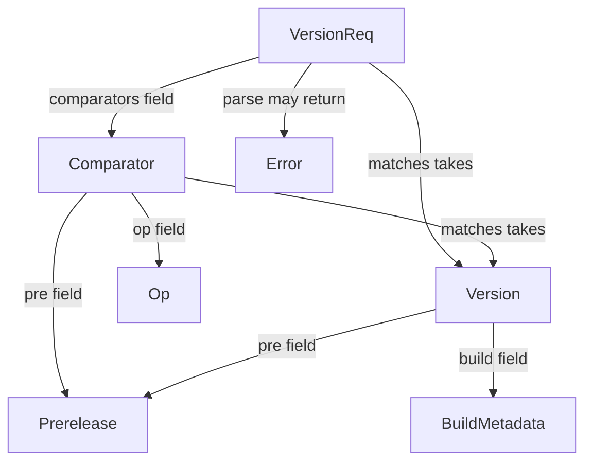

# A public interface graph of Rust's semver crate

**Two GPT-6 Luna agents named all seven exported types and all 13 public inherent methods. They found only 10 of the 19 crate-local dependencies in public fields and method signatures.** Nothing they proposed in those categories was false. The risk was missing true edges while producing a plausible inventory. A third Luna agent built a downstream Rust program that independently checks several relationships.

We shallow-cloned [dtolnay/semver 1.0.27](https://github.com/dtolnay/semver/tree/6ed8561154715b2c34df417a2052597d586f2c43): eight Rust files in `src/`, one commit of history. The crate implements Cargo-style semantic version requirements, so its types and the questions a caller asks about them are small enough to audit. See its [published public API](https://docs.rs/semver/1.0.27/semver/).

## Read the graph

Start with the [19 local signature dependencies](local-signatures.json). Each edge goes **from a public member to the type it mentions**. The diagram shows a selection, rolled up to owner types; the JSON preserves the exact method or field and its source span.



**Forward:** [`VersionReq::matches`](https://github.com/dtolnay/semver/blob/6ed8561154715b2c34df417a2052597d586f2c43/src/lib.rs#L514) depends on `Version` because it takes `&Version`. This is not a claim that a particular function calls `matches`. **Backward:** five public inherent signatures can return `semver::Error`; five distinct `FromStr::Err` bindings also name it. Removing a public error type affects both users of the named constructors and generic consumers of `FromStr`. The graph identifies contracts to inspect, not actual downstream breakages.

```sh
python3 query.py out semver::VersionReq::matches --role parameter
python3 query.py in semver::Error --role returns
python3 query.py in semver::Error --role associated_type
python3 query.py out semver::Version --role implements --profile serde
```

The [default graph](graph-default.json) has 72 nodes and 170 typed edges. Its 42 member relationships and 63 trait implementations are explicitly labeled so that an ownership link, an external trait and a signature dependency are not mistaken for the same thing. The [serde-enabled graph](graph-serde.json) adds **six implementation edges, no new local nominal types**: `Version`, `VersionReq` and `Comparator` each gain serialization and deserialization. A graph keyed only by repository commit would conflate two different public contracts.

## What Luna missed

| Source-only assignment (low reasoning effort) | Matched | Incorrect proposals |
|---|---:|---:|
| Root-exported nominal types, including re-exports | 7 / 7 | 0 |
| Local type dependencies of public fields | 4 / 5 | 0 |
| Public inherent methods | 13 / 13 | 0 |
| Local type dependencies of non-receiver parameters and returns | 6 / 14 | 0 |

- The fields agent correctly followed `Vec<Comparator>` and spotted private representation types. It omitted [`Comparator::op: Op`](https://github.com/dtolnay/semver/blob/6ed8561154715b2c34df417a2052597d586f2c43/src/lib.rs#L193), even though it listed `Op` as public.
- The methods agent explicitly said it substituted `Self`, but its returned edges omitted all seven dependencies expressed through `Self`: six constructor/parse returns and the explicit `other: &Self` parameter of [`Version::cmp_precedence`](https://github.com/dtolnay/semver/blob/6ed8561154715b2c34df417a2052597d586f2c43/src/lib.rs#L467). It also missed the error arm of `VersionReq::parse`. We scored the triples it returned, not its description of what it did.
- A public name is not its definition path. `semver::Error` is usable by callers even though it lives in private module `parse`. The graph pins both the re-export site and the definition. A source index flagged `ErrorKind` as exported too; it is **not** among this crate's externally exported nominal types. Starting at the public crate root matters.
- The [downstream consumer](consumer/src/main.rs) compiled and ran, checking `VersionReq::comparators`, `Comparator::op`, `VersionReq::matches` and the identity of `Version::parse`'s error with `<Version as FromStr>::Err`. This tests observable behavior but is not a proof for every edge.
- Our earlier [17.45 MB binding ranker](../tiny-reexport/learned-binding/pretrained/README.md) scanned these eight files, saw 23 syntactic return-type mentions, had zero parse failures and found **zero eligible two-way same-name collisions**. That is a scope limit, not a prediction failure. A collision resolver is not a graph builder. GPT-6 Luna was a separate hosted agent; this experiment does not measure its RAM, cost or latency.

[Original structured agent proposals](luna-proposals.json) and [exact omissions and scores](luna-scores.json). Agents had disjoint source-only assignments and did not see rustdoc output. These are two single attempts at a narrow task, not a general benchmark of the model. **My recommendation for Parseltongue:** let a small agent explain a verified neighborhood or write a consumer check. When rustdoc is available, build named type edges deterministically; do not interpret an omitted model edge as evidence of independence.

## Scope and reproduction

The source of truth for this experiment is pinned nightly rustdoc JSON (schema 57), not hand matching against names. [The extractor](build_graph.py) follows the crate root's public entries and re-exports, keeps public fields, unit enum variants, inherent methods/constants, source-located non-blanket trait implementations (including derives) and their associated type bindings. It walks wrappers such as `Result<Self, Error>`, resolves nominal references by rustdoc ID, and uses public-path identifiers in the output rather than unstable numeric IDs. Rows record the item span supplied by rustdoc, **not** the exact token span of each occurrence. Non-receiver parameters retain their slot names. External types and primitives are boundary nodes; their crates are not recursively indexed.

This is **not** a runtime call graph, control-flow graph, general Rust parser, or an all-targets API inventory. We do not enumerate trait-provided methods, auto/blanket impls, trait lifetime constraints, private bodies, or downstream consumers. Only the host target (Apple Silicon macOS here) and the two recorded feature sets were tested. The extractor intentionally rejects unsupported shapes rather than claiming to handle every crate.

To rebuild from a fresh checkout, install `nightly-2026-04-01` via rustup and run `sh reproduce.sh` from this directory (Python 3.9+, Git, Cargo). The script shallow-clones the pinned tag under `work/semver`, runs rustdoc twice with a dependency lockfile, regenerates both graphs and scores, runs five graph contracts and the downstream consumer. The workspace wrapper keeps the upstream manifest unchanged. Reading/querying the published JSON requires only Python, not a clone or compiler.
